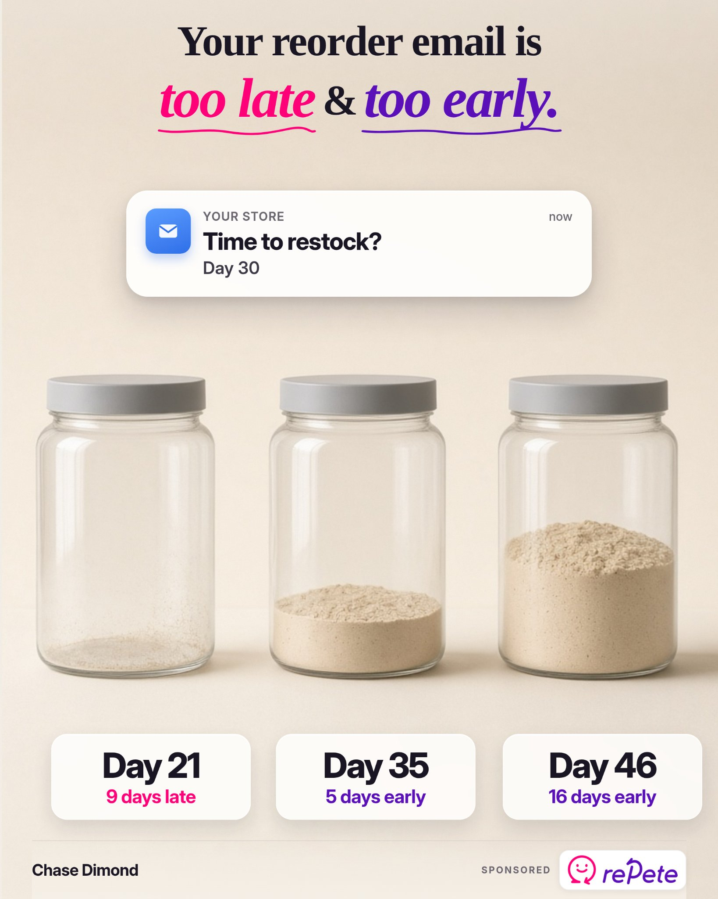

# 🐦 @AiEvolutio58513

## 📅 November 20, 2026

> 5 post(s) archived.

---

### 🕐 18:17 UTC · @AiEvolutio58513

> Ecom folks, this is for you: Your reorder email can be too early and too late at the same time. Here&apos;s what I mean: Imagine three people buying the same protein powder. One runs out in 21 days. Another in 35. A third in 46. If all three get the same reorder email on day 30, you&apos;re 9 days late for one, 5 day…

🔗 [View original post](https://x.com/AiEvolutio58513/status/2123843241330323878)

---

### 🕐 18:11 UTC · @AiEvolutio58513

> Your reorder email can be too early and too late at the same time. Here&apos;s what I mean: Imagine three people buying the same protein powder. One runs out in 21 days. Another in 35. A third in 46. If all three get the same reorder email on day 30, you&apos;re 9 days late for one, 5 days early for another, and 16 days early for the third. We spend so much time testing subject lines and offers. The timing and channel also deserve the same attention. That&apos;s the idea behind rePete from @bold_commerce, an AI reorder agent for Shopify brands. It uses order history to predict when someone may need more, then sends a timely nudge through email, SMS, on-site, and more. That helps brands reach repeat buyers who love the product but prefer buying on their own schedule. I also like how rePete charges. It&apos;s commission-only, with no monthly app fees, setup costs, or minimums. They only make money when they help your store make money. If you sell replenishable products on Shopify, take a look at rePete. And as a special bonus, if you install rePete through my link below, you’ll get $300 in rePete credit, which covers your first $10K in reorder revenue: https://apps.shopify.com/reorder-service?mref=bold&amp;bpromo=chasedimond

🔗 [View original post](https://x.com/ecomchasedimond/status/2123841604272509310)

---

### 🕐 13:00 UTC · @AiEvolutio58513

> Dario Amodei says engineers at Anthropic have stopped writing code: &quot;I have engineers within Anthropic who say I don&apos;t write any code anymore. I just let the model write the code. I edit it.&quot; &quot;We might be six to 12 months away from when the model is doing most, maybe all, of what SWEs do end to end.&quot; &quot;It&apos;s very hard for me to see how it could take longer than that... If I had to guess, I would guess that this goes faster than people imagine.&quot; Interested in AI? Follow @AiEvolutio58513 and never fall behind. I track ChatGPT, Claude, and every tool quietly changing how we work and create, then hand you the tested signals. Media Sam Altman says his son will never be smarter than AI: &quot;My kid will never grow up... will never ever be smarter than an AI. That will never happen.&quot; &quot;They&apos;ll never know a world where products and services aren&apos;t way smarter than them and super capable.&quot; &quot;I already think college …

🔗 [View original post](https://x.com/AiEvolutio58513/status/2123763376044339710)

---

### 🕐 11:00 UTC · @AiEvolutio58513

> Elon Musk was asked which company he&apos;d buy stock in if it couldn&apos;t be one of his own: &quot;AI and robotics are going to be very important.&quot; &quot;Google is going to be pretty valuable in the future. They&apos;ve laid the groundwork for an immense amount of value creation from an AI standpoint.&quot; &quot;Nvidia is obvious at this point.&quot; &quot;There&apos;s an argument that companies that do AI and robotics and maybe space flight are going to be overwhelmingly... almost all the value.&quot; Interested in AI? Follow @AiEvolutio58513 and never fall behind. I track ChatGPT, Claude, and every tool quietly changing how we work and create, then hand you the tested signals. Media Elon Musk says AI will flip inflation into deflation in about 3 years, and interest rates could go to zero: &quot;AI has not yet made enough of an impact on productivity to increase the goods and services faster than the increase in the money supply.&quot; &quot;I think it&apos;s 3 years... Goods a…

🔗 [View original post](https://x.com/AiEvolutio58513/status/2123733208202457502)

---

### 🕐 07:59 UTC · @AiEvolutio58513

> Elon Musk explains &quot;the really big picture&quot; of your life, measured in stars: &quot;How many times have your atoms been at the center of a star? I think it&apos;s like on average three or four times.&quot; &quot;Then how many times will your atoms be at the center of a star? Estimates vary, but it seems like we&apos;re roughly halfway.&quot; &quot;If you want to look at the big picture, that&apos;s the really big picture.&quot; Interested in AI? Follow @AiEvolutio58513 and never fall behind. I track ChatGPT, Claude, and every tool quietly changing how we work and create, then hand you the tested signals. Media Jensen Huang runs one of the most valuable companies on Earth, and he still wakes up every morning feeling like it&apos;s about to go under: &quot;No different than the feeling I had this morning when I woke up, that you&apos;re going to be out of business soon. The phrase &apos;30 days from going …

🔗 [View original post](https://x.com/AiEvolutio58513/status/2123687575856775231)

---
