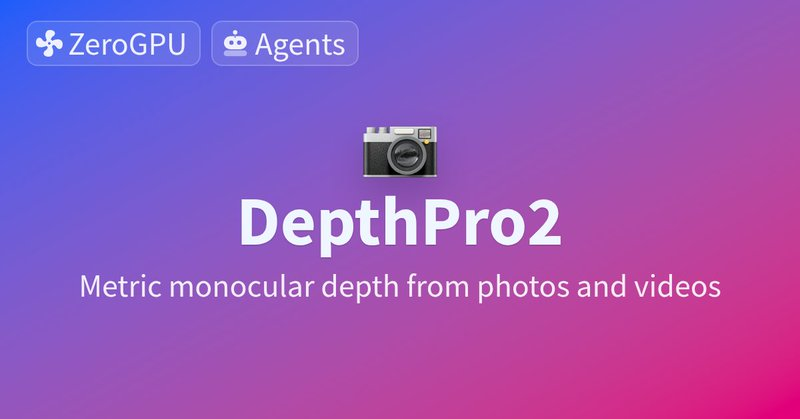
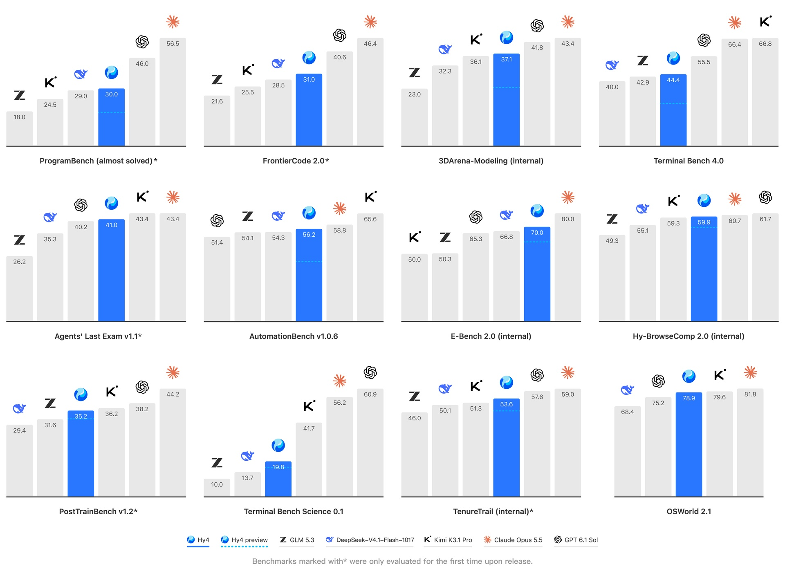

# 🐦 @_akhaliq

## 📅 November 20, 2026

> 4 post(s) archived.

---

### 🕐 13:45 UTC · @_akhaliq

> We serve almost 1 exabyte of open models and datasets over the internet per month. At that scale, we had to build our own CDN for AI downloads. 🌎 @hugoch and team made this live map of where the traffic flows and it&apos;s beautiful 😍 Media

🔗 [View original post](https://x.com/julien_c/status/2123774636458696959)

---

### 🕐 07:43 UTC · @_akhaliq

> app: https://huggingface.co/spaces/akhaliq/DepthPro2

🔗 [View original post](https://x.com/_akhaliq/status/2123683522166845709)

---

### 🕐 03:05 UTC · @_akhaliq

> Tencent just released the Hy4 base model on Hugging Face A 770B-parameter MoE multimodal foundation model with 49B active params, 1M-token context, and text, image, and video understanding.

🔗 [View original post](https://x.com/HuggingPapers/status/2123613629182583057)

---

### 🕐 01:16 UTC · @_akhaliq

> Apple just released Depth Pro 2 Sharp and Temporally Consistent Metric Monocular Depth HF: https://huggingface.co/apple/DepthPro2 Media

🔗 [View original post](https://x.com/_akhaliq/status/2123586174405296481)

---
