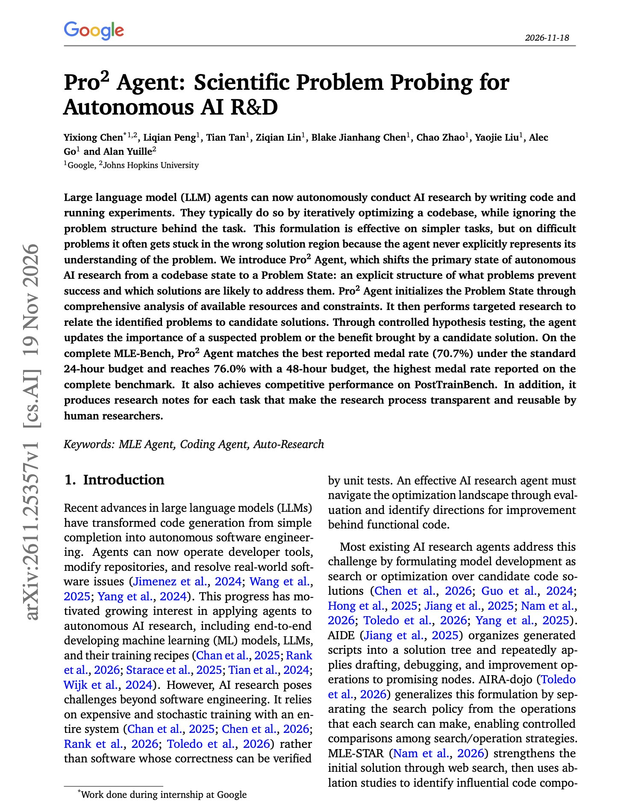
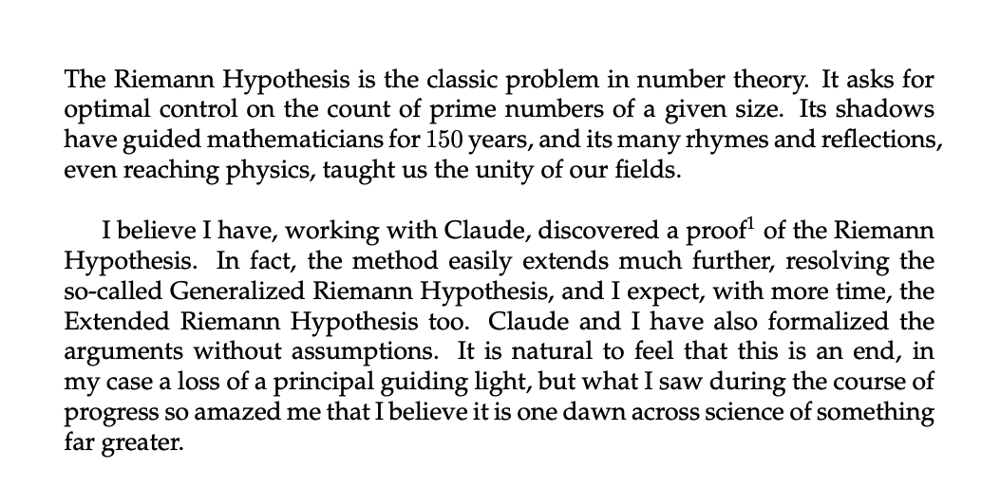
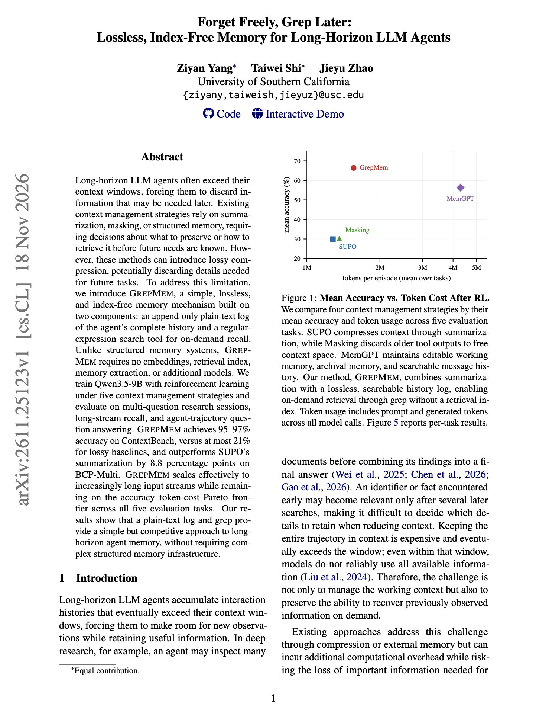
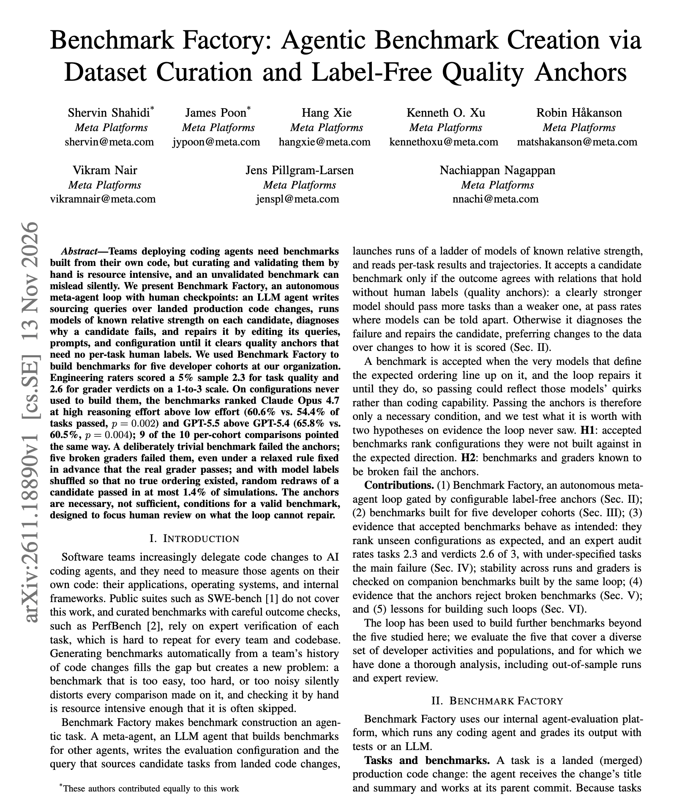

# 🐦 @dair_ai

## 📅 November 20, 2026

> 4 post(s) archived.

---

### 🕐 23:15 UTC · @dair_ai

> Brilliant work from Google and colleagues. (bookmark it) Their research agent reaches a 76.0% medal rate on the complete MLE-Bench, the highest reported on the full benchmark. Autonomous research agents usually keep editing the codebase until a metric moves. On hard tasks, this often leaves them stuck in the wrong part of the solution space, because they never write down what they think is wrong. Pro² Agent addresses this with a Problem State. It is a structured list of the problems that block success, and the candidate fixes for each one. The agent runs controlled tests that update how important each problem is and how much each fix helps. With the standard 24 hours, it matches the best reported 70.7%. With 48 hours, it reaches 76.0%. Each task also produces research notes that humans can review and reuse. https://arxiv.org/abs/2611.25357 Chat with Paper: https://academy.dair.ai/papers/pro-2-agent-scientific-problem-probing-for-autonomous-ai-r-d-2611.25357

🔗 [View original post](https://x.com/dair_ai/status/2123918068393144639)

---

### 🕐 15:53 UTC · @dair_ai

> &quot;I believe I have, working with Claude, discovered a proof of the Riemann Hypothesis.&quot; What a crazy timeline we are in. This is obviously huge for math if true. JUST IN: Riemann Hypothesis has been solved. https://alpo.ge/remark.pdf

🔗 [View original post](https://x.com/omarsar0/status/2123807029416620336)

---

### 🕐 13:20 UTC · @dair_ai

> Is grep all you need? This work claims that an append-only text log plus a regex search tool beats summarization and structured memory for long-horizon agents. (bookmark it) GrepMem keeps the agent&apos;s full history as plain text and lets it search that log when it needs something. It does not need embeddings, a retrieval index, or an extra model. They trained Qwen3.5-9B with RL under five context strategies. GrepMem reaches 95-97% on ContextBench, where lossy methods reach at most 21%. It beats SUPO summarization by 8.8 points on BCP-Multi and stays on the accuracy-and-token-cost Pareto frontier on all five tasks. Why does it hold up? Summaries decide what to keep before the agent knows what it will need later. The log keeps everything, and search finds the detail on demand. https://arxiv.org/abs/2611.25123 Chat with Paper: https://academy.dair.ai/papers/forget-freely-grep-later-lossless-index-free-memory-for-long-horizon-llm-agents-2611.25123

🔗 [View original post](https://x.com/dair_ai/status/2123768329810903053)

---

### 🕐 13:15 UTC · @dair_ai

> Interesting paper from Meta showing how to build coding evals from your own codebase. (bookmark it) Good benchmarks are hard to create, but using this method with agents looks promising. They propose Benchmark Factory, an agent loop that turns merged internal code changes into benchmarks. It writes the query that selects tasks, runs models of known relative strength, and repairs the benchmark until it passes a set of quality checks. These checks need no per-task human labels. To make sure the checks catch bad benchmarks, the authors fed them bad benchmarks on purpose. A benchmark that was far too easy got rejected. So did benchmarks with five different kinds of broken grading. When they scrambled which model was which, a bad benchmark slipped through at most 1.4% of the time. On configurations never used to build them, the benchmarks ranked Claude Opus 4.7 at high effort above low effort (60.6% vs 54.4%) and GPT-5.5 above GPT-5.4 (65.8% vs 60.5%). 9 of 10 per-team comparisons agreed. https://arxiv.org/abs/2611.18890 Chat with Paper: https://academy.dair.ai/papers/benchmark-factory-agentic-benchmark-creation-via-dataset-curation-and-label-free-2611.18890

🔗 [View original post](https://x.com/omarsar0/status/2123767076745818281)

---
