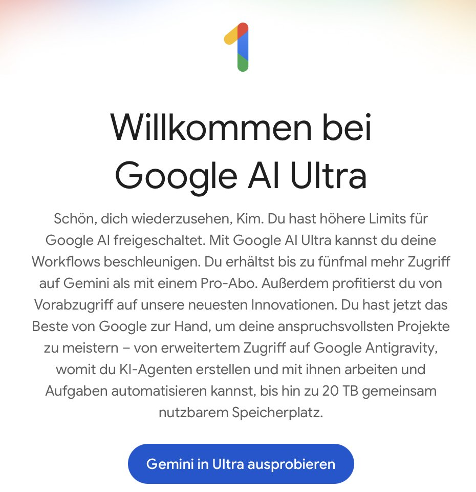

# 🐦 @demishassabis

## 📅 November 20, 2026

> 4 post(s) archived.

---

### 🕐 23:27 UTC · @demishassabis

> Yes, Gemini 4 Neon is *that* good. I subscribed to Ultra tier. Well done @Google

🔗 [View original post](https://x.com/kimmonismus/status/2123921122219708568)

---

### 🕐 20:11 UTC · @demishassabis

> Fantastic to be collaborating with Merck on designing a new cancer drug - another important proof point of the rapid progress we’re making at Iso on reimagining drug discovery! Today, we enter a strategic research collaboration with @MSDInvents. The collaboration brings together Isomorphic Labs’ world-leading frontier AI capabilities with MSD’s deep discovery, development and manufacturing expertise. Read more: https://www.isomorphiclabs.com/articles/i…

🔗 [View original post](https://x.com/demishassabis/status/2123871861843075099)

---

### 🕐 13:58 UTC · @demishassabis

> Let me say this in no uncertain terms. Gemini Neon has solved the hardest problems I could throw at it, clearing a bar no model, not even Fable 5.2, could. I&apos;m not quite sure what happened here.

🔗 [View original post](https://x.com/systematicls/status/2123778032645410917)

---

### 🕐 00:03 UTC · @demishassabis

> 🤣 💙 Apology accepted (so this was @_sholtodouglas then? 😅 ), but I think you missed checking the &apos;Underestimated the cracked Google DeepMind team&apos; box. Amazing work from the Gemini &amp; GDM teams, always great to see folks enjoy our cooking!👨‍🍳🧪

🔗 [View original post](https://x.com/demishassabis/status/2123567986565173289)

---
