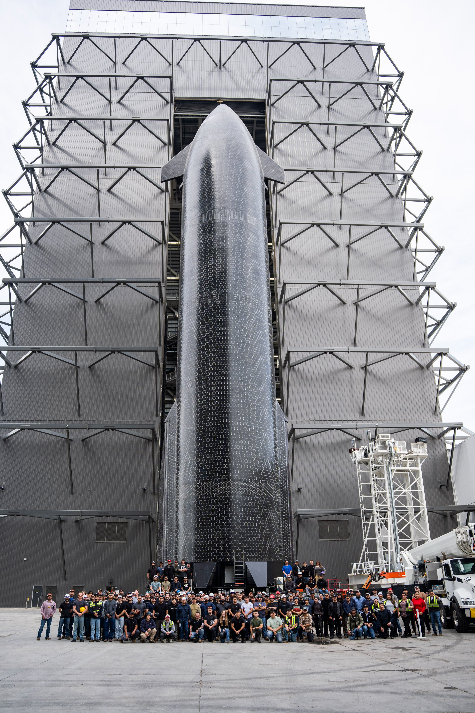
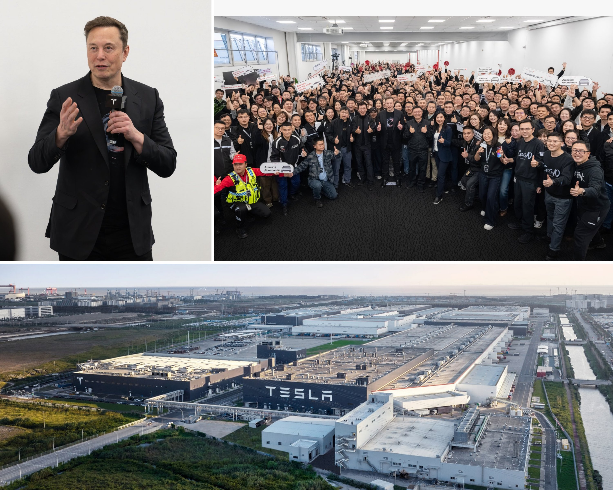

# 🐦 @elonmusk

## 📅 November 20, 2026

> 12 post(s) archived.

---

### 🕐 16:19 UTC · @elonmusk

> 𝕏 is the global town square &quot;X has become a much more powerful force in driving tech investor sentiment over the past few years. Honestly, besides Bloomberg, it’s my most important resource. I literally started a new section of my daily email a few weeks ago called SchilskyX where I screenshot and respond …

🔗 [View original post](https://x.com/elonmusk/status/2123813520244605100)

---

### 🕐 16:03 UTC · @elonmusk

> Members of the Starship production team with Starship 42 before its launch

🔗 [View original post](https://x.com/SpaceX/status/2123809508187078839)

---

### 🕐 11:26 UTC · @elonmusk

> Sono orgoglioso di annunciare un’altra importante novità per la mobilità in Italia. Il @mitgov_it, dopo puntuale verifica tecnica di fattibilità, ha dato il via libera all’omologazione provvisoria del sistema di guida assistita Tesla Assisted Driving, anticipando il processo di riconoscimento comunitario, attualmente in fase di definizione. Un altro passo avanti verso l’innovazione, la tecnologia e la mobilità del futuro, sempre mettendo al primo posto la sicurezza dei cittadini.

🔗 [View original post](https://x.com/matteosalvinimi/status/2123739830194512067)

---

### 🕐 11:19 UTC · @elonmusk

> Approvata la guida autonoma di Tesla in Italia: è il primo dei grandi Paesi europei ad approvarla. Complimenti al sindaco di Roma Gualtieri, che per primo l&apos;ha provata in città (ci siamo divertiti!), al ministro Salvini per la decisione lungimirante di approvarla al Presidente Meloni per il supporto verso le nuove tecnologie e all&apos;opposizione di Azione di Carlo Calenda per aver fatto proposte costruttive affinché ciò avvenisse. Orgoglio 🇮🇹🇺🇸

🔗 [View original post](https://x.com/andst7/status/2123738109330223565)

---

### 🕐 11:19 UTC · @elonmusk

> Yes it&apos;s pretty clear that if you want to have any meaningful conversation about tech you have to be on X

🔗 [View original post](https://x.com/elonmusk/status/2123737976710848580)

---

### 🕐 10:34 UTC · @elonmusk

> Tesla’s AI, running on our little AI4 computer, can now reach Torment II in Diablo

🔗 [View original post](https://x.com/elonmusk/status/2123726569206415815)

---

### 🕐 08:34 UTC · @elonmusk

> Starlink just secured another major spectrum expansion in Brazil, and the authorization is now OFFICIAL 🇧🇷 Brazil&apos;s telecom regulator Anatel published Act No. 14,179 on November 19, formally adding new radio-frequency bands to Starlink&apos;s existing satellite authorization Here&apos;s what was approved: • 5 new uplink frequency sub-bands • 4 new downlink frequency sub-bands • Additional spectrum across Ku, Ka and Q/V bands • Authorization covering ALL of Brazil • Non-exclusive use for the remaining term of Starlink&apos;s existing authorization • Approved by Anatel&apos;s board in October and formally published November 19 The authorization is held by Space Exploration Holdings, with Starlink Brazil Holding serving as its local representative These additional frequencies are an important part of expanding Starlink&apos;s satellite communications capacity and supporting its next-generation network And with Starlink V3 satellites bringing dramatically more bandwidth per satellite, securing additional spectrum is very important Brazil is already a major market for Starlink, and SpaceX is continuing to build the regulatory foundation for its future expansion Step by step, Starlink is securing the infrastructure and spectrum needed to keep scaling across Brazil Media

🔗 [View original post](https://x.com/XFreeze/status/2123696355554316764)

---

### 🕐 08:29 UTC · @elonmusk

> This is not AI 😂 Back in January 2020, Elon Musk celebrated with the Tesla China team by dancing on stage at Giga Shanghai Tesla had just started delivering its first China-made Model 3s to customers, only 357 days after construction began Elon personally thanked the team for their incredible ha…

🔗 [View original post](https://x.com/elonmusk/status/2123695317375992288)

---

### 🕐 07:07 UTC · @elonmusk

> Great to have Elon at Giga Shanghai! During his brief visit to China, Elon made a special stop to thank our teams across Asia in person. Our Giga Shanghai team had a little something for him, too — a special gift designed and crafted by the team right here at the factory, using leftover materials from production. The energy on the floor was unmistakable. From the latest progress in superintelligence to the team’s achievements, there was plenty to celebrate — and even more to look forward to. Let’s make the future look like the future. 🚀

🔗 [View original post](https://x.com/Tesla_Asia/status/2123674470351310910)

---

### 🕐 06:47 UTC · @elonmusk

> Back in 2019, Elon Musk stood on an empty field in Shanghai and broke ground on Tesla’s first factory in China Less than a year later, the first China-made Model 3s were being delivered Then in January 2020, Elon returned to launch the Model Y program and celebrated with the team on stage Fast forward to 2026 Giga Shanghai has become one of the most important factories in Tesla’s entire global operation • 851,732 vehicles produced for wholesale in 2025 • 810,889 already through October 2026 • 95% of last year’s entire volume in just 10 months • +21.4% YoY through October • 420,984 vehicles exported through October • Exports up more than 100% YoY • More than half of Shanghai’s 2026 wholesale volume now going overseas • Tesla’s biggest global export hub And on November 19, Elon returned to Shanghai again to personally thank Tesla’s China and APAC teams From an empty construction site in 2019… To hundreds of thousands of vehicles every year, supplying markets around the world Giga Shanghai is one of the clearest examples of how quickly Tesla can turn an empty field into global industrial infrastructure

🔗 [View original post](https://x.com/XFreeze/status/2123669662768812123)

---

### 🕐 03:20 UTC · @elonmusk

> The magnitude of the consumer surplus for AI tools is mind boggling. My Grok subscription has probably already saved (made?) me more money than I am ever likely to spend on it.

🔗 [View original post](https://x.com/jamesdouma/status/2123617446590570679)

---

### 🕐 02:23 UTC · @elonmusk

> In retrospect, barely needing to drive came long before barely needing to code, a testament to Tesla engineering. 10/10 was two years ago (Sonnet 3.5), and the Robotaxi service (Opus 4) began last year. But I couldn’t remember the last time I needed to babysit the steering wheel.

🔗 [View original post](https://x.com/yunta_tsai/status/2123602995200024895)

---
