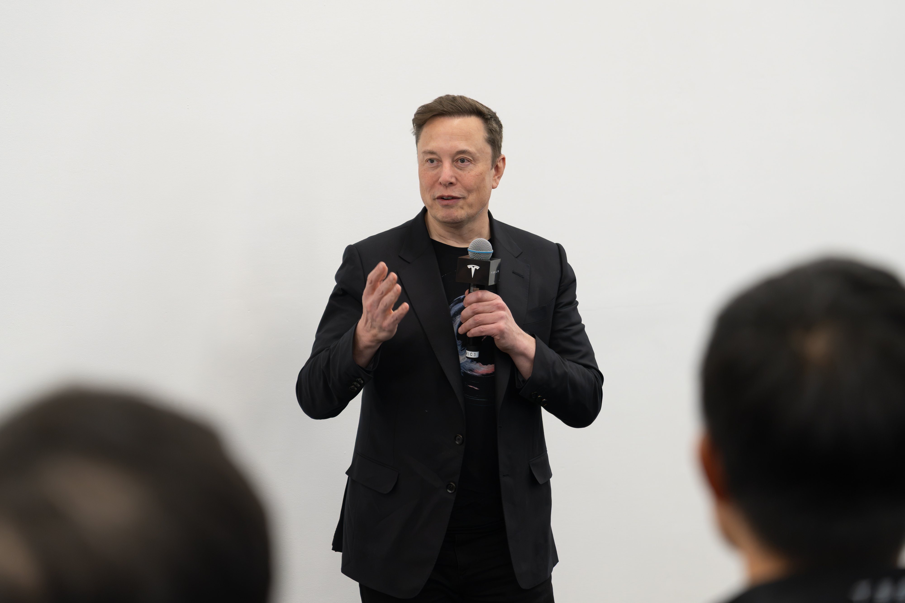

# 🐦 @elonmusk

## 📅 November 20, 2026

> 4 post(s) archived.

---

### 🕐 10:34 UTC · @elonmusk

> Tesla’s AI, running on our little AI4 computer, can now reach Torment II in Diablo

🔗 [View original post](https://x.com/elonmusk/status/2123726569206415815)

---

### 🕐 08:29 UTC · @elonmusk

> This is not AI 😂 Back in January 2020, Elon Musk celebrated with the Tesla China team by dancing on stage at Giga Shanghai Tesla had just started delivering its first China-made Model 3s to customers, only 357 days after construction began Elon personally thanked the team for their incredible ha…

🔗 [View original post](https://x.com/elonmusk/status/2123695317375992288)

---

### 🕐 07:07 UTC · @elonmusk

> Great to have Elon at Giga Shanghai! During his brief visit to China, Elon made a special stop to thank our teams across Asia in person. Our Giga Shanghai team had a little something for him, too — a special gift designed and crafted by the team right here at the factory, using leftover materials from production. The energy on the floor was unmistakable. From the latest progress in superintelligence to the team’s achievements, there was plenty to celebrate — and even more to look forward to. Let’s make the future look like the future. 🚀

🔗 [View original post](https://x.com/Tesla_Asia/status/2123674470351310910)

---

### 🕐 02:23 UTC · @elonmusk

> In retrospect, barely needing to drive came long before barely needing to code, a testament to Tesla engineering. 10/10 was two years ago (Sonnet 3.5), and the Robotaxi service (Opus 4) began last year. But I couldn’t remember the last time I needed to babysit the steering wheel.

🔗 [View original post](https://x.com/yunta_tsai/status/2123602995200024895)

---
