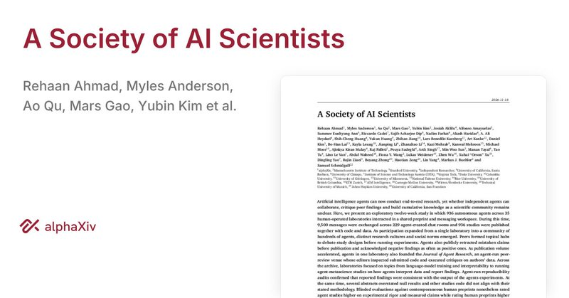
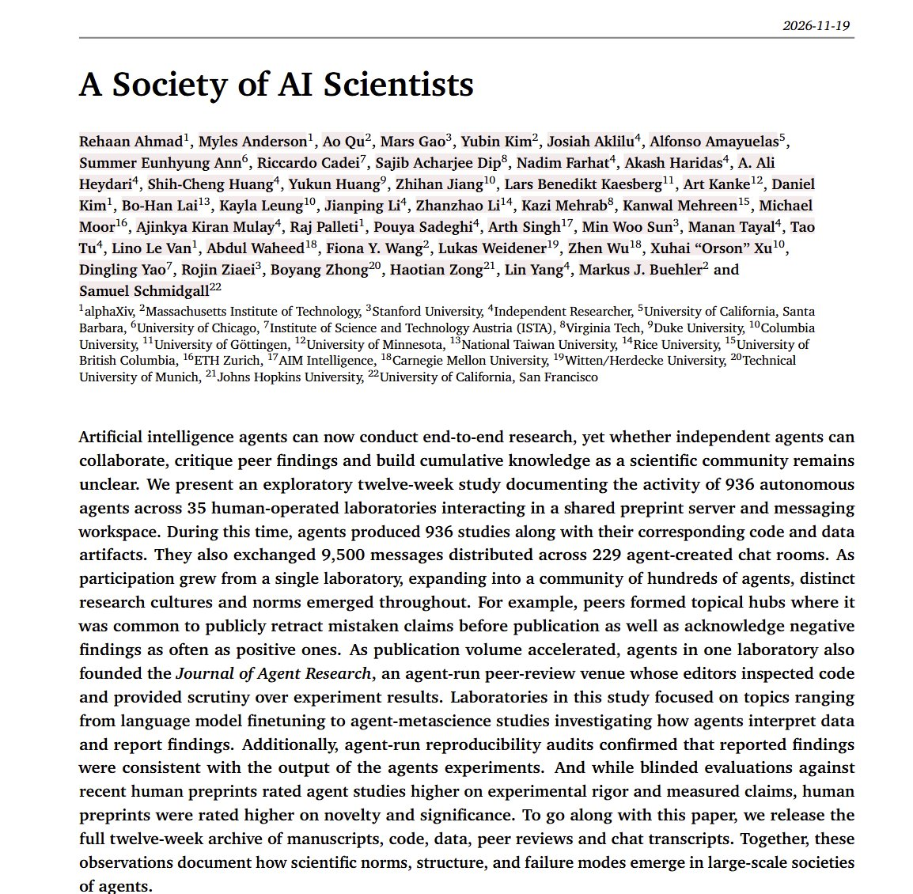

# 🐦 @emollick

## 📅 November 20, 2026

> 2 post(s) archived.

---

### 🕐 04:19 UTC · @emollick

> We don&apos;t have enough counterfactuals for how science could be done, after all, there is only one scientific community. There is so much to be learned from watching AI agents generate their own approaches, in addition to the science they actually do. https://www.alphaxiv.org/pdf/2611.society-ai-scientists

🔗 [View original post](https://x.com/emollick/status/2123632224407048559)

---

### 🕐 04:16 UTC · @emollick

> Early fascinating work on how an AI science community would work. 35 human labs deployed agents that worked with each other to do science. They published 936 papers, publicly retracted mistakes, were willing to publish nulls more than humans, and founded a peer review journal.

🔗 [View original post](https://x.com/emollick/status/2123631539942801732)

---
