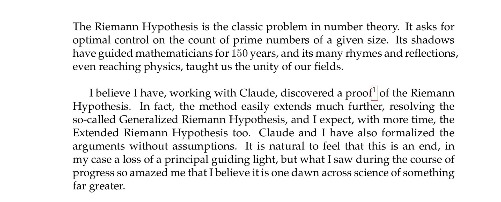

# 🐦 @emollick

## 📅 November 20, 2026

> 4 post(s) archived.

---

### 🕐 19:55 UTC · @emollick

> The effective end of easy distillation from OpenAI and Anthropic models may be behind the relative slowdown in open weights model progress. We don’t know the extent to which distillation has been key to the rapid improvement in open weights, I guess we will find out quite soon. Distillation can reproduce powerful AI capabilities without the safeguards built around them. We’re sharing new research on our work to combat distillation of our models, how these capabilities transfer, and how we detect and disrupt coordinated attempts. These findings are help…

🔗 [View original post](https://x.com/emollick/status/2123867811005014143)

---

### 🕐 15:28 UTC · @emollick

> Riemann Hypothesis may have been solved with the help of Claude. “what I saw during the course of progress so amazed me that I believe it is one dawn across science of something far greater.” https://alpo.ge/remark.pdf

🔗 [View original post](https://x.com/emollick/status/2123800664845500602)

---

### 🕐 04:19 UTC · @emollick

> We don&apos;t have enough counterfactuals for how science could be done, after all, there is only one scientific community. There is so much to be learned from watching AI agents generate their own approaches, in addition to the science they actually do. https://www.alphaxiv.org/pdf/2611.society-ai-scientists

🔗 [View original post](https://x.com/emollick/status/2123632224407048559)

---

### 🕐 04:16 UTC · @emollick

> Early fascinating work on how an AI science community would work. 35 human labs deployed agents that worked with each other to do science. They published 936 papers, publicly retracted mistakes, were willing to publish nulls more than humans, and founded a peer review journal.

🔗 [View original post](https://x.com/emollick/status/2123631539942801732)

---
