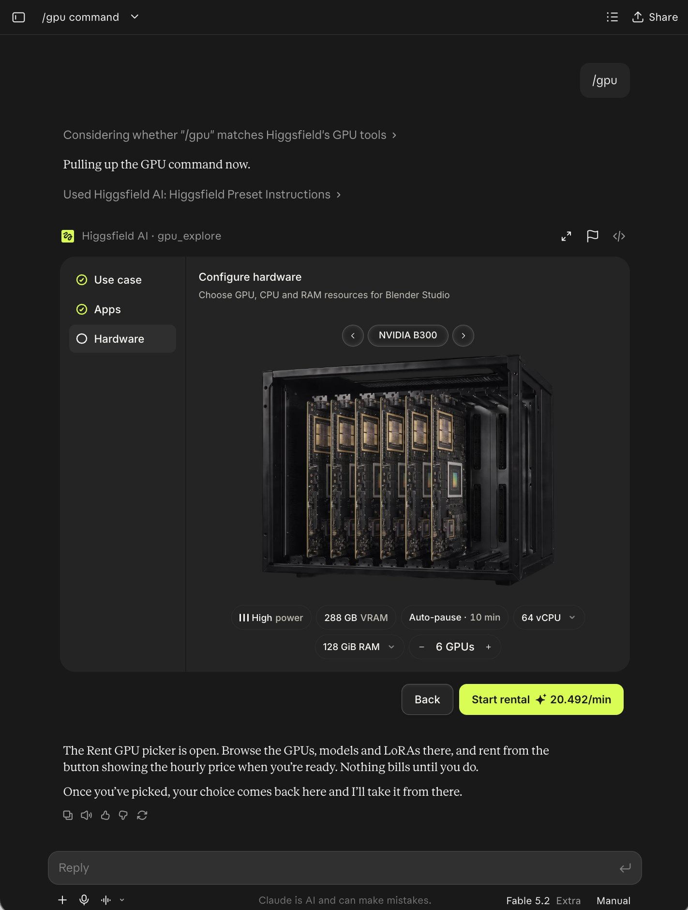

# 🐦 @omarsar0

## 📅 November 20, 2026

> 2 post(s) archived.

---

### 🕐 03:22 UTC · @omarsar0

> Agents shouldn&apos;t be locked into a single harness. MyClaw 3.0 lets you run your agents on Claude Code, Codex, Hermes, Pi, or OpenClaw, with context shared across them. Each agent comes with tools and live data sources connected, and keeps running in the cloud after you close the laptop. That makes it easy to pick the right harness for each job. 𝐈𝐧𝐭𝐫𝐨𝐝𝐮𝐜𝐢𝐧𝐠 𝐌𝐲𝐂𝐥𝐚𝐰 𝟑.𝟎 Raised AI teammates with tools built in — not a blank agent you babysit. •𝐀𝐠𝐞𝐧𝐭 𝐰𝐢𝐭𝐡 𝐚𝐧𝐲 𝐡𝐚𝐫𝐧𝐞𝐬𝐬 — Claude Code · Codex · Hermes · Pi · OpenClaw — shared context. • 𝟓,𝟎𝟎𝟎+ 𝐥𝐢𝐯𝐞 𝐝𝐚𝐭𝐚 𝐬𝐨𝐮𝐫𝐜𝐞𝐬— Not a sca…

🔗 [View original post](https://x.com/omarsar0/status/2123618003166044447)

---

### 🕐 01:39 UTC · @omarsar0

> you can now rent GPUs in Claude through Higgsfield creative software has decades of capability spread across tools and complex interfaces frontier agents bring expertise across tools into one context. the unexplored space is what those tools can do together Introducing Higgsfield GPU Harness. Rent on-demand GPUs in Claude and ChatGPT to render, run open-weight models and train LoRAs. Let several AI agents work on your professional apps in the cloud at once, from any device. Black Friday deal, live now: get GPUs at up to 64% OFF.

🔗 [View original post](https://x.com/axultan/status/2123592090185843093)

---
