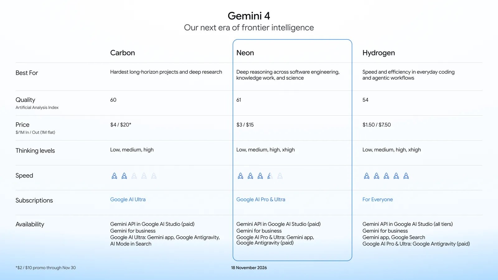

# 🐦 @simonw

## 📅 November 20, 2026

> 1 post(s) archived.

---

### 🕐 15:59 UTC · @simonw

> So is Gemini 4 Neon better than Gemini 4 Carbon for some tasks then? And is Gemini 4 Argon effectively retired? They didn&apos;t include it in the comparison graphic on the Neon announcement post https://blog.google/innovation-and-ai/models-and-research/gemini-models/introducing-gemini-4-neon/

🔗 [View original post](https://x.com/simonw/status/2123808432830701909)

---
