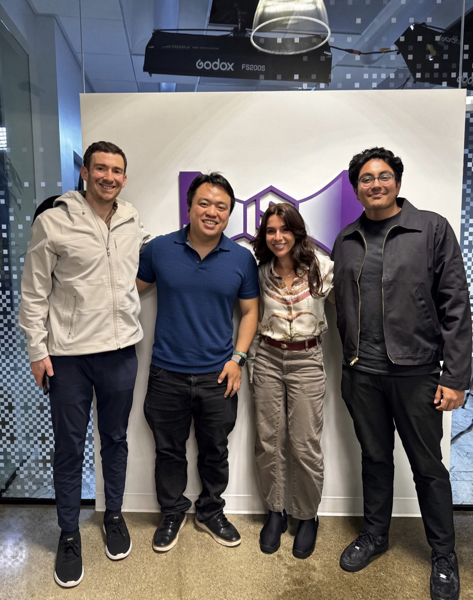
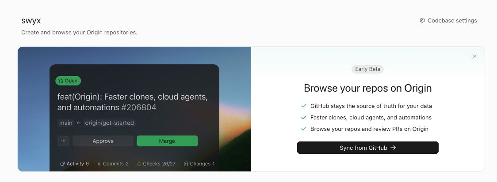

# 🐦 @swyx

## 📅 November 20, 2026

> 8 post(s) archived.

---

### 🕐 22:13 UTC · @swyx

> I host a lot of events both for personal and work and I wrote up how I do it in a #highROI way :) https://dx.tips/hosting

🔗 [View original post](https://x.com/MilksandMatcha/status/2123902565092143294)

---

### 🕐 20:00 UTC · @swyx

> At Code Summit, @zachbruggeman said Inspect writes and ships ~75% of @tryramp&apos;s code. One agent setup for the whole company. Shared sessions. Screenshots and browser recordings that show the work holds up. Watch the full talk: https://youtu.be/MDI81OaZAD4

🔗 [View original post](https://x.com/aiDotEngineer/status/2123868990820712787)

---

### 🕐 19:09 UTC · @swyx

> broooo https://x.com/nishanthooda_/status/2123581995288846611?a=FSJnFjyN6u-pR61QH94&amp;s=46 Happy Anthropic IPO day

🔗 [View original post](https://x.com/swyx/status/2123856303974121851)

---

### 🕐 18:17 UTC · @swyx

> 🔜 why @j_schottenstein left @getdbt for @LangChain to build it into a $3B startup… ….and now they are having to reinvent the content, context (knowledge) and software factory from scratch! having inconsistent ways to define revenue is exactly why you&apos;d need knowledge factory for your company! centralize tacit or implicit knowledge, make those readily available to everyone a big part of ours at langchain is a bunch of definitions of metrics/skills for fetching data…

🔗 [View original post](https://x.com/swyx/status/2123843282082132335)

---

### 🕐 08:09 UTC · @swyx

> whatever happened to @cursor_ai origin? anyone use this thing in anger yet? does it have actions/ci/cd yet? Cursor/Graphite’s @TomasReimers just announced Origin @cursor_ai’s long awaited Git competitor, scalable for agent workloads, extensible with api and mcp, and built in merge conflicts and co failure agent resolution

🔗 [View original post](https://x.com/swyx/status/2123690305736396925)

---

### 🕐 06:08 UTC · @swyx

> you cant be serious

🔗 [View original post](https://x.com/swyx/status/2123659761887625602)

---

### 🕐 01:38 UTC · @swyx

> when scrolling social media i think it is worth bearing in mind that you can say “odds of reaching SOTA have dropped to zero” and get alot of likes and then 3 months later when they have reached SOTA you post apology form and get even more likes and the subject of your writing prints it out and thanks you for motivation theres no consequences at all for inaccuracy and every incentive for hyperbole and the x algorithm is tuned for this I want to thanks @SemiAnalysis_ for the motivation. In the Gemini RL scaling team, we printed &amp; put that article on our desks to be reminded daily of what used to be true at the time. But the times they are changing :)

🔗 [View original post](https://x.com/swyx/status/2123591875349422435)

---

### 🕐 00:08 UTC · @swyx

> there will always be alpha in reviewing something - selected excerpts from my talk on the &quot;No Slop Manifesto&quot;, co-written with speakers and attendees of @aiDotEngineer code summit, now over 1000 signatures including - major internet pioneers and contributors to bind/DNS - distinguished engineers at major cloud providers - long time rust compiler maintainers - Software engineering professors at Purdue, Berkeley, Stanford - employees from OpenAI, Glean, Posthog, Diffusion, AI Engineer, Baseten, and many more you can read and sign it at slopmanifesto dot com (kudos to @jeffreyhuber for this &quot;there will always be alpha in reviewing something&quot; phrasing btw) “There will always be alpha in reviewing something.” @dexhorthy of @factory on what humans review as agents write more code: the plan, the design, the result. The right level of review depends on the stakes.

🔗 [View original post](https://x.com/dexhorthy/status/2123569019374678055)

---
