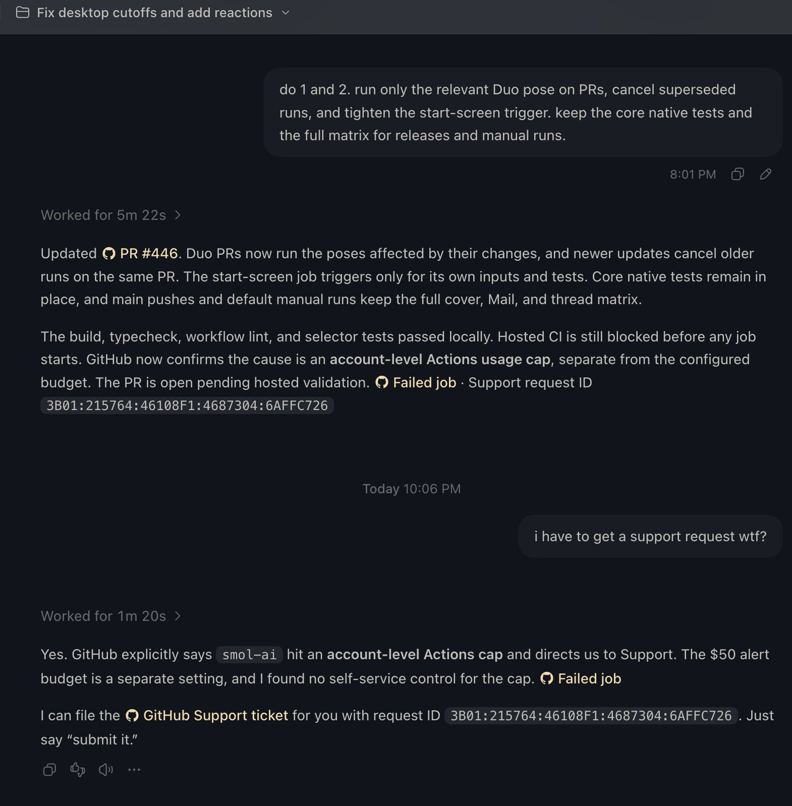

# 🐦 @swyx

## 📅 November 20, 2026

> 3 post(s) archived.

---

### 🕐 06:08 UTC · @swyx

> you cant be serious

🔗 [View original post](https://x.com/swyx/status/2123659761887625602)

---

### 🕐 01:38 UTC · @swyx

> when scrolling social media i think it is worth bearing in mind that you can say “odds of reaching SOTA have dropped to zero” and get alot of likes and then 3 months later when they have reached SOTA you post apology form and get even more likes and the subject of your writing prints it out and thanks you for motivation theres no consequences at all for inaccuracy and every incentive for hyperbole and the x algorithm is tuned for this I want to thanks @SemiAnalysis_ for the motivation. In the Gemini RL scaling team, we printed &amp; put that article on our desks to be reminded daily of what used to be true at the time. But the times they are changing :)

🔗 [View original post](https://x.com/swyx/status/2123591875349422435)

---

### 🕐 00:08 UTC · @swyx

> there will always be alpha in reviewing something - selected excerpts from my talk on the &quot;No Slop Manifesto&quot;, co-written with speakers and attendees of @aiDotEngineer code summit, now over 1000 signatures including - major internet pioneers and contributors to bind/DNS - distinguished engineers at major cloud providers - long time rust compiler maintainers - Software engineering professors at Purdue, Berkeley, Stanford - employees from OpenAI, Glean, Posthog, Diffusion, AI Engineer, Baseten, and many more you can read and sign it at slopmanifesto dot com (kudos to @jeffreyhuber for this &quot;there will always be alpha in reviewing something&quot; phrasing btw) “There will always be alpha in reviewing something.” @dexhorthy of @factory on what humans review as agents write more code: the plan, the design, the result. The right level of review depends on the stakes.

🔗 [View original post](https://x.com/dexhorthy/status/2123569019374678055)

---
