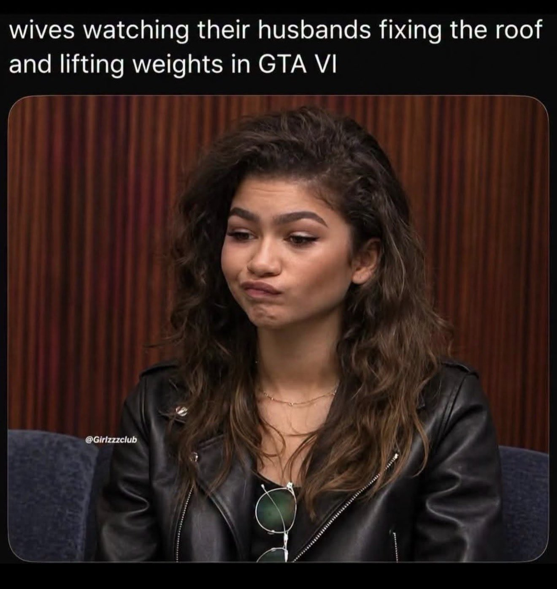

# 🐦 @tunguz

## 📅 November 20, 2026

> 18 post(s) archived.

---

### 🕐 22:15 UTC · @tunguz

> It&apos;s true, I did it once. Still have a big bump on my head from it. BREAKING: Jensen Huang reportedly painted a fake tunnel on a brick wall, tricking an employee into running headfirst into it.

🔗 [View original post](https://x.com/tunguz/status/2123903047801905462)

---

### 🕐 21:53 UTC · @tunguz

> So on top of it! 🫡 If you&apos;re in maths, pivot to physics.

🔗 [View original post](https://x.com/tunguz/status/2123897574298116308)

---

### 🕐 21:52 UTC · @tunguz

> All right, a J-curve transition it is.

🔗 [View original post](https://x.com/tunguz/status/2123897292751020112)

---

### 🕐 21:21 UTC · @tunguz

> Time to repost this.

🔗 [View original post](https://x.com/tunguz/status/2123889418494714266)

---

### 🕐 20:11 UTC · @tunguz

> - Kevin, 11 FEELS LIKE 1929 BUT WORSE

🔗 [View original post](https://x.com/tunguz/status/2123871863864492096)

---

### 🕐 19:42 UTC · @tunguz

> “The market will regulate itself.” The market:

🔗 [View original post](https://x.com/tunguz/status/2123864679382499402)

---

### 🕐 19:08 UTC · @tunguz

> and all of this because a certain board didn’t want to go to jail smdh 🙄

🔗 [View original post](https://x.com/tunguz/status/2123856037807530311)

---

### 🕐 16:37 UTC · @tunguz

> Whether or not you think AI is overhyped is the new IQ test.

🔗 [View original post](https://x.com/tunguz/status/2123817967972401163)

---

### 🕐 16:19 UTC · @tunguz

> 🥺

🔗 [View original post](https://x.com/tunguz/status/2123813474300199161)

---

### 🕐 16:11 UTC · @tunguz

> LOL non sequiturs are at the ATH rn. Is there an AI bubble? I’ll answer that with an observation. Ashton Kutcher made $8 billion from the Anthropic IPO.

🔗 [View original post](https://x.com/tunguz/status/2123811582169735522)

---

### 🕐 16:06 UTC · @tunguz

> Yes. Wow.

🔗 [View original post](https://x.com/tunguz/status/2123810164281430321)

---

### 🕐 15:52 UTC · @tunguz

> Not wrong!

🔗 [View original post](https://x.com/tunguz/status/2123806673697714283)

---

### 🕐 15:20 UTC · @tunguz

> A couple of points: 1. Despite what many think, there *are* ways that you can motivate really wealthy people to work hard that don’t involve public humiliation. There are LOTS of people in tech in particular who chose that field because of the outsize sense of agency and accomplishment that can be attained there. 2. The summer after my freshman year at Stanford I managed to get a job in a Physics lab. At that point I still had not declared my major, and the Professor whose lab it was (who ended up getting the Nobel prize a few years later) told me that if I don’t declare Physics he would, and I quote, “rip your arms out of their sockets and beat you over your head with the bloody ends.” Even a kid like me knew that was just a form of guy humor and didn’t take him *literally*, and ended up having a great time in that lab for the rest of my undergrad years. Our latest on Jensen Huang and Nvidia. https://www.nytimes.com/2026/11/20/technology/jensen-huang-nvidia-culture.html

🔗 [View original post](https://x.com/tunguz/status/2123798530007429573)

---

### 🕐 15:17 UTC · @tunguz

> A couple of points: 1. Despite what many think, there *are* ways that you can motivate really wealthy people to work hard that don’t involve public humiliation. There are LOTS of people in tech in particular who chose that field because of the outsize sense of agency and accomplished that can be attained there. 2. The summer after my freshman year at Stanford I managed to get a job in a Physics lab. At that point I still had not declared my major, and the Professor whose lab it was (who ended up getting the Nobel prize a few years later) told me that if I don’t declare Physics he would, and I quote, “rip your arms out of their sockets and beat you over your head with the bloody ends.” Even a kid like me knew that was just a form of guy humor and didn’t take him *literally*, and ended up having a great time in that lab for the rest of my undergrad years. Our latest on Jensen Huang and Nvidia. https://www.nytimes.com/2026/11/20/technology/jensen-huang-nvidia-culture.html

🔗 [View original post](https://x.com/tunguz/status/2123798008974180735)

---

### 🕐 13:53 UTC · @tunguz

> Acceleration will be accelerating - new version of mlx-signal-processing has been released. More speedups across the board. mlx-signal 0.1.2 (mlx-signal-processing) is out! ⚡️ GPU-accelerated scipy.signal for Apple Silicon, built on MLX + custom Metal kernels. Big end-to-end speedups, ~61× lower peak spectral memory, and native GPU FIR streaming state. 🧵 1/6

🔗 [View original post](https://x.com/tunguz/status/2123776722738774341)

---

### 🕐 03:36 UTC · @tunguz

> OAI are now GPU poor. Tokens go brrrrrr. Going to need more compute.

🔗 [View original post](https://x.com/tunguz/status/2123621361905983719)

---

### 🕐 02:26 UTC · @tunguz

> AI will expose some really ugly truths about us that we really, really don&apos;t want to know.

🔗 [View original post](https://x.com/tunguz/status/2123603959268950217)

---

### 🕐 01:58 UTC · @tunguz

> I can’t wait for OAI to release a Uranus model.

🔗 [View original post](https://x.com/tunguz/status/2123596777060229449)

---
