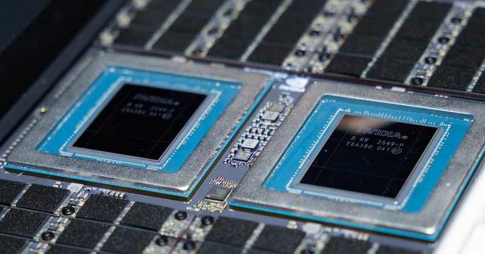
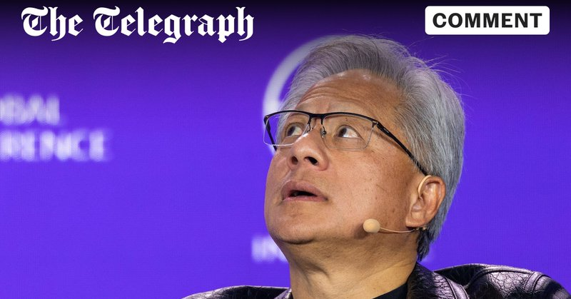
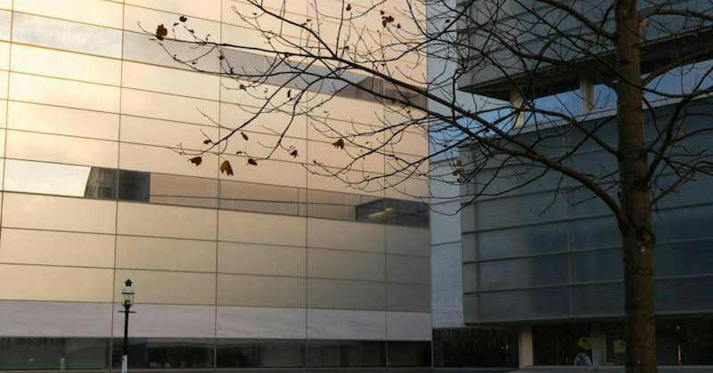
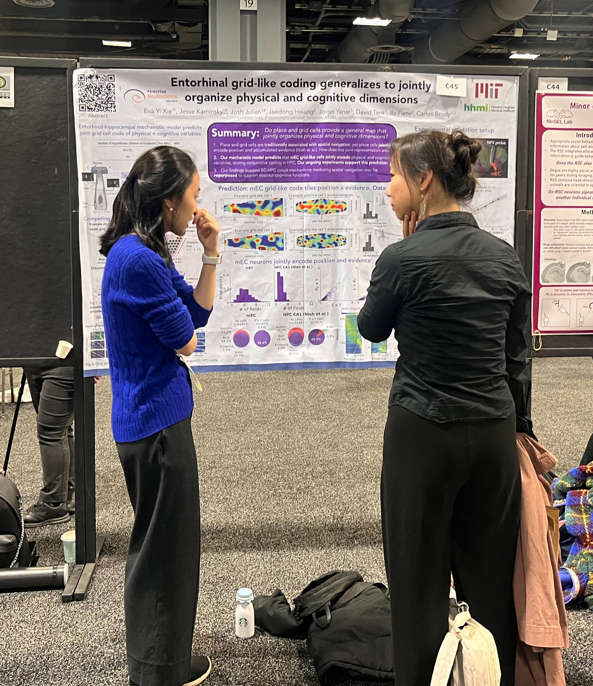

# 🐦 @ylecun

## 📅 November 20, 2026

> 6 post(s) archived.

---

### 🕐 13:01 UTC · @ylecun

> Lawmakers released confidential information showing that Trump&apos;s Commerce Department under Howard Lutnick had approved the sale of 800,000+ advanced A.I. chips to Chinese companies for the year, as of May 11, including several Chinese military companies. https://trib.al/z8FNH5o

🔗 [View original post](https://x.com/KenRoth/status/2123763587063685453)

---

### 🕐 12:16 UTC · @ylecun

> My latest Telegraph column argues that amid all the competing claims and counterclaims swirling around Nvidia and Jensen Huang, a more important story has been lost in the noise: the battle being waged behind the scenes between those who favour open systems and those determined to keep them closed. This illustrates a longstanding contradiction at the heart of American policy: between its professed commitment to free markets and its determination to control the global flow of strategic technology. (Plus, I briefly revisit the Ferranti affair.) https://www.telegraph.co.uk/business/2026/11/20/jensen-huangs-downfall-exposes-a-deep-divide-over-ai/

🔗 [View original post](https://x.com/izakaminska/status/2123752355560611911)

---

### 🕐 06:57 UTC · @ylecun

> Another banger paper dropped by Yann LeCun, Randall Balestriero, and Kerda Varaku. &quot;Counterfactual World Models: JEPAs That Reason About What If&quot; What if AI could predict what would have happened if it had made a different decision? They introduce Counterfactual World Models, which extend JEPAs to predict alternative outcomes under the same hidden conditions. For example, if wind pushes a robot off course, the model uses the observed error to estimate where it would have ended up had it taken a different action, without requiring additional training. Across four simulated physical environments, the approach improves counterfactual prediction R² from 38-46% to 86-96% using the same underlying world models. https://www.alphaxiv.org/abs/2611.24778

🔗 [View original post](https://x.com/askalphaxiv/status/2123671936475816292)

---

### 🕐 04:44 UTC · @ylecun

> https://www.dailyprincetonian.com/article/2026/11/princeton-news-broadfocus-princeton-phd-neuroscience-student-detained-by-immigration-customs-and-enforcement-ice

🔗 [View original post](https://x.com/nathanieldaw/status/2123638649472336269)

---

### 🕐 03:56 UTC · @ylecun

> Eva is a student at @PrincetonNeuro working with me, @brody_lab and Ben Eysenbach. She was abducted by ICE while trying to board a flight from SFN. Some thoughts below how we can help her. Our colleague Eva Yi Xie, a Princeton neuroscience PhD student, was detained by ICE at Reagan National Airport on her way home from SfN, where she’d just presented her poster. She’s being held in Chantilly, VA. Please help us bring her home. 📷

🔗 [View original post](https://x.com/nathanieldaw/status/2123626558304776335)

---

### 🕐 03:07 UTC · @ylecun

> Our colleague Eva Yi Xie, a Princeton neuroscience PhD student, was detained by ICE at Reagan National Airport on her way home from SfN, where she’d just presented her poster. She’s being held in Chantilly, VA. Please help us bring her home. 📷

🔗 [View original post](https://x.com/brody_lab/status/2123614249251709199)

---
