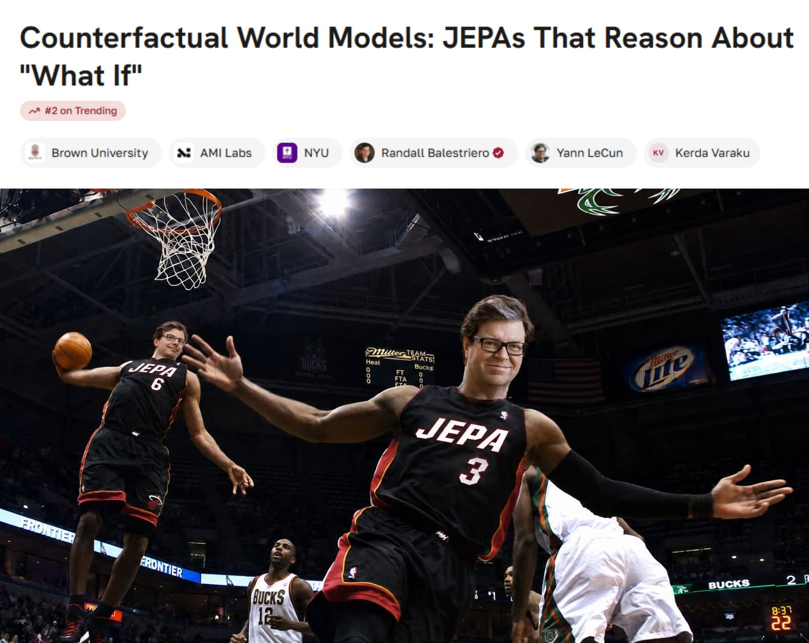

# 🐦 @ylecun

## 📅 November 20, 2026

> 1 post(s) archived.

---

### 🕐 06:57 UTC · @ylecun

> Another banger paper dropped by Yann LeCun, Randall Balestriero, and Kerda Varaku. &quot;Counterfactual World Models: JEPAs That Reason About What If&quot; What if AI could predict what would have happened if it had made a different decision? They introduce Counterfactual World Models, which extend JEPAs to predict alternative outcomes under the same hidden conditions. For example, if wind pushes a robot off course, the model uses the observed error to estimate where it would have ended up had it taken a different action, without requiring additional training. Across four simulated physical environments, the approach improves counterfactual prediction R² from 38-46% to 86-96% using the same underlying world models. https://www.alphaxiv.org/abs/2611.24778

🔗 [View original post](https://x.com/askalphaxiv/status/2123671936475816292)

---
