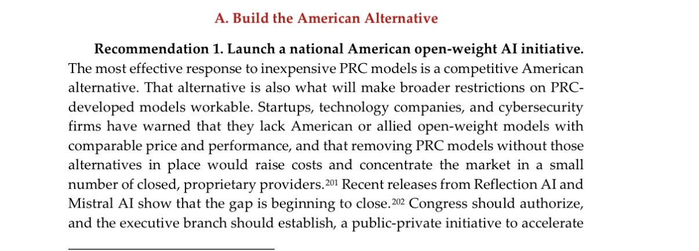

# 🐦 @_akhaliq

## 📅 November 21, 2026

> 1 post(s) archived.

---

### 🕐 16:22 UTC · @_akhaliq

> American researchers, startups, nonprofits, government, students and hobbyists overwhelmingly benefit from open-source AI, wherever it comes from. The best response to Chinese open-source AI isn’t to ban it, it’s to build more American open-source AI! 🇺🇸 Great to see a new US House report recognizing this. Thanks to @RepMoolenaar, @RepGarbarino and their teams for their work! We need more open source, not less! 🤗

🔗 [View original post](https://x.com/ClementDelangue/status/2124176756751945911)

---
