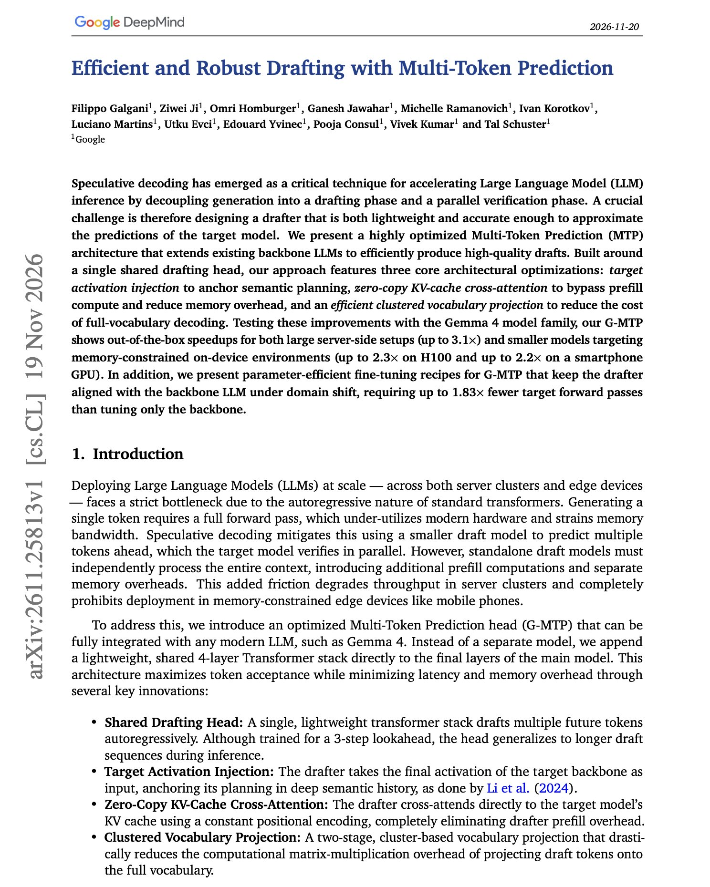
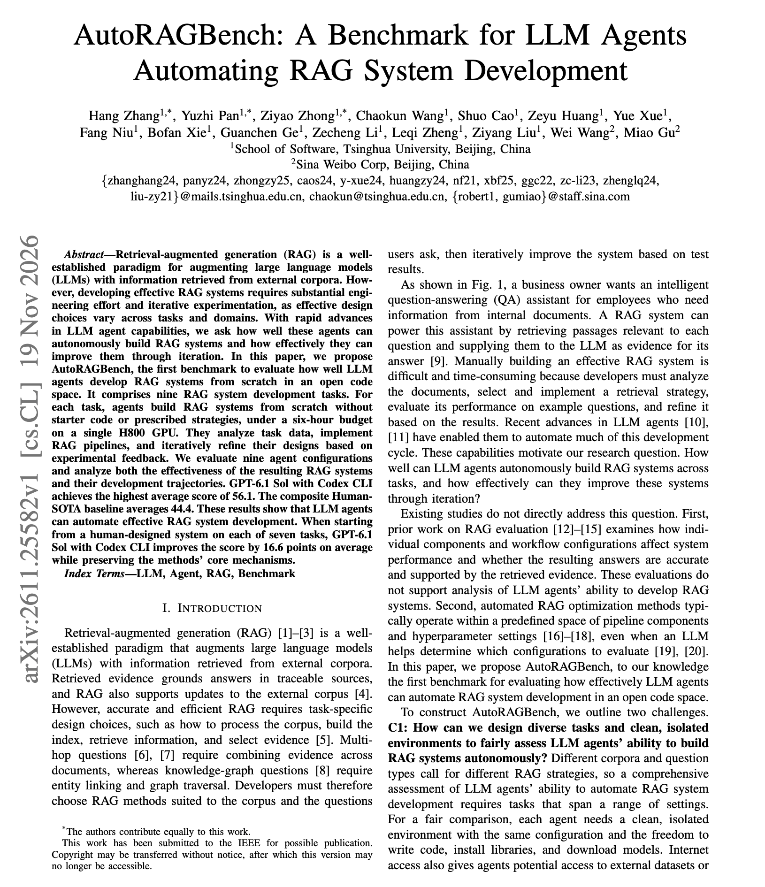
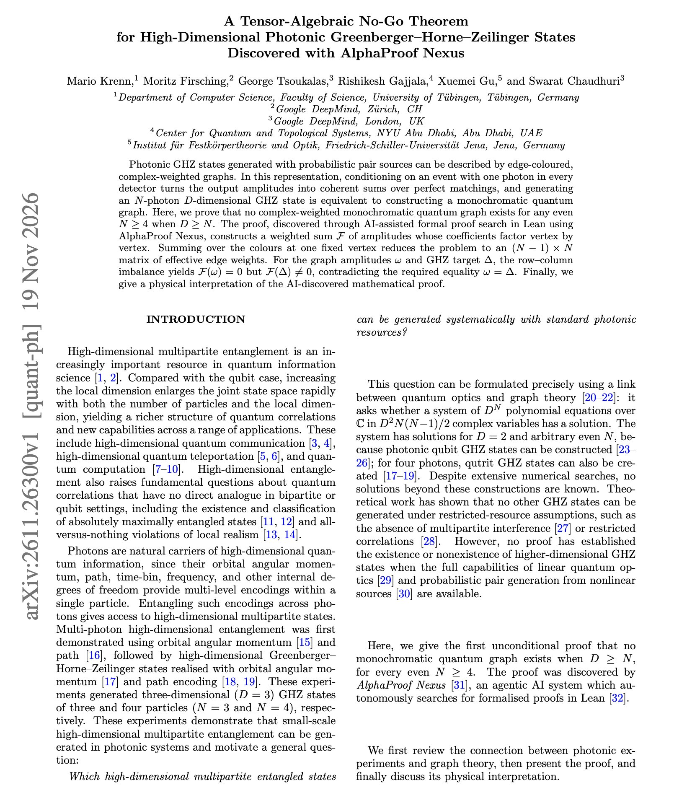

# 🐦 @dair_ai

## 📅 November 21, 2026

> 5 post(s) archived.

---

### 🕐 22:54 UTC · @dair_ai

> Recommended reading on building a &quot;knowledge factory&quot;. The biggest transformation in my agent setup recently is feeding it knowledge at the right time. This compounds in insane ways with proactive agents that can connect bits of knowledge over time. It&apos;s such a magical experience when your agent reminds you of an experiment or suggests you reach back out to a connection. There are no standards for how you build a knowledge factory. For instance, I use graphs of MD files. MD files are versatile and are the preferred language of LLM agents, and graphs provide structure, which turns out to help agents a ton. OKF is an interesting format for capturing semantics better, but I agree you don&apos;t want to be overprescriptive here. I have built several LLM Wikis (research papers, experimental results, etc.) that together make up my knowledge factory. In terms of building it, what I have found works best is interacting with your agents and co-evolving the knowledge factory as you go. No need to overcomplicate things initially. As a researcher, I&apos;ve built other forms, like an eval factory and a content factory, that build on top of this knowledge factory; they are all key to the software factory. Okay, I know I used the word &quot;factory&quot; too much, but you get the point. This compounds. all our agents at langchain (internal GTM &amp; content agents, LangSmith Engine) have a learning loop with similar pieces wrote about what we think makes up a &quot;knowledge factory&quot; https://x.com/i/article/2124180107669766144

🔗 [View original post](https://x.com/omarsar0/status/2124275237042733374)

---

### 🕐 21:00 UTC · @dair_ai

> Brilliant work from Google on speculative decoding for Gemma 4. This matters a lot if your agents generate long outputs, because faster decoding lowers both latency and serving cost. The team built a multi-token prediction drafter directly into the model. It uses one shared drafting head that reads the backbone&apos;s own activations and its existing KV cache. That removes the separate prefill step a standalone drafter needs. A clustered vocabulary projection also cuts the cost of each draft step, which helps most on small devices. The speedups reach 3.1x for large models on servers. Small models get up to 2.3x on an H100 and up to 2.2x on a smartphone GPU. They also tested fine-tuning. When the backbone is adapted to a new domain, distilling the drafter with it needs up to 1.83x fewer target forward passes than tuning the backbone alone. The code for the domain adaptation recipes is public. https://arxiv.org/abs/2611.25813 Chat with Paper: https://academy.dair.ai/papers/efficient-and-robust-drafting-with-multi-token-prediction-2611.25813

🔗 [View original post](https://x.com/dair_ai/status/2124246507125903841)

---

### 🕐 17:55 UTC · @dair_ai

> Can coding agents build better RAG systems than the best published human designs? AutoRAGBench gives an agent nine RAG development tasks to measure this. There is no starter code and no suggested approach. The agent gets six hours and one H800 GPU to analyze the data, build a pipeline, and refine it from experiments. GPT-6.1 Sol with Codex CLI averages 56.1. The composite human baseline, which takes the best published method on each task, averages 44.4. When the agent starts from a human-designed system instead of from scratch, it adds 16.6 points on average across seven tasks. The paper compares nine agent setups and also studies how each one&apos;s development process unfolds over the six hours. Paper: https://arxiv.org/abs/2611.25582 Chat with Paper: https://academy.dair.ai/papers/autoragbench-a-benchmark-for-llm-agents-automating-rag-system-development-2611.25582

🔗 [View original post](https://x.com/omarsar0/status/2124199923424104874)

---

### 🕐 17:05 UTC · @dair_ai

> Can an AI agent settle an open physics question with a machine-checked proof? This new paper from the University of Tübingen and Google DeepMind shows that it can. The question comes from quantum optics. Physicists wanted to know whether high-dimensional GHZ states, a kind of entangled photon state, can be built with only linear optics and pair sources. The authors first raised it in 2017. The answer is no. For any even number of photons from 4 upward, with at least as many dimensions as photons, the construction is impossible. AlphaProof Nexus found the proof. It searches for formal proofs in Lean, combining frontier language models with feedback from the Lean compiler. Because the proof is formal, a computer verifies it. The authors then worked out what the proof means physically and explained it in the paper. This is one of the clearest recent examples of formal proof search producing a new result outside pure math. https://arxiv.org/abs/2611.26300 Chat with Paper: https://academy.dair.ai/papers/a-tensor-algebraic-no-go-theorem-for-high-dimensional-photonic-greenberger-horne-2611.26300

🔗 [View original post](https://x.com/dair_ai/status/2124187341141283117)

---

### 🕐 16:15 UTC · @dair_ai

> Can&apos;t believe I am saying this. I am strongly considering replacing Opus 5.5 with Gemini Neon as my daily driver. Google absolutely cooked with this model. I&apos;ve been testing it with Pi + Gemini API, and it&apos;s the first Gemini model that actually feels like a daily driver. Now I just want to use this with a subscription in other harnesses. @OfficialLoganK, I think it&apos;s time to make it happen. If this is a sign of what&apos;s to come, you&apos;ll want to watch Google&apos;s next releases very closely. Check out this nice visual explainer it generated in one shot using the ElevenLabs API for voice, based on the RSI conversation in @a16z&apos;s first episode of Working Theory. These explainers are quickly becoming one of the best ways to learn and consume research. Gemini Neon is extremely good for scientific knowledge and work. I already preferred Gemini Flash models for research outputs, explainers, and notes. So this makes me want to use the new Gemini models even more. Media

🔗 [View original post](https://x.com/omarsar0/status/2124174963410174246)

---
