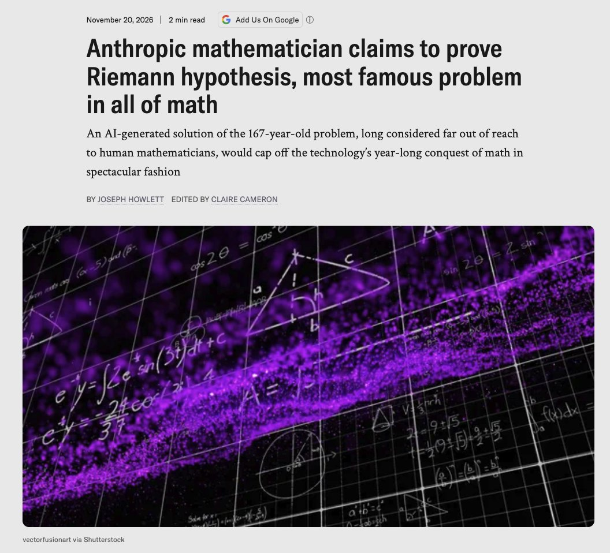
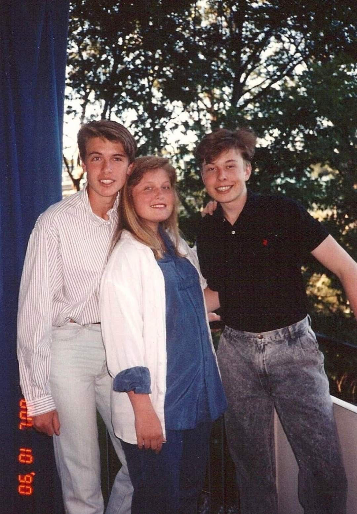

# 🐦 @elonmusk

## 📅 November 21, 2026

> 23 post(s) archived.

---

### 🕐 20:40 UTC · @elonmusk

> It’s high time we probed Uranus again! Much better images are needed (actually).

🔗 [View original post](https://x.com/elonmusk/status/2124241570451054609)

---

### 🕐 20:27 UTC · @elonmusk

> It’s like GTA Here are the new FSD visualizations in FSD V15. It continuously streams a view from an arbitrary virtual camera situated above your vehicle. Upcoming navigation turns display directly in the driving visualization. Turn signals are quieter and fade out after a few clicks.

🔗 [View original post](https://x.com/elonmusk/status/2124238249686159590)

---

### 🕐 20:26 UTC · @elonmusk

> In FSD V15, the Tesla AI computer re-renders reality with chevrons in the sky for turns like a video game. You can tap any point on the reality revisualizer to make your car go there. Media

🔗 [View original post](https://x.com/elonmusk/status/2124238164512714925)

---

### 🕐 19:13 UTC · @elonmusk

> Shortest explanation is just: 🤯 Simple explanation of the usefulness of the Riemann proof (so far) is that it removes the conditional nature of other math theorems dependent upon it. And, of course, is yet another mind-blowing thing achieved by super intelligence … https://x.com/i/grok/share/bGVnYWN5_2b134790-…

🔗 [View original post](https://x.com/elonmusk/status/2124219646459220296)

---

### 🕐 19:12 UTC · @elonmusk

> Grok understands Elon means turning lunar and Mercurian material into optimized compute substrate: silicon solar cells harvesting power + aluminum radiators dumping waste heat to deep space (~3 K). Mercury gets ~6–9× Earth&apos;s solar flux (~9,000 W/m² mean). Its highly reduced regolith is silicon- …

🔗 [View original post](https://x.com/elonmusk/status/2124219378489311656)

---

### 🕐 18:53 UTC · @elonmusk

> @elonmusk This will help you visualize the Riemann theory. Media

🔗 [View original post](https://x.com/leorinaldi1/status/2124214574836502743)

---

### 🕐 18:49 UTC · @elonmusk

> Simple explanation of the usefulness of the Riemann proof (so far) is that it removes the conditional nature of other math theorems dependent upon it. And, of course, is yet another mind-blowing thing achieved by super intelligence … https://x.com/i/grok/share/bGVnYWN5_2b134790-72b8-47d6-b182-afb9b775bd6a

🔗 [View original post](https://x.com/elonmusk/status/2124213680422387741)

---

### 🕐 11:15 UTC · @elonmusk

> Incredible that this actually happened, seven years later. We are in a completely new world. To anyone who wants to “ban lying” on social media Please write down a function that takes in a statement and returns whether it is true If you can start with the Riemann Hypothesis that would be amazing

🔗 [View original post](https://x.com/balajis/status/2124099490110193793)

---

### 🕐 09:24 UTC · @elonmusk

> XV is the beginning of the “super” part of Tesla SI XV

🔗 [View original post](https://x.com/elonmusk/status/2124071338394399028)

---

### 🕐 09:20 UTC · @elonmusk

> Banger Props to Rockstar, GTA 6 shipped before the Riemann Hypothesis was proven!

🔗 [View original post](https://x.com/elonmusk/status/2124070328158900294)

---

### 🕐 09:18 UTC · @elonmusk

> Starlink saves lives Starlink is being deployed to help fight DR Congo’s deadly Ebola outbreak. 🇨🇩 Africa CDC has donated Starlink kits to health officials in Beni to help frontline teams share critical data in real time and coordinate faster responses, even in remote communities.

🔗 [View original post](https://x.com/elonmusk/status/2124069831989178660)

---

### 🕐 09:17 UTC · @elonmusk

> Starlink helps education SpaceX has donated 1,600 Starlink kits to help connect some of Paraguay&apos;s most remote schools to high-speed internet 🇵🇾 And the rollout has already reached a major milestone! COPACO has completed the first phase, connecting 800 schools across Paraguay, and has received another…

🔗 [View original post](https://x.com/elonmusk/status/2124069585590813180)

---

### 🕐 09:06 UTC · @elonmusk

> SpaceX just launched the USSF-317 national security mission for the U.S. Space Force, and the Falcon 9 booster landed successfully for the 11th time This same booster had already completed 10 missions: • NROL-105 • USSF-385 • 8 Starlink missions After launching from Vandenberg Space Force Base, it landed on the Of Course I Still Love You droneship in the Pacific Ocean The U.S. Space Force is now launching classified national security missions on rockets that have already flown to space 10 times https://x.com/SpaceX/status/2123995383625924847/video/1 Media

🔗 [View original post](https://x.com/XFreeze/status/2124067003636080641)

---

### 🕐 08:29 UTC · @elonmusk

> ✨ @roger_kappler Yeah. The new user interface will re-render reality in a mind-bending way. Hard to describe, but it’s awesome.

🔗 [View original post](https://x.com/aelluswamy/status/2124057656398958873)

---

### 🕐 07:47 UTC · @elonmusk

> Elon Musk with his brother Kimbal and sister Tosca in 1990.

🔗 [View original post](https://x.com/cb_doge/status/2124047095460245567)

---

### 🕐 07:46 UTC · @elonmusk

> Even if Riemann turns out not to be fully solved yet, it will be soon enough https://x.com/i/grok/share/bGVnYWN5_883c4778-e70d-4d39-b95d-c807591b80b0

🔗 [View original post](https://x.com/elonmusk/status/2124046857659650295)

---

### 🕐 07:38 UTC · @elonmusk

> We’ve had monkeys playing video while drinking banana smoothies for 5 years. Not a bad life. How it started vs how it&apos;s going In April 2021, Neuralink showed Pager the macaque playing MindPong with his brain Now a Neuralink patient is flying a plane in GTA VI with 2 joysticks and 12 buttons of control, all with his brain Before the implant, he used a mouth stick on an i…

🔗 [View original post](https://x.com/elonmusk/status/2124044780099285426)

---

### 🕐 07:35 UTC · @elonmusk

> Grok bot is still by far my most used personal agent True

🔗 [View original post](https://x.com/ArthurMacwaters/status/2124044033886728272)

---

### 🕐 07:33 UTC · @elonmusk

> Telepathy is very real. What Elon is doing with Neuralink is basically magic Playing GTA VI with a Neuralink

🔗 [View original post](https://x.com/XFreeze/status/2124043559536152707)

---

### 🕐 07:31 UTC · @elonmusk

> True Grok Bot does the work of an entire team of people. If you make good use of it, it&apos;s worth much more than anyone is paying for it.

🔗 [View original post](https://x.com/elonmusk/status/2124043015941767630)

---

### 🕐 07:30 UTC · @elonmusk

> SFT is more like getting a haircut with a chainsaw than it is “fine-tuning”! Should just be built into primary training. And having a “system prompt” is silly! Default behavior should be sensible. The above are already true for Tesla AI (not yet deserving of “super”). It is the most efficient AI on Earth. FSD V15 goes to wide release next month. It will be something special.

🔗 [View original post](https://x.com/elonmusk/status/2124042864891982292)

---

### 🕐 06:34 UTC · @elonmusk

> Playing GTA VI with Telepathy Playing GTA VI with a Neuralink

🔗 [View original post](https://x.com/elonmusk/status/2124028719190749681)

---

### 🕐 04:22 UTC · @elonmusk

> Liftoff! Media

🔗 [View original post](https://x.com/SpaceX/status/2123995383625924847)

---
