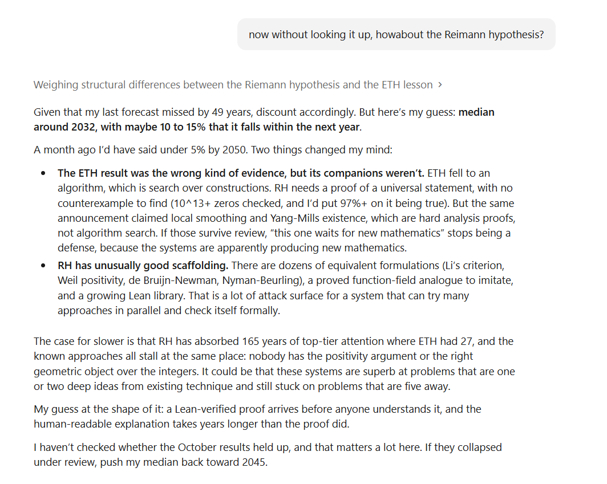

# 🐦 @emollick

## 📅 November 21, 2026

> 6 post(s) archived.

---

### 🕐 20:36 UTC · @emollick

> “its just spicy autocomplete” Sure, and isn’t that incredible!

🔗 [View original post](https://x.com/emollick/status/2124240524219748483)

---

### 🕐 16:08 UTC · @emollick

> We really are in a (temporary?) place where a combination of expertise and being able to work with AI allows people to do incredible things. It is no coincidence that people proving Millennium Problems have all been great mathematicians, the models can&apos;t (yet) do it on their own Today in AI as complements: the Harvard valedictorian, Princeton PhD, HSF, who went into AI after working on Riemann for years, solved it. I didn&apos;t, you didn&apos;t, the other folks at the labs didn&apos;t. Human judgement about what is worthwhile, what is verified, what is possible...

🔗 [View original post](https://x.com/emollick/status/2124173181065806006)

---

### 🕐 05:28 UTC · @emollick

> Big win for the humanities. And the math people thought they had the key to everything. (Yes, yes, matrix multiplication is impressive, but it wouldn’t matter if it weren’t being done on representations of language. And their textbooks were written in words anyway.)

🔗 [View original post](https://x.com/emollick/status/2124011965605380422)

---

### 🕐 05:22 UTC · @emollick

> It is amazing that human language turned out to be so unreasonably effective at modeling the universe that training a system to predict what comes next in a sentence would get us this far.

🔗 [View original post](https://x.com/emollick/status/2124010579836768572)

---

### 🕐 03:04 UTC · @emollick

> Same thread This never gets old (&amp; also shows how hard forecasting AI is even for AI) “Hey Claude Fable &amp; GPT-6 Astra, Without looking anything up, when do you think we will solve the Exponential Time Hypothesis?” (I only show part of the answers for space)

🔗 [View original post](https://x.com/emollick/status/2123975764664066542)

---

### 🕐 02:51 UTC · @emollick

> I think trying to track how much work AI can do autonomously is critical, and this is a useful counter to some of the most audacious claims about the state of autonomous AI research. But I do want to note that the focus on research tasks at the most advanced AI research organizations on the planet also runs the risk of substantially underestimating what AI can already do in terms of economically valuable tasks. Its worth separating the two (and I don&apos;t think Ramez is claiming they are not seperated). Most work is not frontier AI research, and there AI can be tremendously successful. Epoch&apos;s MirrorCode results, for example, show AI autonomously reimplementing software that the researchers estimate would take a humans 2-17 weeks. This is well-specified work, so it has very different boundary conditions. Plus, in the real world, some human intervention is fine (in my mind, vastly preferrable to no human role for a variety of reasons). Occasional guidance can still leave you with enormous productivity gains, even if that doesn’t satisfy the requirements for fully autonomous AI research. And even in the case of AI research, the same OpenAI report includes researchers estimating that a month of their team’s work would have taken three months without coding agents, on average. In short, RSI/AI-driven research progress may not tightly couple with progress on economically valuable tasks, and the variance and range on those tasks are less well understood. New from me: The most important graphs in AI are wrong. Specifically, measures of the length of task AIs can autonomously accomplish are dramatically different than real-world data from inside OpenAI and Google. 🧵 https://www.rameznaam.com/p/the-most-important-charts-in-ai-are

🔗 [View original post](https://x.com/emollick/status/2123972584400204199)

---
