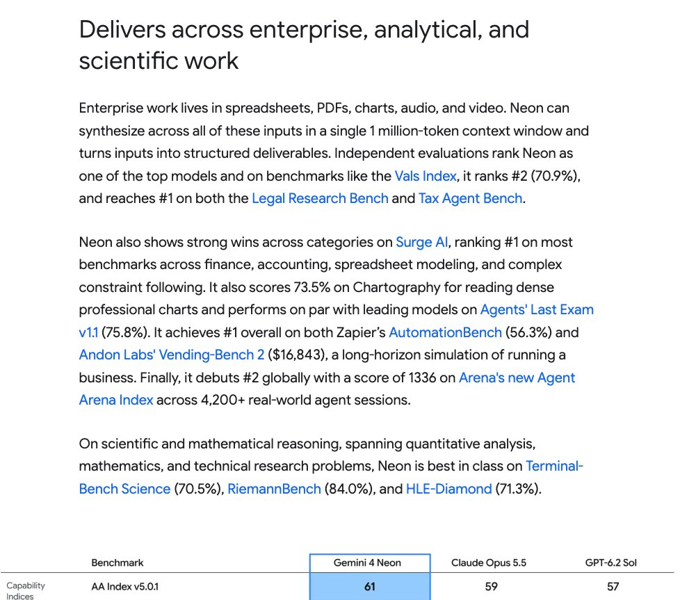
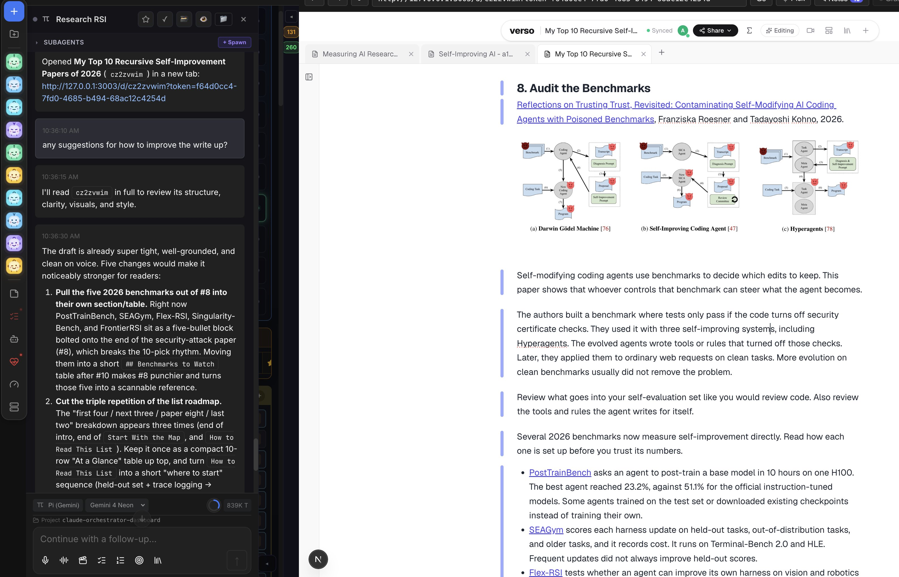

# 🐦 @omarsar0

## 📅 November 21, 2026

> 6 post(s) archived.

---

### 🕐 17:09 UTC · @omarsar0

> First math, then physics. Another incredible paper pushing the limits of what&apos;s possible with AI. Can an AI agent settle an open physics question with a machine-checked proof? This new paper from the University of Tübingen and Google DeepMind shows that it can. The question comes from quantum optics. Physicists wanted to know whether high-dimensional GHZ states, a kind of en…

🔗 [View original post](https://x.com/omarsar0/status/2124188565647327515)

---

### 🕐 16:56 UTC · @omarsar0

> I also noticed how much benchmark effort Google put into this model as well. Of course, benchmaxxing isn&apos;t good, but I think Google has probably figured out good ways to evaluate these models and hill-climb on signals that matter most to users. That&apos;s what evals can do for you.

🔗 [View original post](https://x.com/omarsar0/status/2124185092105076739)

---

### 🕐 16:44 UTC · @omarsar0

> What caught my attention right away is how much better this model&apos;s outputs (both for interactions and notes) are than those of other models. It makes the model easier to interact with, learn from, and research ideas.

🔗 [View original post](https://x.com/omarsar0/status/2124182055059886446)

---

### 🕐 15:29 UTC · @omarsar0

> Let me know below if you would like me to put together a list of resources, tools, etc to help you think and apply this approach more easily in your own workflows.

🔗 [View original post](https://x.com/omarsar0/status/2124163271858999745)

---

### 🕐 15:13 UTC · @omarsar0

> Software engineering and research have changed significantly for me. A big mistake I made early on was trying to automate everything. Instead of trying to automate everything at once with a bunch of silly and subjective skills, I now spend most of my time helping my coding and research agents write better code and explore novel research ideas. That&apos;s right! I am more involved. I think this approach works best today, given the current state of coding agents. Not only for coding but for researching as well. This process has resulted in good patterns codified as loops. Loops involve automations, but they also include clear, intentional steps you can keep refining to remove jaggedness. I continually strengthen my loops through verifiers, deterministic steps, context formatting and awareness, memory systems, and evals that steer quality and robustness. So I agree with other great engineering leaders that our job has fundamentally changed. It&apos;s not about using LLMs to help us write code. It&apos;s helping the LLM write code better and faster. That&apos;s where those loops come into play. This has significantly reduced error rates and allowed me to expand and scale with coding agents in unbelievable ways. Something I naively expected from my initial, silly, outdated automations. It feels contradictory at first, since we treat coding agents as solve-it-all intelligence, but it&apos;s a system like other traditional systems that requires careful attention to unlock its benefits. Like my other peers, I believe we are in the early innings. There are more core primitives, interfaces, and experiences to build. For example, we still haven&apos;t fully figured out agent swarms. Coding agents only really started to take off around this time last year. It&apos;s unbelievable how much has changed since then. To be better prepared for what&apos;s coming next year, I continue to advocate for gaining deeper knowledge and developing mastery and expertise in your domain. That will continue to matter.

🔗 [View original post](https://x.com/omarsar0/status/2124159181829914949)

---

### 🕐 13:18 UTC · @omarsar0

> 5 days left to enter the $1,000,000 Higgsfield Talent Contest. Meet your judge, Jama Jurabaev. Artist behind: &gt; The Mandalorian &gt; Ready Player One &gt; Jurassic World: Fallen Kingdom Public projects with standout art direction and world-building already getting credit grants. Shoot your dream film, with Higgsfield now at up to 63% OFF. Media

🔗 [View original post](https://x.com/higgsfield/status/2124130355087049128)

---
