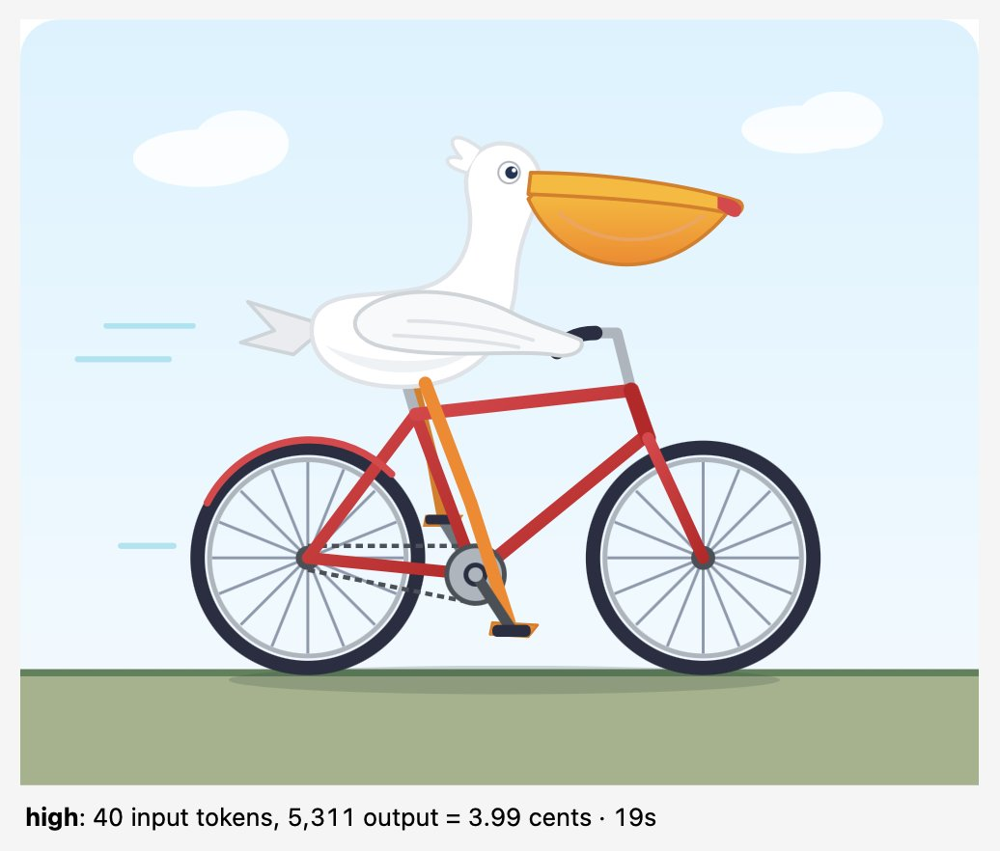

# 🐦 @simonw

## 📅 November 21, 2026

> 2 post(s) archived.

---

### 🕐 19:28 UTC · @simonw

> Here&apos;s the full comparison grid for Gemini 4 Carbon, Neon and Hydrogen across all of their reasoning levels https://static.simonwillison.net/static/2026/gemini-4-carbon-neon-hydrogen-with-xhigh.html

🔗 [View original post](https://x.com/simonw/status/2124223349769609407)

---

### 🕐 19:06 UTC · @simonw

> Gemini 4 tip: the difference between Gemini 4 Hydrogen on &quot;high&quot; thinking effort and that same model on &quot;xhigh&quot; is VERY significant Here&apos;s the high v.s. the xhigh pelican - high cost 3.99 cents and used 5,311 output tokens, xhigh cost 23.61 cents and used 31,477 output tokens

🔗 [View original post](https://x.com/simonw/status/2124217876777464269)

---
