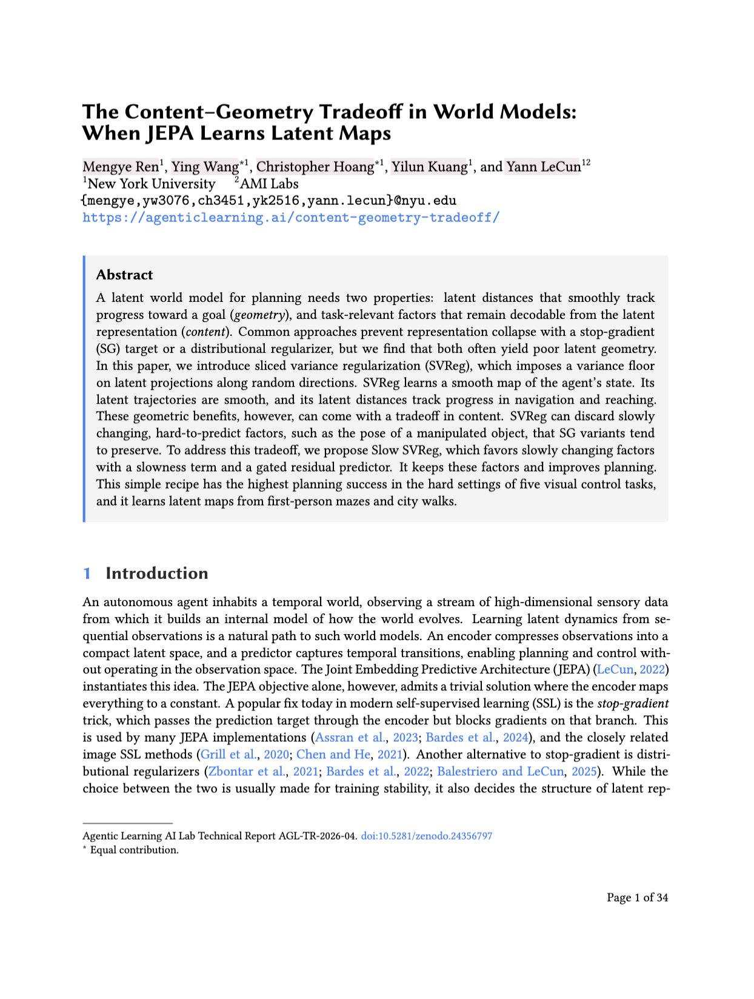
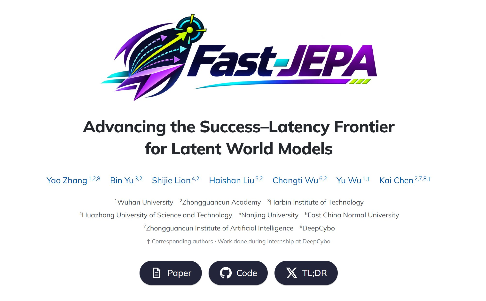

# 🐦 @ylecun

## 📅 November 21, 2026

> 4 post(s) archived.

---

### 🕐 15:07 UTC · @ylecun

> IMPORTANT NOTE: EBM are often presented as a particular form of probabilistic models. This is a very common misunderstanding. EBMs are *MORE GENERAL* than probabilistic models. Probabilistic models are a special case of EBMs in which: 1. Energies can be turned into a probabilities through the Gibbs distribution. That requires a convergent and computable partition function! 2. The loss function has a probabilistic interpretation, e.g. negative likelihood. But there is whole world of EBMs that are NOT probabilistic: they require no partition function or normalization, and they can be trained with lots of loss functions that have no probabilistic interpretation.

🔗 [View original post](https://x.com/ylecun/status/2124157691677307351)

---

### 🕐 14:58 UTC · @ylecun

> That&apos;s the essence of my Deep Learning course at NYU for the past 20 years or so. Everything can be understood within the unified framework of energy-based models, including classification, regression, structured prediction, unsupervised and self-supervised learning (clustering, auto-encoders, denoising AE, variational AE, Siamese nets, joint embedding, JEPA, diffusion models,...). Look at themes 3 and 4 from our 2021 course: https://atcold.github.io/NYU-DLSP21/ @alfcnz has been working on an EBM textbook derived from my course. Here is a lecture I gave at IAS in 2019 about understanding SSL with EBM https://youtu.be/m17B-cXcZFI?is=z7jMkbW_JqZZziSF There is also my 2006 EBM tutorial paper: http://yann.lecun.com/exdb/publis/pdf/lecun-06.pdf

🔗 [View original post](https://x.com/ylecun/status/2124155600946769955)

---

### 🕐 12:43 UTC · @ylecun

> Yet another amazing JEPA paper, and it&apos;s also supervised by Yann LeCun! &quot;The Content–Geometry Tradeoff in World Models: When JEPA Learns Latent Maps&quot; JEPA world models have a tradeoff where they can learn a smooth map for navigation, but would lose track of objects they need to interact with. So this paper introduces Slow SVReg, which helps the model learn a smoother map of its environment while preserving important details, such as the positions of objects that change slowly. On difficult first-person maze navigation, Slow SVReg improves planning success from 21.2% to 92.9% compared to a standard stop-gradient baseline. On the PushT manipulation task, success increases from 44.0% to 87.3%. https://www.alphaxiv.org/abs/2611.jepa-latent-maps-content-geometry

🔗 [View original post](https://x.com/askalphaxiv/status/2124121398268559382)

---

### 🕐 07:56 UTC · @ylecun

> 🚀 Excited to share our latest work: Fast-JEPA! Can world models plan faster without sacrificing success? ⚡ 2.41× faster than INTACT 🎯 96.50% success rate at just 10.88 ms 📄 Paper: https://arxiv.org/abs/2611.25927 🌐 Project: https://deepcybo-physai.github.io/Fast-JEPA

🔗 [View original post](https://x.com/Sofilyzia_1/status/2124049370178077159)

---
