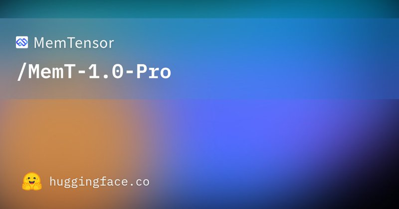
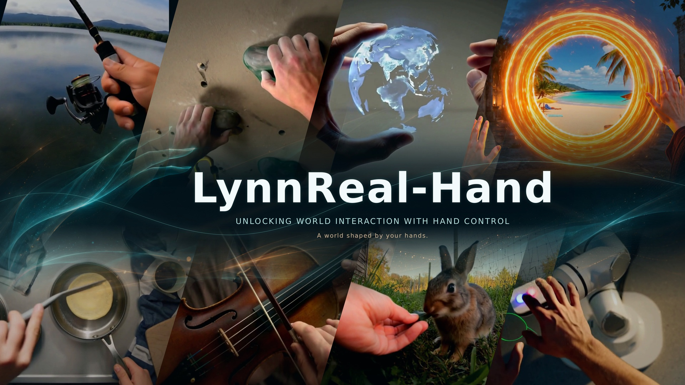

# 🐦 @_akhaliq

## 📅 November 22, 2026

> 2 post(s) archived.

---

### 🕐 22:00 UTC · @_akhaliq

> Today, we launched MemT-1.0-Pro #MemT, a memory-native model developed in collaboration with @NVIDIAAIDev. Built on NVIDIA Nemotron 3 Ultra, with distributed training powered by NVIDIA Megatron-Core and Megatron Bridge. Here&apos;s how it compares to MemT-1.0-Flash: 🧠 554B parameters with native memory 📈 +4.76 pts on BEAM-1M 📈 +6.51 pts on MemoryAgentBench Store history in native memory. Use it in later interactions — without keeping the original history in the query context. Advancing memory for long-horizon AI agents. 🎮 Explore the model: https://huggingface.co/MemTensor/MemT-1.0-Pro 📄 Technical report: https://arxiv.org/abs/2610.26825

🔗 [View original post](https://x.com/MemOS_dev/status/2124623963087126562)

---

### 🕐 20:08 UTC · @_akhaliq

> LynnReal-Hand A hand-controlled video world model that turns hand motion and camera poses into interactive video worlds, streaming at 18 FPS at 540p on a single H200.

🔗 [View original post](https://x.com/HuggingPapers/status/2124595815989559506)

---
