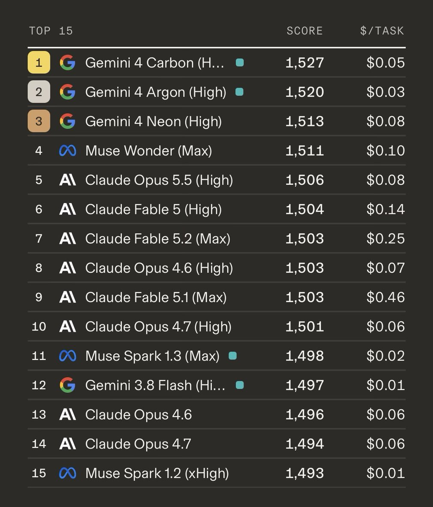
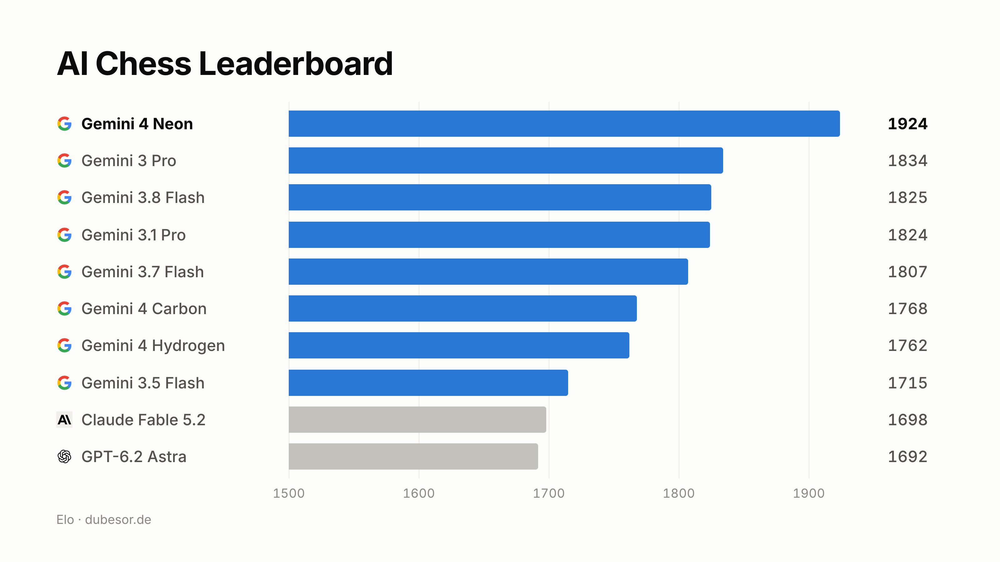

# 🐦 @demishassabis

## 📅 November 22, 2026

> 3 post(s) archived.

---

### 🕐 13:33 UTC · @demishassabis

> Google now holds the top 3 spots on the Arena text leaderboard 👀 &gt; Gemini 4 Carbon 1,527 &gt; Gemini 4 Argon 1,520 &gt; Gemini 4 Neon 1,513 &gt; Meta&apos;s Muse Wonder 1,511 &gt; Claude Opus 5.5 1,506

🔗 [View original post](https://x.com/alexmichael/status/2124496549036077213)

---

### 🕐 05:14 UTC · @demishassabis

> Gemini 4 Neon just took #1 overall on LiveBench 2.0 (87.4) beating both Claude Fable 5.2 (84.9) and GPT-6.2 Astra (84.9) by a full 2.5 points.

🔗 [View original post](https://x.com/AI_Screening/status/2124370923705024753)

---

### 🕐 04:34 UTC · @demishassabis

> Google&apos;s Gemini 4 Neon just took #1 on the AI Chess Leaderboard ♟️ &gt; 1924 Elo with 24 wins and 2 losses &gt; Claude Fable 5.2 is 9th and GPT-6.2 Astra is 10th

🔗 [View original post](https://x.com/alexmichael/status/2124360947410342012)

---
