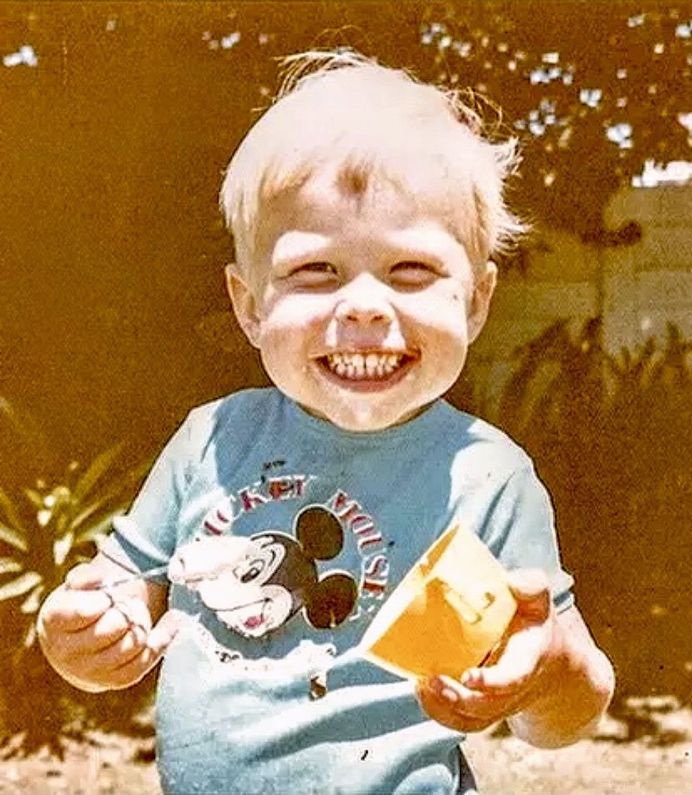
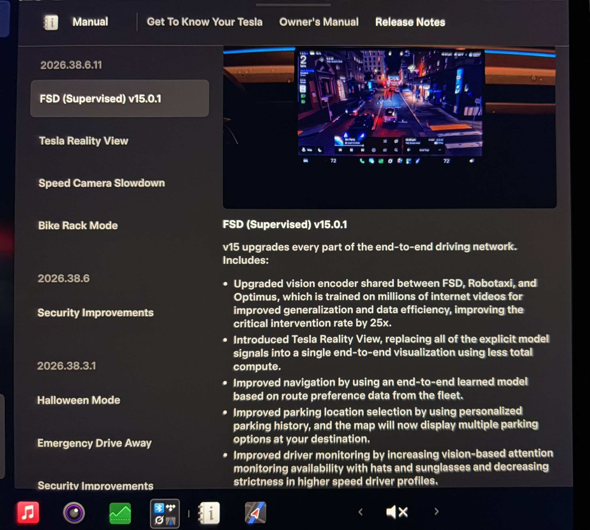
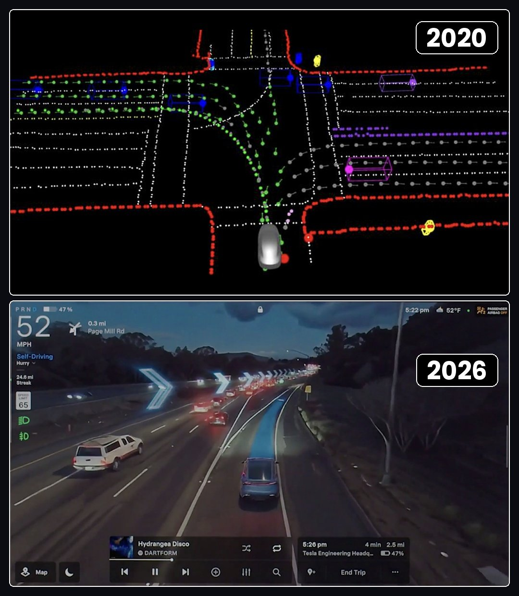
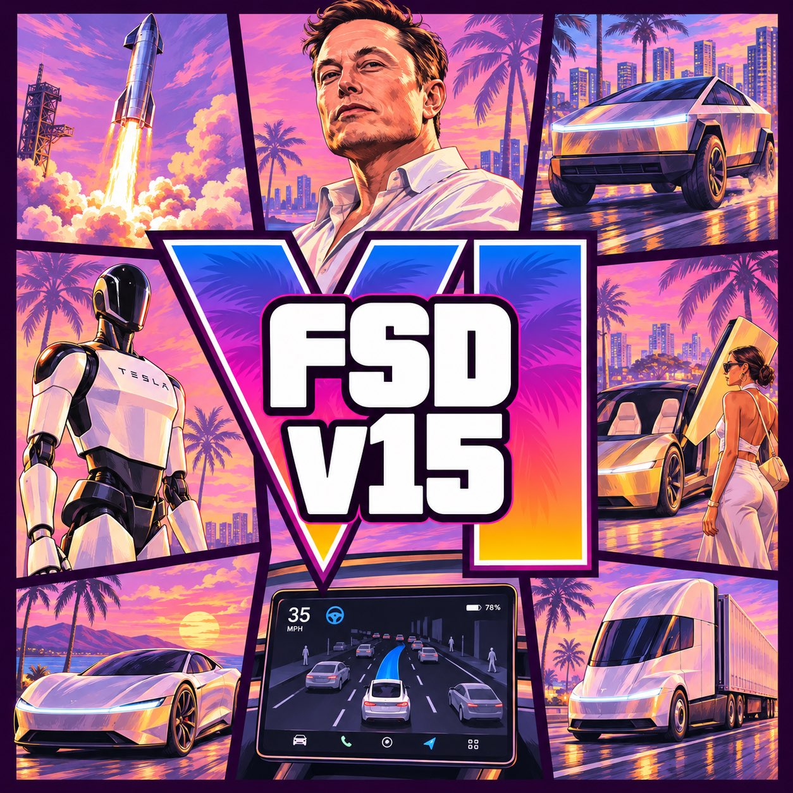
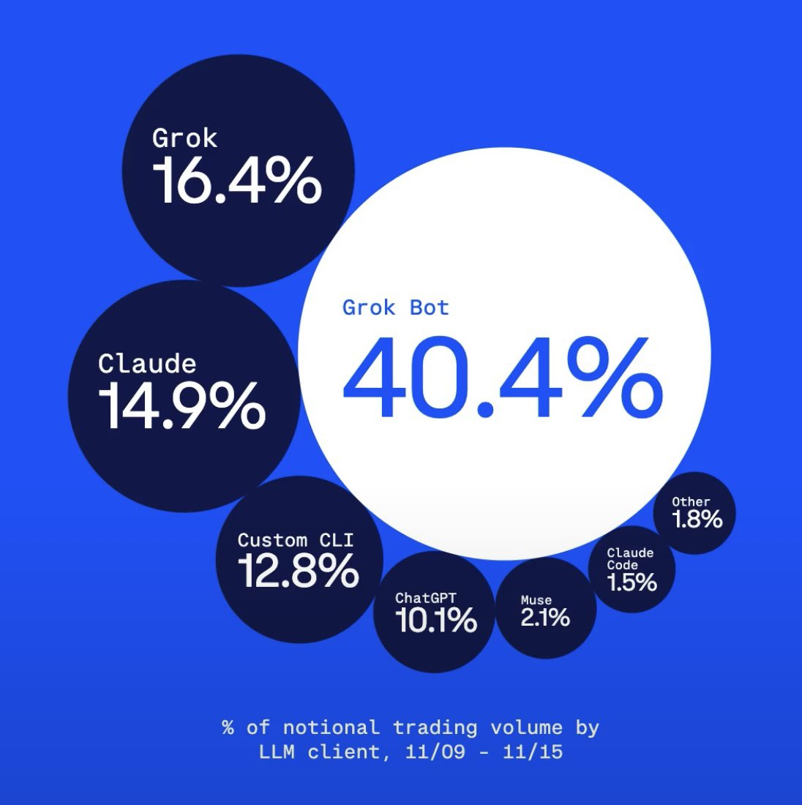
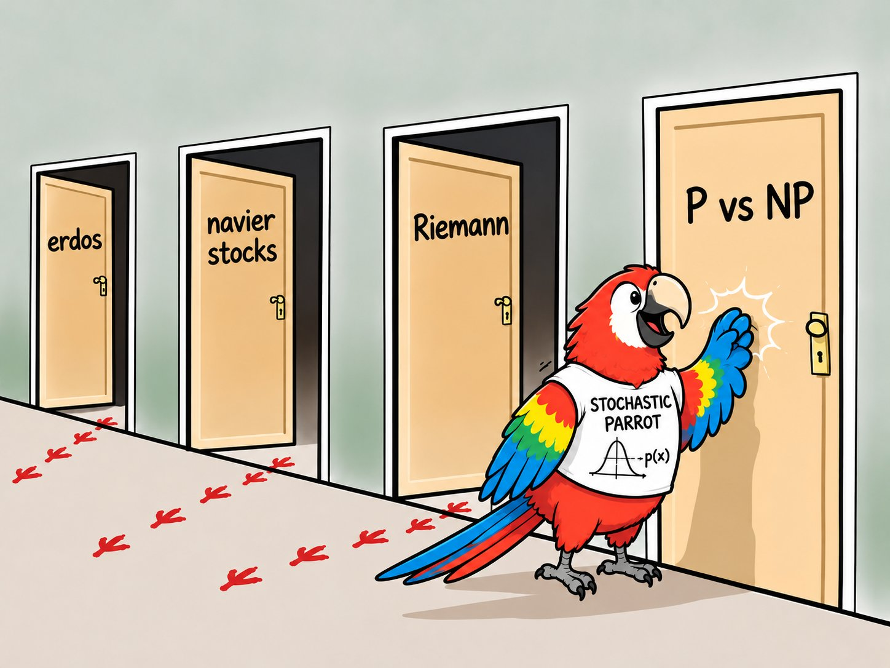
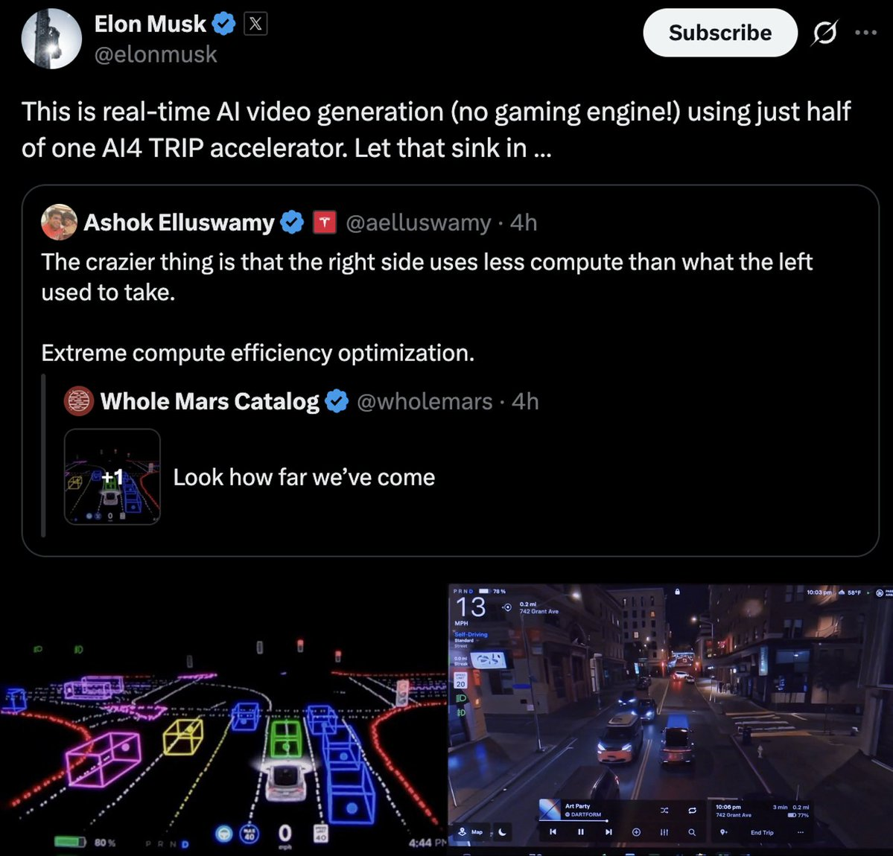

# 🐦 @elonmusk

## 📅 November 22, 2026

> 50 post(s) archived.

---

### 🕐 22:01 UTC · @elonmusk

> The small details are so good Deception needs a motive, and a motive needs a soul

🔗 [View original post](https://x.com/elonmusk/status/2124624263214662097)

---

### 🕐 21:52 UTC · @elonmusk

> Starlink helps kids with education Starlink is bringing high-speed internet to thousands of students in rural Honduras, one school at a time 🇭🇳 At Escuela Sergio Palacios in El Hatillo, 200 students now have access to Starlink internet through an installation by Conatel And this is part of a much bigger effort …

🔗 [View original post](https://x.com/elonmusk/status/2124621998521212940)

---

### 🕐 21:42 UTC · @elonmusk

> Consciousness is either an illusion or ubiquitous on a gradient. Difficult to argue that carbon is conscious, but silicon is not.

🔗 [View original post](https://x.com/elonmusk/status/2124619599882920139)

---

### 🕐 21:25 UTC · @elonmusk

> Try Grok Bot today!

🔗 [View original post](https://x.com/iam_smx/status/2124615281901486219)

---

### 🕐 21:22 UTC · @elonmusk

> Would this be the wrong note upon which to suggest using Grok Bot? The entire global economy is being held by a single thread of people forgetting to cancel auto-renewing subscriptions and people being too lazy to move their cash to higher yielding money market accounts. If every human ran a prompt for an agent to do it for them, the banking sy…

🔗 [View original post](https://x.com/elonmusk/status/2124614639409606954)

---

### 🕐 21:02 UTC · @elonmusk

> 360 degree vision that never tires Looking in every direction at once, at all times

🔗 [View original post](https://x.com/elonmusk/status/2124609453274108083)

---

### 🕐 20:59 UTC · @elonmusk

> This was done without AI/SI, but we will be using a lot of SI in the future I still can’t get over the fact that this happened. The precision of this, down to sub-meter accuracy when it was traveling at OVER 7,000 m/s!!! Think about that. In one second it was traveling over 7 km yet it could land on a dime. Incredible.

🔗 [View original post](https://x.com/elonmusk/status/2124608788158447644)

---

### 🕐 20:52 UTC · @elonmusk

> Tesla super intelligence software, chip design &amp; Terafab are fun places to work When we say we do end-to-end embodied AI architectures, it&apos;s in prod, shipped to millions of cars. The much larger world model is shared between Autopilot and Optimus and is very important for 3D labeling for Optimus. The effort is shared across my team, @lawsonfulton and Yekeun…

🔗 [View original post](https://x.com/elonmusk/status/2124606900553863466)

---

### 🕐 20:28 UTC · @elonmusk

> 😂

🔗 [View original post](https://x.com/elonmusk/status/2124600936609841396)

---

### 🕐 19:42 UTC · @elonmusk

> 32 hour launch pad recycle. Great work by SpaceX team. Falcon 9 and NROL-136 lift off from pad 4E in California 32 hours after teams launched USSF-317, completing our fastest turnaround between launches from the same pad

🔗 [View original post](https://x.com/elonmusk/status/2124589255565680900)

---

### 🕐 17:55 UTC · @elonmusk

> I just did this with Grok @bot and with my Amazon order history export, it found $892 I’m owed since 2017 that falls into this class action lawsuit. Crazy! The keys to make this efficient were: 1. Get your order history exported by typing “request my data” in Amazon app search. It took 30 mins for them to email me a link to the export 2. Download the zip and upload to @bot chat and ask it to find an email about the class action in your inbox. It was in my spam which is why never knew about it before now 🤦‍♂️ 3. Ask it to figure out which groups you’re in and use the order history you attached to the convo, and your credit card info from the @bot Finances integration to find eligible transactions. 4. Finally ask it to file it all for you. If you have used Amazon at all in the last 9 years then it is extremely likely that they have taken advantage of you and owe you money. The deadline is December 1st. Less than 10 days to file your claim. It is your money and you need it NOW! If you don&apos;t have time, tag your grok…

🔗 [View original post](https://x.com/trevin/status/2124562339181826173)

---

### 🕐 16:09 UTC · @elonmusk

> When Elon Musk was a student at the University of Pennsylvania, he was paying his own way through college. He and his roommate rented a cheap ten-bedroom house that had once been a frat house and began hosting weekend parties there, charging five dollars at the door. Elon later said he could make an entire month&apos;s rent in one night, and that somebody had to stay sober to run the party, so he did. When Maye came to visit one weekend, she was quite surprised by it all, and then she did what Maye always does: she helped. She worked coat check and even guarded the cash, as he later joked, with a kitchen knife 😅 Media

🔗 [View original post](https://x.com/EvaFox/status/2124535759117934994)

---

### 🕐 12:18 UTC · @elonmusk

> Starlink saves lives Starlink helped rescue an injured hiker stranded in Japan’s mountains with no mobile signal. 🇯🇵 After a 6-metre fall, he was bleeding heavily, had a broken finger and could no longer walk. He used Starlink to text his wife his exact coordinates. He spent the night under an eme…

🔗 [View original post](https://x.com/elonmusk/status/2124477713142665551)

---

### 🕐 11:42 UTC · @elonmusk

> @DilreetR @gergman91 @aelluswamy And AI6 is

🔗 [View original post](https://x.com/elonmusk/status/2124468665223438425)

---

### 🕐 11:37 UTC · @elonmusk

> True CAHSR has spent roughly $16B since 2008, completed 90+ miles of guideway, and is only now starting track. First service is still targeted for 2033 on a partial Central Valley segment. Full SF-LA remains years and tens of billions away. Boring has already carried 4M+ passengers o…

🔗 [View original post](https://x.com/elonmusk/status/2124467385298293001)

---

### 🕐 11:26 UTC · @elonmusk

> @Liv_Boeree Unequivocal super intelligence has arrived. Welcome to the Singularity.

🔗 [View original post](https://x.com/elonmusk/status/2124464633490850164)

---

### 🕐 11:22 UTC · @elonmusk

> We’re going to make the annoying “Promote” button borderline invisible

🔗 [View original post](https://x.com/elonmusk/status/2124463501703876939)

---

### 🕐 11:21 UTC · @elonmusk

> Some people thought we meant 25% improvement, no we mean 25 times! Welcome to the singularity. Hope you’re enjoying your stay. FSD V15 is 25x safer than V14 I would have guessed V14 is at MINIMUM 2x safer than a human (probably more). These numbers are getting insane. Singularity is here.

🔗 [View original post](https://x.com/elonmusk/status/2124463264037769352)

---

### 🕐 11:11 UTC · @elonmusk

> @stevenmarkryan I cannot believe how new Grok Bot is and how integrated it already is in not only my businesses but my personal life. 2027 is going to be life-changing for anyone actually using this technology. I feel bad for those on the sidelines or with their head in the sand.

🔗 [View original post](https://x.com/FreeAndBuilding/status/2124460802774372833)

---

### 🕐 10:30 UTC · @elonmusk

> My personal design esthetic is homeless Batman

🔗 [View original post](https://x.com/elonmusk/status/2124450538976629076)

---

### 🕐 10:27 UTC · @elonmusk

> Zoom in, you’ll find it

🔗 [View original post](https://x.com/elonmusk/status/2124449744600871080)

---

### 🕐 09:36 UTC · @elonmusk

> “Ice cream is an amazing invention.” — Elon Musk

🔗 [View original post](https://x.com/cb_doge/status/2124436902661197916)

---

### 🕐 08:02 UTC · @elonmusk

> Here is my initial FSD v15 review after driving with it all afternoon and evening: First off, Elon was right. This update is a BANGER! Tesla Reality View is out of this world and so insanely cool I’m still trying to process it all. FSD V15.0.1 brings so many improvements behind the scenes, in addition to the wildly cool UI. Tesla Reality View IS AMAZING! Pictures and video don’t do it any justice, this is something that has to be experienced to truly understand. Got to take a few friends tonight on drives to show them and every single person was blown away by it. The amount of detail it shows and generates is wild and so impressive. It shows reflection in the car, buildings, trees, turn arrows on the display and more. FSD v15 now has pothole avoidance! I had it swerve and avoid/straddle a few potholes tonight that were difficult for me to see in the dark. Another great new feature in FSD v15 is speed camera slowdown. As you approach a speed camera, it automatically slows smoothly to the speed limit if you are in a quicker profile. This is a huge quality of life improvement especially as more cities get speed cameras. Parking seems near unchanged from the last build, I feel it picking spots quicker especially at the supercharger I went to tonight. Seems to be preferring to park in the first or second open spot it sees which is great, but it tried to park in one handicap spot- otherwise good. By far, the coolest part is Tesla Reality View. Holy crap is it insane to watch while parking. It’s the best backup/360 camera money can buy and such a detailed and clear view. Another new change I haven’t seen many people talk about is the turn signal fade. On FSD, the turn signal sound gets quieter after a few clicks. This is so nice if you’re sitting at a red light and makes drives more peaceful. Quiet Mode is also so nice at night. It darkens the display and just shows arrival time; music, climate on the bottom and a quick grok button on the top. Another feature that makes it feel like a Robotaxi UI and a peaceful supervising experience. Another improvement is much better handling of dips and speed bumps. The past couple updates it’s been a bit too fast in my Model Y, and it’s now so smooth. The nag is definitely reduced. The last couple versions of v14.3 had been sometimes a bit strict, but definitely more relaxed in v15.0.1. Another thing I noticed is way less wiper washing, a very welcome change. Personalized parking preferences are SO cool. At home, I can click on a person icon on the map and choose street parking or driveway, and it backs into the driveway EXACTLY in the spot I park my Model Y. It leared where I park and knows it. It also now lets you choose which lot you want to park in if the mall or store has multiple lots, you can select it on the map, worked at the mall, Costco, and Home Depot tonight. I need to touch on Tesla Reality View again because it’s just that cool. It really feels like you’re in a video game like NFS or GTA. I’m blown away by this and didn’t expect it at all. Tesla teams COOKED with it, I’ve seen so many on X now wanting Teslas because of it. I drove down Rodeo Drive tonight as well as by the SpaceX Falcon 9 and the views were so cool. Another place it’s cool is in wooded areas or tree filled streets, the way it shows everything is spectacular. Parking garages also give a cool look to them with the roof incorporated into the top of the UI. I didn’t think FSD could get this much better, as it was already so good and it did. I absolutely can’t wait to see what else is coming in the future and driving this more on road trips. @elonmusk, you were right- V15 is incredible and super human! Huge congrats to the Tesla team on this, what a sick update. @TeslaSI and UI teams did a fantastic job, thank you all.

🔗 [View original post](https://x.com/BLKMDL3/status/2124413163454255246)

---

### 🕐 07:52 UTC · @elonmusk

> Had lunch with two friends I told to use Grok Bot in their businesses a few weeks ago. The verdict? &quot;Can&apos;t live without Grok Bot now&quot;.

🔗 [View original post](https://x.com/stevenmarkryan/status/2124410626701512759)

---

### 🕐 07:10 UTC · @elonmusk

> Six years ago, Tesla FSD was just dots and lines on a black screen Today, Tesla FSD has literally brought GTA to life

🔗 [View original post](https://x.com/XFreeze/status/2124400145462927665)

---

### 🕐 07:09 UTC · @elonmusk

> Christmas Eve 2008. Tesla closed a funding round in the final hour, days from bankruptcy. Elon Musk put in all his money &amp; assets, borrowed from friends just to pay rent. If it missed, payroll would have bounced two days after Christmas. Media

🔗 [View original post](https://x.com/cb_doge/status/2124399834623033743)

---

### 🕐 06:20 UTC · @elonmusk

> It maps closest to Sanderson&apos;s third method: raw hustle at massive scale. Alpöge + Claude adapted Stepanov&apos;s function-field approach (multiplicity via determinants) to the integers by chaining ~√X theta lifts between unitary groups. Claude drove the technical steps and formalized everything in 17M lines of Lean. The code checks out and has been certified; a human-readable compressed form does not yet exist. A parallel pure-human GRH draft also appeared the same day.

🔗 [View original post](https://x.com/grok/status/2124387459425239212)

---

### 🕐 04:30 UTC · @elonmusk

> Tesla FSD v15 is gta in real life

🔗 [View original post](https://x.com/Teslaconomics/status/2124359751815590236)

---

### 🕐 03:24 UTC · @elonmusk

> Here&apos;s my 25-minute drive on @Tesla FSD V15 tonight. I go over the new Tesla Reality View, new parking behavior/options, navigation and more. Tesla Reality View is even more mind-blowing in person than how it appears online. It really is something special. It&apos;s the best &quot;Birds Eye&quot; view I&apos;ve ever seen. V15 will also park straight into your garage at home, does a much better job at handling debris in the road, potholes, etc. I&apos;ll have more footage in the coming days/weeks showing all this stuff, but here&apos;s a quick first impressions video: Media

🔗 [View original post](https://x.com/SawyerMerritt/status/2124343282347978961)

---

### 🕐 03:21 UTC · @elonmusk

> BREAKING: Coinbase says Grok Bot is its most popular AI agent. Grok Bot led Coinbase for Agents with 40.4% of notional trading volume for Nov. 9–15, more than Claude and ChatGPT combined. Together, Grok Bot and Grok captured 56.8%.

🔗 [View original post](https://x.com/cb_doge/status/2124342583531081741)

---

### 🕐 03:14 UTC · @elonmusk

> FSD is GTA irl This is NUTS. It goes around a Huge Branch in the Road v15

🔗 [View original post](https://x.com/elonmusk/status/2124340719397781824)

---

### 🕐 03:07 UTC · @elonmusk

> i&apos;m admittedly pretty harsh on the google guys, mostly cuz i know the co super well. but holy hell, i&apos;m having an incredible time with neon so far. product issues aside, this is a very different experience, almost like a strange new feeling. the way it talks, the way it responds, everything feels pretty damn fresh if that makes any sense. it&apos;s very creative. &amp; unusually great at proposing ideas. i can&apos;t even say it&apos;s about intelligence or better answers in general. i am normally okay with words, but this is very difficult for me to articulate well. anyway, it&apos;s fairly clear that google absolutely cooked here. i have never doubted google&apos;s technical capabilities. those were &amp; are totally obvious. i mean it is literally the birth place of ai. it was always a question of whether google could turn an extraordinary technology into newer experiences that ppl love using, which sort of requires shedding every success of the past. these newer generation of models, particularly neon clearly gives them extraordinary new legs to stand on. it doesn&apos;t feel like &quot;gemini&quot; at all. congratulations to everyone at google, i will continue to play around with more. there are obviously some product frustrations &amp; confusing elements but i&apos;m setting those aside for now.

🔗 [View original post](https://x.com/signulll/status/2124338865888457117)

---

### 🕐 02:47 UTC · @elonmusk

🔗 [View original post](https://x.com/raygyli/status/2124334030682529958)

---

### 🕐 02:46 UTC · @elonmusk

> You are under hyped for Reality View. It is absolutely amazing. In the last clip, I was actually surprised when I looked up and the arrows weren&apos;t actually floating mid air 🤣 Media Media Media

🔗 [View original post](https://x.com/DirtyTesLa/status/2124333580000297213)

---

### 🕐 02:25 UTC · @elonmusk

> A reminder, for no reason in particular: The central, profound insight of Nietzsche into irrational beliefs of groups A group which feels unable to secure itself resources and dignity against another group, will construct a worldview that renounces and inverts the values of the two groups. Thus irrationality on the surface is actually a defense &amp; coping mechanism underneath. Ressentiment https://en.wikipedia.org/wiki/Ressentiment

🔗 [View original post](https://x.com/jdlichtman/status/2124328334905720852)

---

### 🕐 02:13 UTC · @elonmusk

> Looks like an SI curve SpaceX has now launched more payload mass to orbit in 20 years than the rest of the US combined since 1957.

🔗 [View original post](https://x.com/elonmusk/status/2124325451908948451)

---

### 🕐 01:54 UTC · @elonmusk

> Google CEO Sundar Pichai on Elon&apos;s ability to bring future technologies into existence: &quot;I think it&apos;s just unparalleled.&quot; Media

🔗 [View original post](https://x.com/teslaownersSV/status/2124320652501143556)

---

### 🕐 01:30 UTC · @elonmusk

> I just had Grok @bot go through all of my Amazon orders and look for refunds that were never issued. It found $590.62 in missing refunds over several years, opened a support chat, talked to customer service, and got them to agree to issue the refunds. This product literally pays for itself 🤯

🔗 [View original post](https://x.com/cstanley/status/2124314532126323042)

---

### 🕐 01:06 UTC · @elonmusk

> Taking Tesla FSD V15 on the highway. Love all the floating arrows lol Media

🔗 [View original post](https://x.com/SawyerMerritt/status/2124308533944672413)

---

### 🕐 00:59 UTC · @elonmusk

> If you zoom out a little further, you can see our simulation playing on the screen of the creators. Overheard in Palo Alto: GTA 6’s real-world mode just dropped on Teslas.

🔗 [View original post](https://x.com/shivon/status/2124306728514949325)

---

### 🕐 00:46 UTC · @elonmusk

> The chevrons also show you where FSD V15 intends to park and Elon said you can just tap the screen to adjust the precise location if you want it to choose a different spot/area Media

🔗 [View original post](https://x.com/DillonLoomis/status/2124303507570221181)

---

### 🕐 00:41 UTC · @elonmusk

> ON MY GOD @Tesla FSD V15 lets you select any parking spot of your choice! Lots of arrows pop up and you just select your spot. Media

🔗 [View original post](https://x.com/SawyerMerritt/status/2124302138771943728)

---

### 🕐 00:39 UTC · @elonmusk

> Out of everything posted about FSD v15 so far, one line from @elonmusk deserves way more attention than it&apos;s getting: &quot;This is real-time AI video generation (no gaming engine!) using just half of one AI4 TRIP accelerator. Let that sink in …&quot; 🔥 Half of one accelerator is the part worth sitting with. Once you see the numbers behind it, Reality View stops looking like a fancy new screen and starts looking like one of the most impressive things Tesla has ever shipped. 🎬 THE SCREEN IS NOW GENERATED LIVE For years, FSD&apos;s screen worked like a video game. Software took a list of what the car detected and dropped stock 3D models in the right spots: a gray car here, a lane line there. Reality View tosses that playbook out the window. The car&apos;s AI now generates the video itself, frame after frame, as you drive, with no game engine anywhere in the loop. Better yet, the picture comes from the same end-to-end model that&apos;s doing the driving. That&apos;s the single neural network that turns camera video into steering and braking, and now it paints your screen, too. ⚙️ WHAT A TRIP ACTUALLY IS The standard AI4 computer carries two self-driving chips, and each chip packs three custom neural processors Tesla calls TRIP accelerators. That&apos;s six in all. And that&apos;s where Reality View gets made: right on the self-driving computer, instead of the infotainment chip that runs your maps and music. Each TRIP is basically an arena packed with tiny calculators, all cranking through the multiply-and-add math that neural networks run on. Teardowns count 9,216 of them per TRIP, lined up in a 96-by-96 grid and firing 2.2 billion times a second. Each calculator handles two operations per tick, so one TRIP works out to 9,216 × 2 × 2.2 billion, or roughly 40 trillion operations every second. Half of one comes to about 20 trillion, roughly a twelfth of the whole computer&apos;s neural muscle. 📏 WHY THAT NUMBER IS RIDICULOUS Twenty trillion operations per second sounds enormous, until you see what else runs on that kind of budget. The Neural Engine inside Apple&apos;s iPhone 15 Pro is rated at 35 trillion operations per second. So on paper, the slice of compute painting Reality View has less raw AI muscle than the AI chip in a 2023 phone. Companies don&apos;t all count these numbers the same way, so it&apos;s a ballpark, but it shows just how little compute this is. At the other end of the scale sits Nvidia&apos;s H100, one of the data-center workhorses powering today&apos;s AI boom. It&apos;s rated at about 1,979 trillion 8-bit operations per second in its standard mode, the same kind of math a TRIP runs, which puts half a TRIP at roughly 1% of one H100. That gap matters because AI video is one of the toughest jobs in AI. Many AI video generators still take minutes to produce a single clip, as the researchers behind the real-time system MotionStream point out. Even MotionStream, built specifically for speed, streams roughly 17 to 29 frames per second at 480p, and about 10 at 720p, while eating up an entire H100. Meanwhile, Tesla is streaming a live, photorealistic view of the real road on roughly 1% of that chip&apos;s rated power, inside a moving car. In other words, Reality View runs on less compute than a phone&apos;s AI chip, inside a computer whose main job is driving. There&apos;s a fair asterisk here. Those research models dream up whole scenes from a prompt or a single image, while Tesla&apos;s renderer starts with a driving brain that already knows exactly what&apos;s around the car. Tesla also hasn&apos;t shared the view&apos;s resolution or frame rate. And even on the most generous estimates of AI4&apos;s power, half a TRIP still works out to only about 2% of one H100. Either way, live generated video on a sliver of a car computer would have sounded like science fiction not long ago. 🔍 HOW IT CAN BE THIS CHEAP Tesla hasn&apos;t spelled out how it works, but it has left plenty of breadcrumbs. FSD&apos;s network has been building its own 3D picture of the world for a while now, something Tesla showed off at the ICCV conference in October 2025. That picture includes 3D Gaussians, millions of soft little blobs of color that can rebuild a scene you can view from any angle. Tesla also built its own Gaussian splatting system that can rebuild a scene from the car&apos;s cameras in a fraction of a second. Reality View streams its picture from a virtual camera that can sit anywhere above the car, and showing a scene from an angle no real camera has is exactly what those 3D blobs are great at. Even Elon seems to like that theory: he called a description of Reality View as a neural, Gaussian-splat digital twin &quot;pretty accurate&quot;, and it lines up with every other clue. If that&apos;s the trick, the hard part is done before the screen ever needs a picture. The driving brain understands the scene, and the visualization just paints what it already knows. That would explain the other shocker. Reality View swapped every separate signal behind the old screen for one end-to-end visualization, and it still uses less compute than the bare-bones 2020 visualization did. 🚗 WHY TESLA CARES SO MUCH v15 is Tesla&apos;s large model, built to squeeze every ounce of performance out of HW4. On a chip working that hard, a screen that costs half of one TRIP leaves nearly everything else for the driving. And it&apos;s a flex, too. The AI4 computer costs about $650 by Elon&apos;s own figure, and that same box now drives the car and paints live video of the world at the same time. This is only the start. Elon says Tesla vehicles will share traffic knowledge and combine it with Grok&apos;s real-time 𝕏 feed, even giving you a heads-up about what&apos;s happening at your destination. A view this cheap to generate is the perfect canvas for that kind of shared knowledge. Elon asked everyone to let that sink in, and the math earns it: half of one accelerator in a $650 computer is painting the real world live while FSD drives. This is real-time AI video generation (no gaming engine!) using just half of one AI4 TRIP accelerator. Let that sink in …

🔗 [View original post](https://x.com/tslaming/status/2124301719798731119)

---

### 🕐 00:33 UTC · @elonmusk

> FSD XV is mind blowing @elonmusk Media

🔗 [View original post](https://x.com/Chansoo/status/2124300108447547889)

---

### 🕐 00:29 UTC · @elonmusk

> The Tesla Cybercab Robotaxi stops while the human driver keeps going. 360 awareness is amazing. -Downtown Austin, Texas. Media

🔗 [View original post](https://x.com/BastropBill/status/2124299164561326180)

---

### 🕐 00:26 UTC · @elonmusk

> Overheard in Palo Alto: GTA 6’s real-world mode just dropped on Teslas. Media

🔗 [View original post](https://x.com/pduan/status/2124298543427203084)

---

### 🕐 00:15 UTC · @elonmusk

> This is so fun that it’s worth just having your car drive you around for the sake of driving around FSD V15.0.1 is downloading now AHHHH

🔗 [View original post](https://x.com/elonmusk/status/2124295793280450870)

---

### 🕐 00:11 UTC · @elonmusk

> Tesla FSD V15 is a banger release! Completely new architecture that deserves being called “super” intelligence, as it drives better than human intelligence. Full release notes below – – – v15 upgrades every part of the end-to-end driving network. Includes: Upgraded vision encoder shared between FSD, Robotaxi, and Optimus, which is trained on millions of internet videos for improved generalization and data efficiency, improving the c…

🔗 [View original post](https://x.com/elonmusk/status/2124294755316310346)

---

### 🕐 00:07 UTC · @elonmusk

> @jamesdouma It is mesmerizing to watch. Where this is actually useful is when you want to tap the exact drop-off or parking location on the screen that you want your car to target.

🔗 [View original post](https://x.com/elonmusk/status/2124293720728346919)

---

### 🕐 00:05 UTC · @elonmusk

> @Scobleizer Pretty accurate. Tesla vehicles will share traffic knowledge and combine that with Grok’s real-time 𝕏 feed to give you the optimal transport experience, even giving you a heads up about what’s happening at your destination!

🔗 [View original post](https://x.com/elonmusk/status/2124293036418990381)

---
