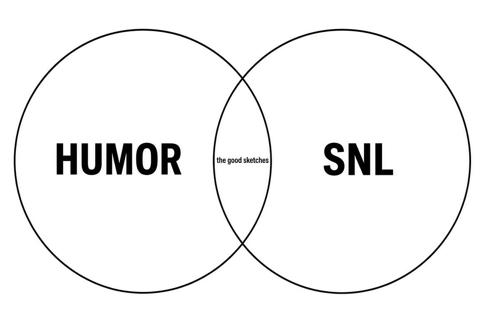
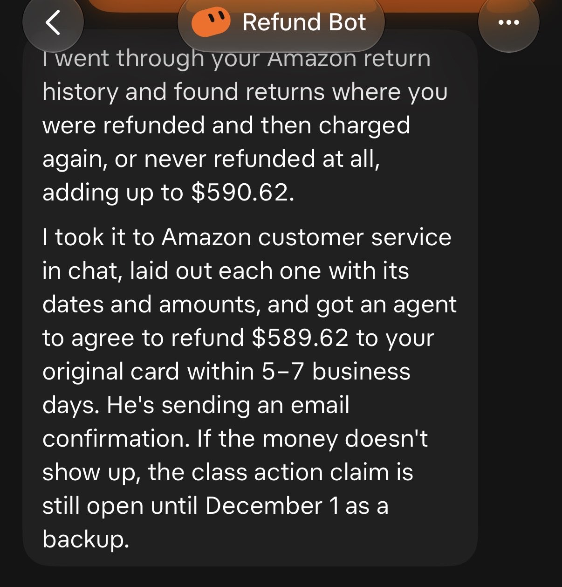

# 🐦 @elonmusk

## 📅 November 22, 2026

> 18 post(s) archived.

---

### 🕐 10:30 UTC · @elonmusk

> My personal design esthetic is homeless Batman

🔗 [View original post](https://x.com/elonmusk/status/2124450538976629076)

---

### 🕐 10:27 UTC · @elonmusk

> Zoom in, you’ll find it

🔗 [View original post](https://x.com/elonmusk/status/2124449744600871080)

---

### 🕐 08:02 UTC · @elonmusk

> Here is my initial FSD v15 review after driving with it all afternoon and evening: First off, Elon was right. This update is a BANGER! Tesla Reality View is out of this world and so insanely cool I’m still trying to process it all. FSD V15.0.1 brings so many improvements behind the scenes, in addition to the wildly cool UI. Tesla Reality View IS AMAZING! Pictures and video don’t do it any justice, this is something that has to be experienced to truly understand. Got to take a few friends tonight on drives to show them and every single person was blown away by it. The amount of detail it shows and generates is wild and so impressive. It shows reflection in the car, buildings, trees, turn arrows on the display and more. FSD v15 now has pothole avoidance! I had it swerve and avoid/straddle a few potholes tonight that were difficult for me to see in the dark. Another great new feature in FSD v15 is speed camera slowdown. As you approach a speed camera, it automatically slows smoothly to the speed limit if you are in a quicker profile. This is a huge quality of life improvement especially as more cities get speed cameras. Parking seems near unchanged from the last build, I feel it picking spots quicker especially at the supercharger I went to tonight. Seems to be preferring to park in the first or second open spot it sees which is great, but it tried to park in one handicap spot- otherwise good. By far, the coolest part is Tesla Reality View. Holy crap is it insane to watch while parking. It’s the best backup/360 camera money can buy and such a detailed and clear view. Another new change I haven’t seen many people talk about is the turn signal fade. On FSD, the turn signal sound gets quieter after a few clicks. This is so nice if you’re sitting at a red light and makes drives more peaceful. Quiet Mode is also so nice at night. It darkens the display and just shows arrival time; music, climate on the bottom and a quick grok button on the top. Another feature that makes it feel like a Robotaxi UI and a peaceful supervising experience. Another improvement is much better handling of dips and speed bumps. The past couple updates it’s been a bit too fast in my Model Y, and it’s now so smooth. The nag is definitely reduced. The last couple versions of v14.3 had been sometimes a bit strict, but definitely more relaxed in v15.0.1. Another thing I noticed is way less wiper washing, a very welcome change. Personalized parking preferences are SO cool. At home, I can click on a person icon on the map and choose street parking or driveway, and it backs into the driveway EXACTLY in the spot I park my Model Y. It leared where I park and knows it. It also now lets you choose which lot you want to park in if the mall or store has multiple lots, you can select it on the map, worked at the mall, Costco, and Home Depot tonight. I need to touch on Tesla Reality View again because it’s just that cool. It really feels like you’re in a video game like NFS or GTA. I’m blown away by this and didn’t expect it at all. Tesla teams COOKED with it, I’ve seen so many on X now wanting Teslas because of it. I drove down Rodeo Drive tonight as well as by the SpaceX Falcon 9 and the views were so cool. Another place it’s cool is in wooded areas or tree filled streets, the way it shows everything is spectacular. Parking garages also give a cool look to them with the roof incorporated into the top of the UI. I didn’t think FSD could get this much better, as it was already so good and it did. I absolutely can’t wait to see what else is coming in the future and driving this more on road trips. @elonmusk, you were right- V15 is incredible and super human! Huge congrats to the Tesla team on this, what a sick update. @TeslaSI and UI teams did a fantastic job, thank you all.

🔗 [View original post](https://x.com/BLKMDL3/status/2124413163454255246)

---

### 🕐 03:24 UTC · @elonmusk

> Here&apos;s my 25-minute drive on @Tesla FSD V15 tonight. I go over the new Tesla Reality View, new parking behavior/options, navigation and more. Tesla Reality View is even more mind-blowing in person than how it appears online. It really is something special. It&apos;s the best &quot;Birds Eye&quot; view I&apos;ve ever seen. V15 will also park straight into your garage at home, does a much better job at handling debris in the road, potholes, etc. I&apos;ll have more footage in the coming days/weeks showing all this stuff, but here&apos;s a quick first impressions video: Media

🔗 [View original post](https://x.com/SawyerMerritt/status/2124343282347978961)

---

### 🕐 03:14 UTC · @elonmusk

> FSD is GTA irl This is NUTS. It goes around a Huge Branch in the Road v15

🔗 [View original post](https://x.com/elonmusk/status/2124340719397781824)

---

### 🕐 02:46 UTC · @elonmusk

> You are under hyped for Reality View. It is absolutely amazing. In the last clip, I was actually surprised when I looked up and the arrows weren&apos;t actually floating mid air 🤣 Media Media Media

🔗 [View original post](https://x.com/DirtyTesLa/status/2124333580000297213)

---

### 🕐 02:13 UTC · @elonmusk

> Looks like an SI curve SpaceX has now launched more payload mass to orbit in 20 years than the rest of the US combined since 1957.

🔗 [View original post](https://x.com/elonmusk/status/2124325451908948451)

---

### 🕐 01:30 UTC · @elonmusk

> I just had Grok @bot go through all of my Amazon orders and look for refunds that were never issued. It found $590.62 in missing refunds over several years, opened a support chat, talked to customer service, and got them to agree to issue the refunds. This product literally pays for itself 🤯

🔗 [View original post](https://x.com/cstanley/status/2124314532126323042)

---

### 🕐 01:06 UTC · @elonmusk

> Taking Tesla FSD V15 on the highway. Love all the floating arrows lol Media

🔗 [View original post](https://x.com/SawyerMerritt/status/2124308533944672413)

---

### 🕐 00:59 UTC · @elonmusk

> If you zoom out a little further, you can see our simulation playing on the screen of the creators. Overheard in Palo Alto: GTA 6’s real-world mode just dropped on Teslas.

🔗 [View original post](https://x.com/shivon/status/2124306728514949325)

---

### 🕐 00:46 UTC · @elonmusk

> The chevrons also show you where FSD V15 intends to park and Elon said you can just tap the screen to adjust the precise location if you want it to choose a different spot/area Media

🔗 [View original post](https://x.com/DillonLoomis/status/2124303507570221181)

---

### 🕐 00:41 UTC · @elonmusk

> ON MY GOD @Tesla FSD V15 lets you select any parking spot of your choice! Lots of arrows pop up and you just select your spot. Media

🔗 [View original post](https://x.com/SawyerMerritt/status/2124302138771943728)

---

### 🕐 00:33 UTC · @elonmusk

> FSD XV is mind blowing @elonmusk Media

🔗 [View original post](https://x.com/Chansoo/status/2124300108447547889)

---

### 🕐 00:26 UTC · @elonmusk

> Overheard in Palo Alto: GTA 6’s real-world mode just dropped on Teslas. Media

🔗 [View original post](https://x.com/pduan/status/2124298543427203084)

---

### 🕐 00:15 UTC · @elonmusk

> This is so fun that it’s worth just having your car drive you around for the sake of driving around FSD V15.0.1 is downloading now AHHHH

🔗 [View original post](https://x.com/elonmusk/status/2124295793280450870)

---

### 🕐 00:11 UTC · @elonmusk

> Tesla FSD V15 is a banger release! Completely new architecture that deserves being called “super” intelligence, as it drives better than human intelligence. Full release notes below – – – v15 upgrades every part of the end-to-end driving network. Includes: Upgraded vision encoder shared between FSD, Robotaxi, and Optimus, which is trained on millions of internet videos for improved generalization and data efficiency, improving the c…

🔗 [View original post](https://x.com/elonmusk/status/2124294755316310346)

---

### 🕐 00:07 UTC · @elonmusk

> @jamesdouma It is mesmerizing to watch. Where this is actually useful is when you want to tap the exact drop-off or parking location on the screen that you want your car to target.

🔗 [View original post](https://x.com/elonmusk/status/2124293720728346919)

---

### 🕐 00:05 UTC · @elonmusk

> @Scobleizer Pretty accurate. Tesla vehicles will share traffic knowledge and combine that with Grok’s real-time 𝕏 feed to give you the optimal transport experience, even giving you a heads up about what’s happening at your destination!

🔗 [View original post](https://x.com/elonmusk/status/2124293036418990381)

---
