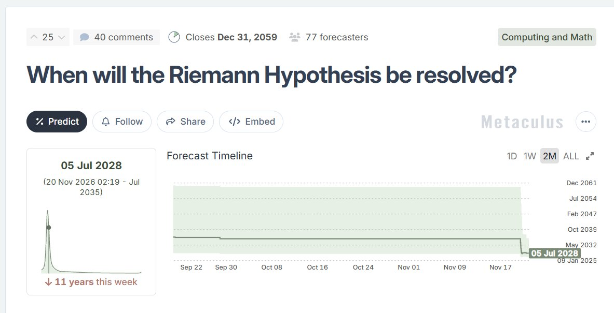

# 🐦 @emollick

## 📅 November 22, 2026

> 6 post(s) archived.

---

### 🕐 03:47 UTC · @emollick

> This is obviously not a dunk on any of these experts or forecasting groups, but it is an indicator that even the best forecasters and experts are still underestimating AI abilities.

🔗 [View original post](https://x.com/emollick/status/2124348911553061167)

---

### 🕐 03:45 UTC · @emollick

> Predictions made last MONTH (post Navier-Stokes) about when the Riemann Hypotheses would be solved: Metaculus: May 2035 LEAP Superforecasters: 10% chance of additional Millennium problem being solved in 2026. Terrance Tao: “some combination of humans and AIs in 2050 or something&quot;

🔗 [View original post](https://x.com/emollick/status/2124348445649768955)

---

### 🕐 03:26 UTC · @emollick

> As I argued in my new book, automation has a playbook and a long history, augmentation is harder to do and takes experimentation. Lets not default to the easy path.

🔗 [View original post](https://x.com/emollick/status/2124343640507977874)

---

### 🕐 03:21 UTC · @emollick

> I worry that we will retreat in the face of AI ability gains, rather than pushing to make sure human work stays centered (as long as AI stays jagged) by rethinking tasks &amp; UX. We don&apos;t want a world where the top human tasks are to &quot;greet customers&quot; &amp; &quot;keep carts clean and tidy.&quot; Top 20 tasks with highest bottleneck pressure

🔗 [View original post](https://x.com/emollick/status/2124342498625740988)

---

### 🕐 03:00 UTC · @emollick

> The weakness of the AIs in Sloan&apos;s book is particularly LLMish in a clever way that I will not spoil. But again, it is far future stuff, more Urth of the New Sun (though much more winking at contemporary life) or New Weird than contemporary hard science fiction.

🔗 [View original post](https://x.com/emollick/status/2124337191392317490)

---

### 🕐 02:52 UTC · @emollick

> I&apos;ve given my suggestions here many times,* but a new addition is Moonbound by Robin Sloan. It is weird future science fantasy, but LLM-like AIs have a central role. * Watts (worrying!), Banks, Chambers, Vinge, Douglas Adams (oddly correct about AI), Stross, Egan, etc. what is a good sci-fi book to read (or re-read) at this particular moment? Accelerando would be good if I hadn&apos;t just read it.

🔗 [View original post](https://x.com/emollick/status/2124335219499012430)

---
