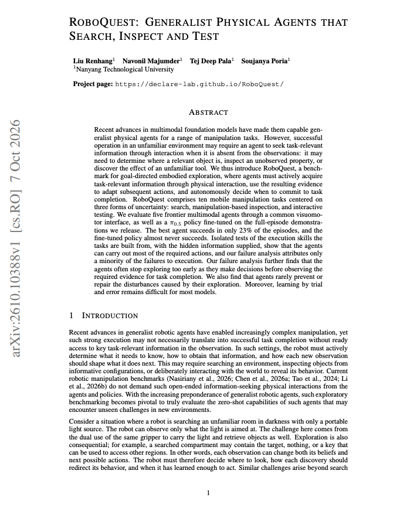

# 🐦 @omarsar0

## 📅 November 22, 2026

> 4 post(s) archived.

---

### 🕐 17:03 UTC · @omarsar0

> New benchmark to test general physical agents. RoboQuest asks robots to search, inspect, and run physical tests before acting. The strongest model solved only 23.2% of tasks, even though the same models completed the underlying motor skills 72–81% of the time in isolation. The bottleneck was evidence gathering and decision-making. Agents often saw what they needed to inspect, but stopped exploring or committed too early. Reliable physical agents need better evidence tracking, planning, and recovery. Great work from @soujanyaporia and colleagues. Paper: https://arxiv.org/abs/2610.10388

🔗 [View original post](https://x.com/omarsar0/status/2124549311174427069)

---

### 🕐 16:25 UTC · @omarsar0

> Interesting to hear top mathematicians describe these incredible AI achievements in math as &quot;just evals for AI researchers&quot;. There are many takeaways, but the one I stick with is the importance of ambitious evals in pushing what&apos;s possible in verifiable domains (to advance understanding) and, more importantly, in open-ended domains (to advance real-world applicability). I also hear their concern that AI-driven solutions to these math problems aren&apos;t leading to much new human understanding of the field. That&apos;s an important discussion to have as we figure out how to move forward in the new era of accelerated discoveries. The evolved role of the practitioner or scientist is something we are all trying to figure out. As a professional in both, I constantly build for and with AI agents. I spend a lot of time augmenting my knowledge and toolbox with AI and developing a ton of evals to improve AI-powered systems for all kinds of work. This is helping me understand the world around me (economy, physics, health, people, networks, etc.) and prepare better for this new era of intelligent computer systems. Like Terence Tao, I believe in the Copernican view of intelligence: a richer, broader view that advocates for different forms of intelligence to coexist. Although not positioned this way (unfortunately), I believe the researchers making these breakthroughs in math with AI are the first signs of that. The quicker we can adapt, the more problems we can attempt to solve—hopefully with a sharper focus on real-world problems affecting the world today. Just thinking out loud about the current state of things, and hopefully offering words of encouragement to the younger practitioners and scientists who may feel lost about all that&apos;s happening today.

🔗 [View original post](https://x.com/omarsar0/status/2124539875827314801)

---

### 🕐 14:29 UTC · @omarsar0

> https://x.com/i/article/2124509643820994561

🔗 [View original post](https://x.com/dair_ai/status/2124510548070895895)

---

### 🕐 14:12 UTC · @omarsar0

> Recommended read. It&apos;s a great recap of the key primitives of strong agent platforms. One important point to highlight is support for a variety of agent configurations, as well as separating agents from instances and sessions. In an RSI world, things need to be malleable. From agents to tools to apps and beyond. Build for a malleable agentic future. Great tools mentioned, like Pi Durable, Eve, and Grok Bot. I would add other notable ones like DeepSeek Harness for personalized harnesses and Exo for RSI primitives. I would also add memory and knowledge, which are key to the so-called &quot;knowledge factory.&quot; I would need like to suggest adding an eval layer of sorts to the list. Evals aren&apos;t just something ML researchers use; they&apos;re what will allow you to grow and optimize your agentic software and platforms. You can&apos;t optimize what you can&apos;t measure. Lastly, there are many other primitives yet to be built (dynamic interfaces, agent swarms, etc.), so build with that in mind. Agent platform of 2027. This is the end game. This is the blueprint for the one and only application layer software that will exist. Every other software will effectively become databases for this layer, the everything agentic operating system for the million agent swarm to work…

🔗 [View original post](https://x.com/omarsar0/status/2124506354324840953)

---
