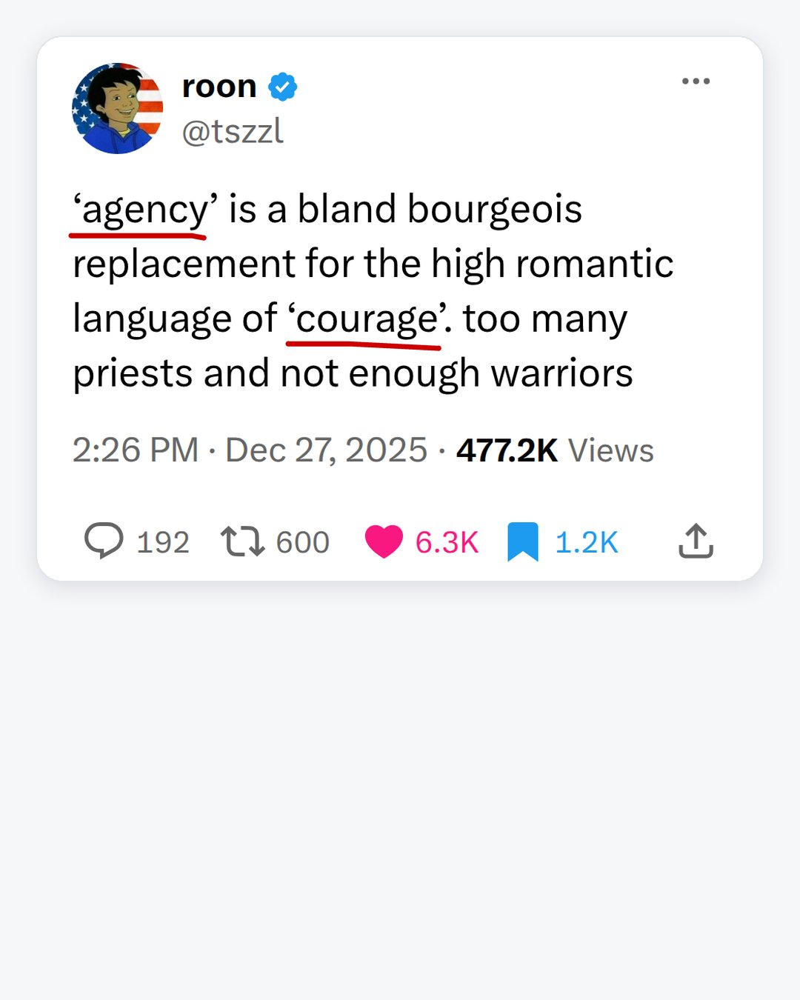

# 🐦 @swyx

## 📅 November 22, 2026

> 5 post(s) archived.

---

### 🕐 19:46 UTC · @swyx

> by this metric we have seen more ai progress this year than in 2022-2025. is that true? doesn’t suuuper feel like it but who knows we could be cooked by algorithm and/or metric only translates at frontier math level

🔗 [View original post](https://x.com/swyx/status/2124590240539259381)

---

### 🕐 19:19 UTC · @swyx

> OpenAI proposes perplexity as the universal metric for industry self regulation and pacing (as opposed to eg FLOPS) “Given that the main way new surprising capabilities emerge is by progress on compression, a measure rooted in perplexity could give us a shared benchmark for general intelligence, regardless of the degree of automation of the development process. Extrapolating from recent progress, we should expect further transformative capabilities as we enter the ~0.68-0.7 log-perplexity window.” this chart is one of the most beautiful ways to tell the story of the last 4 years. it also shows that a lot of the post training issues we debate is kinda the B plot to the overall A plot of large scale pretrain progress. We decided to provide more transparency into pretraining progress at OpenAI for the sake of moving toward shared safety bars. In “Perplexity and Intelligence” I argue for common limits based on perplexity and other measurements, with progress beyond them gated on our ability to …

🔗 [View original post](https://x.com/swyx/status/2124583459356373052)

---

### 🕐 18:58 UTC · @swyx

> I call this the &quot;courage carousel&quot;

🔗 [View original post](https://x.com/chrislakin/status/2124578257748300122)

---

### 🕐 06:37 UTC · @swyx

> something broke in the last. month or so and codex is unable to clear its own worktree hell despite me asking nicely. giving up

🔗 [View original post](https://x.com/swyx/status/2124391769798533160)

---

### 🕐 00:00 UTC · @swyx

> Your agent runs for 10 hours. Your team deploys every two minutes. @FabianHedin on how @Lovable separates task history from running processes so agents can keep working through deployments. From AI Engineer Code Summit. Media

🔗 [View original post](https://x.com/aiDotEngineer/status/2124291774671880239)

---
