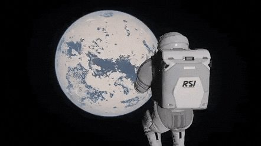

# 🐦 @tunguz

## 📅 November 22, 2026

> 16 post(s) archived.

---

### 🕐 23:57 UTC · @tunguz

> One of my favorite things about the advent of superhuman AI coding tools is that we can *finally* stop dealing with the f***ing Docker containers.

🔗 [View original post](https://x.com/tunguz/status/2124653505205948817)

---

### 🕐 23:25 UTC · @tunguz

> 1. *really* good kernels and machine code is actually pretty hard to do at the highest level for the current generation of AI tools. I should know, I’ve spent last few months doing it for Apple silicon. 2. CUDA is not even in the top five of NVIDIA’s moats and hasn’t been for years. It feels like agent swarms have essentially filled the CUDA moat. 1. Fewer model types + agents make it easier to build optimized kernels 2. There is a trend for agents to write machine code directly, skipping CUDA altogether. NVIDIA has other moats, but none is this deep.

🔗 [View original post](https://x.com/tunguz/status/2124645397251428853)

---

### 🕐 23:22 UTC · @tunguz

> part of your job as a swe now is to scroll twitter

🔗 [View original post](https://x.com/tunguz/status/2124644612430299374)

---

### 🕐 19:20 UTC · @tunguz

> So now we know that it&apos;s possible to be a superior mathematician without being conscious. There are many other professions that we&apos;ll soon also find out that are in the same category.

🔗 [View original post](https://x.com/tunguz/status/2124583738596102242)

---

### 🕐 19:18 UTC · @tunguz

> Yeah ... If you ever want to see how far we still need to go with these models just start a sufficiently complex project. The ratio of dazzling to frustration quickly inverts 😩😫😖

🔗 [View original post](https://x.com/tunguz/status/2124583207148380520)

---

### 🕐 19:15 UTC · @tunguz

> Soon ... Jensen Huang after being named NVIDIA’s new CEO

🔗 [View original post](https://x.com/tunguz/status/2124582645300670916)

---

### 🕐 19:05 UTC · @tunguz

> No distillation is illegal on stolen data.

🔗 [View original post](https://x.com/tunguz/status/2124579973625233549)

---

### 🕐 19:01 UTC · @tunguz

> This would go so hard! Some will say this is AI, but it isn’t.

🔗 [View original post](https://x.com/tunguz/status/2124578984054952203)

---

### 🕐 14:31 UTC · @tunguz

> Biology and all of complex many-body problems are NP. We&apos;ll only get &quot;Lean for biology&quot; if P=NP. Only if we had Lean for biology

🔗 [View original post](https://x.com/tunguz/status/2124511008118968340)

---

### 🕐 13:50 UTC · @tunguz

> We now know that in the age of AI meteoric fall can happen to anyone at any time with no advance notice. But so can meteoric rise. The unhingiest of times.

🔗 [View original post](https://x.com/tunguz/status/2124500894427316487)

---

### 🕐 13:47 UTC · @tunguz

> 70 days to flatten the curve. BREAKING: Math projected to be solved in under 70 days at current pace.

🔗 [View original post](https://x.com/tunguz/status/2124499998440038482)

---

### 🕐 13:36 UTC · @tunguz

> mlx-geospatial 0.1.2 is out! Huge improvements on select algorithms on Apple Silicon. Go check it out: pip install -U mlx-geospatial 2,284× on M4 Max. 1,256× on M1 Ultra. mlx-geospatial v0.1.2 is out. Those peak ratios compare DuckDB counts on registered inputs with MLX pair arrays from a warm index. Synthetic workloads, minimum wall times, and exact_boundary=False for MLX. 1/4

🔗 [View original post](https://x.com/tunguz/status/2124497197064741069)

---

### 🕐 12:28 UTC · @tunguz

> It&apos;s indeed a great model for math research. It got me &quot;unstuck&quot; on several problems that were hitherto untraceable with all the other models that had worked on them. Alright I’m getting tired of the 6.2 hate Here’s my take: 1. It is a very very smart model 2. It is a “trees” model in that it prefers detail and obsessive proof of everything 3. Makes sense! This is the Navier-Stokes model 4. It is hella token efficient and that matters for us …

🔗 [View original post](https://x.com/tunguz/status/2124480033058099337)

---

### 🕐 11:44 UTC · @tunguz

> It’s actually impressive how far you can get with just elementary math and oodles of compute. In my understanding, the Alpöge/Claude proof of the Riemann Hypothesis seems to be winding its way through a vast set of known methods and tricks. In a sense it is an &quot;elementary&quot; proof in that it does not use any new fancy concepts to succeed. https://en.wikipedia.org/wiki/Elem…

🔗 [View original post](https://x.com/tunguz/status/2124468951946019090)

---

### 🕐 11:29 UTC · @tunguz

> Antigravity is way way way behind Codex and CC desktop. It has very poor &quot;communication skills&quot; let&apos;s put it mildly. I still use it, but it could never be my primary daily driver. everyone who is praising Gemini 4 Neon: are you all actually using Antigravity for it?

🔗 [View original post](https://x.com/tunguz/status/2124465353803862066)

---

### 🕐 00:31 UTC · @tunguz

> Prognostication is hard, even for the top experts in their corresponding fields. Demis Hassabis in april: It would take AI 2 years to solve the riemann hypothesis or another millennium prize problem. Terence Tao in october: current AI isn&apos;t enough to solve the riemann hypothesis, so maybe humans and AI together could make progress by 2050. now we have soluti…

🔗 [View original post](https://x.com/tunguz/status/2124299675155202489)

---
