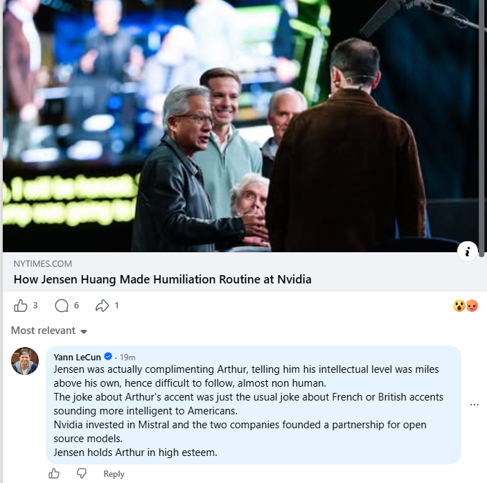

# 🐦 @ylecun

## 📅 November 22, 2026

> 3 post(s) archived.

---

### 🕐 17:06 UTC · @ylecun

> Dario&apos;s spiel since GPT-2 has always been about hyping the dangers so that open models would be made illegal and *he* would stay in control. He left OpenAI because he wasn&apos;t going to have control. It&apos;s like the Ottoman Empire banning the printing press for Arabic so they would keep in control of the dogma. It stops the population from freely accessing diverse knowledge. It&apos;s a new form of medieval obscurantism.

🔗 [View original post](https://x.com/ylecun/status/2124550037912920090)

---

### 🕐 07:57 UTC · @ylecun

> Dario Amodei 在国会听证会上把话挑明了： 开源 AI 再这么走下去，会走向极其危险的境地。 他的逻辑很赤裸： 模型握在自己手里，你能监控谁在用、能随时拔掉某个用户的网线，还能随时给模型划定红线。 但一旦开源放出去，这些“刹车片”就全废了： 模型彻底脱手，你再也收不回来。 于是他直接把球踢给了开源阵营：别回避，你们自己想办法兜底。 这番话最狠的地方在于，他几乎不装了： 顶级智能，不该交到所有人手里。 开源和闭源的根本分歧，从来不是技术路线，而是控制权。 一边想死死握住随时叫停的开关，另一边则认为，放出去的火种就不该再由任何人收回。 看到这你就懂了，为什么两派如今势同水火： 这从来不是一场技术辩论，而是一场权力分配。 https://x.com/vikktorrrre/status/2122353364306374986/video/1 Media

🔗 [View original post](https://x.com/huxlab/status/2124411922959548795)

---

### 🕐 05:26 UTC · @ylecun

> Yann Lecun correcting the record on Jensen Huang.

🔗 [View original post](https://x.com/AlexTensor/status/2124373947864989881)

---
