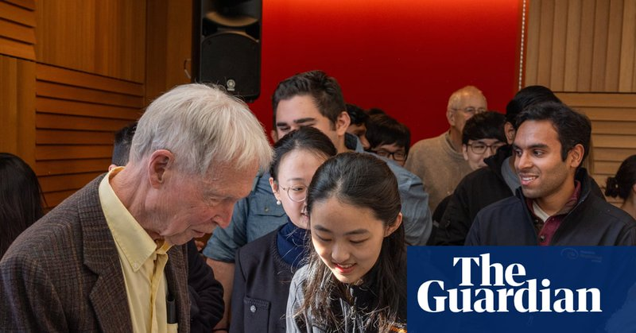
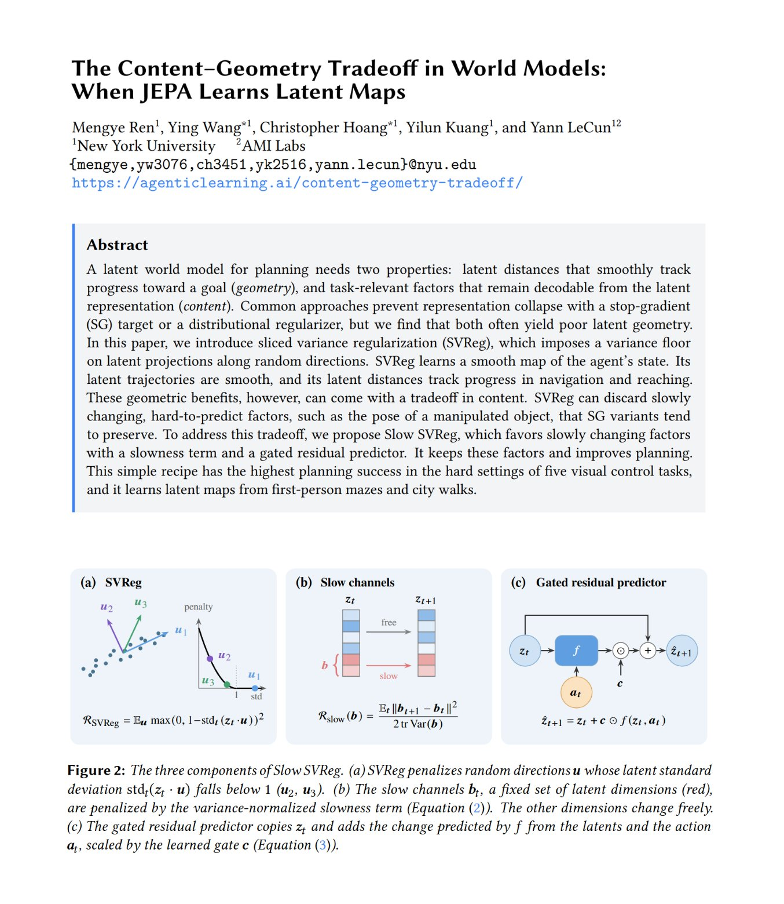

# 🐦 @ylecun

## 📅 November 22, 2026

> 7 post(s) archived.

---

### 🕐 20:45 UTC · @ylecun

> TIL: We have superintelligence but we still don&apos;t have level-5 autonomous driving. A task that most 17 year olds can learn in 20 hours of practice. And we have (you have) billions of hours of training data. We don&apos;t have robots that can come close to doing what an 8 year old can do with no prior training. And let&apos;s not talk about cats. That&apos;s a rather strange kind of superintelligence.

🔗 [View original post](https://x.com/ylecun/status/2124605292402946483)

---

### 🕐 17:06 UTC · @ylecun

> Dario&apos;s spiel since GPT-2 has always been about hyping the dangers so that open models would be made illegal and *he* would stay in control. He left OpenAI because he wasn&apos;t going to have control. It&apos;s like the Ottoman Empire banning the printing press for Arabic so they would keep in control of the dogma. It stops the population from freely accessing diverse knowledge. It&apos;s a new form of medieval obscurantism.

🔗 [View original post](https://x.com/ylecun/status/2124550037912920090)

---

### 🕐 11:39 UTC · @ylecun

> Trump&apos;s disdain for Europe -- too democratic, too liberal, too many immigrants -- shows in his willingness to cut a deal with Putin that would weaken Europe&apos;s defense against a dictatorial, imperialist Russia. https://trib.al/QhW7bb0

🔗 [View original post](https://x.com/KenRoth/status/2124467739653714100)

---

### 🕐 07:57 UTC · @ylecun

> Dario Amodei 在国会听证会上把话挑明了： 开源 AI 再这么走下去，会走向极其危险的境地。 他的逻辑很赤裸： 模型握在自己手里，你能监控谁在用、能随时拔掉某个用户的网线，还能随时给模型划定红线。 但一旦开源放出去，这些“刹车片”就全废了： 模型彻底脱手，你再也收不回来。 于是他直接把球踢给了开源阵营：别回避，你们自己想办法兜底。 这番话最狠的地方在于，他几乎不装了： 顶级智能，不该交到所有人手里。 开源和闭源的根本分歧，从来不是技术路线，而是控制权。 一边想死死握住随时叫停的开关，另一边则认为，放出去的火种就不该再由任何人收回。 看到这你就懂了，为什么两派如今势同水火： 这从来不是一场技术辩论，而是一场权力分配。 https://x.com/vikktorrrre/status/2122353364306374986/video/1 Media

🔗 [View original post](https://x.com/huxlab/status/2124411922959548795)

---

### 🕐 05:26 UTC · @ylecun

> Yann Lecun correcting the record on Jensen Huang.

🔗 [View original post](https://x.com/AlexTensor/status/2124373947864989881)

---

### 🕐 03:00 UTC · @ylecun

> Trump&apos;s ICE detains a Princeton doctoral student. She had just attended a neuroscience conference in Washington DC when ICE detained her. Why? Because she had moved to the US from China? https://trib.al/RI5bD46

🔗 [View original post](https://x.com/KenRoth/status/2124337238603432207)

---

### 🕐 00:47 UTC · @ylecun

> Can a JEPA learn a map of the world in its &quot;head&quot;? This new paper by @ylecun, @mengyer, @yingwww_, @choang333, and @KuangYilun says yes, but only if you change how JEPA avoids collapse. What&apos;s interesting – the researchers firstly proposed a fix, called SVReg, but then discovered its content–geometry tradeoff and upgraded the solution. Here are the details: A planner in latent space needs two things: - Paths have to be smooth, so distance tells you if you&apos;re getting closer. That&apos;s geometry. - And the cube you&apos;re trying to move has to still be on the map. That&apos;s content. Typical stop-gradient and SIGReg often give you one and lose the other. SVReg stops the model from giving every frame the same code. It checks the spread along random directions and only steps in when it gets too small. Without stop-gradient, the model can also change what it encodes, dropping details it can’t reliably predict. But the title itself says that there is &quot;content–geometry tradeoff&quot;. The same predictability pressure erases things that change slowly and are hard to predict, like a block that sits still until the agent pushes it. So they built Slow SVReg, with 2 additions: 1. Slow channels: A few fixed dimensions get penalized if they change too fast between frames (an idea borrowed from slow feature analysis). 2. Gated residual predictor: Predicts the next state as current + gate × change (with the gate starting at 0.1), so unchanging features cost nothing to predict. The results: • 1P Medium maze: 92.9% success (vs. 21.2% stop-gradient) with way smoother paths (1.20 vs. 5.31 jaggedness). • PushT: 87.3% success (vs. 44.0% stop-gradient). • Efficiency: Nearly maxes out hard U-maze goals using just 20% of the data. And the most interesting part is city walks. Trained only on first-person frames and actions from 3D city blocks (no pose data), Slow SVReg pinpoints the agent within 1.6 meters (beating stop-gradient&apos;s 3.4 m and an untrained encoder&apos;s 25.9 m). The street layout pops right out in the plain principal components. So the JEPA line keeps circling the same question – what makes a latent good enough to plan in? LeJEPA made anti-collapse provable, LeHami added physics as a constraint. This paper shows the anti-collapse choice itself decides whether you get a map or a cloud of points.

🔗 [View original post](https://x.com/TheTuringPost/status/2124303722671153346)

---
