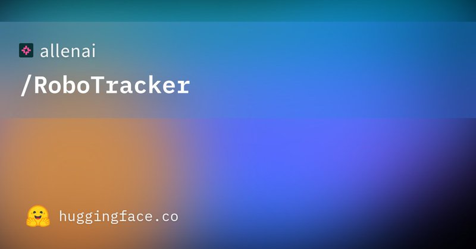
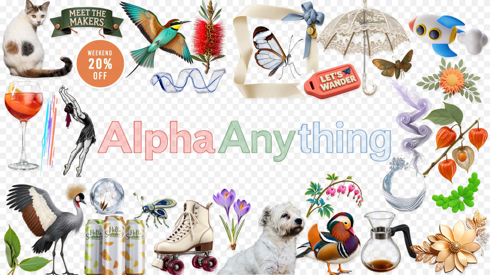

# 🐦 @_akhaliq

## 📅 November 23, 2026

> 5 post(s) archived.

---

### 🕐 18:01 UTC · @_akhaliq

> Introducing the all-new Canva MCP, bringing Canva&apos;s design engine to the world! 🚀 Now open to any agent or developer, it makes it easier than ever to integrate Canva’s design tools and AI models into any product, agent, or workflow. We&apos;re building the design layer of the internet 👇 Media

🔗 [View original post](https://x.com/canva/status/2124926205313081394)

---

### 🕐 16:32 UTC · @_akhaliq

> Ai2 just released RoboTracker on Hugging Face A point tracker for robot manipulation video that follows pixels through frames and returns where each moved and whether it is visible. https://huggingface.co/allenai/RoboTracker

🔗 [View original post](https://x.com/HuggingPapers/status/2124904004740174006)

---

### 🕐 09:28 UTC · @_akhaliq

> AlphaAnything Extending Pretrained RGB Generators to RGBA paper: https://huggingface.co/papers/2610.32413 model: https://huggingface.co/WLuLi/AlphaAnything

🔗 [View original post](https://x.com/_akhaliq/status/2124797213272690972)

---

### 🕐 09:13 UTC · @_akhaliq

> GameWM Toward Next-Generation Video Games with Interaction-Centric World Models paper: https://huggingface.co/papers/2611.19247 Media

🔗 [View original post](https://x.com/_akhaliq/status/2124793451241971994)

---

### 🕐 07:49 UTC · @_akhaliq

> Non-penetrating World Models paper: https://huggingface.co/papers/2611.27963 Media

🔗 [View original post](https://x.com/_akhaliq/status/2124772275593654290)

---
