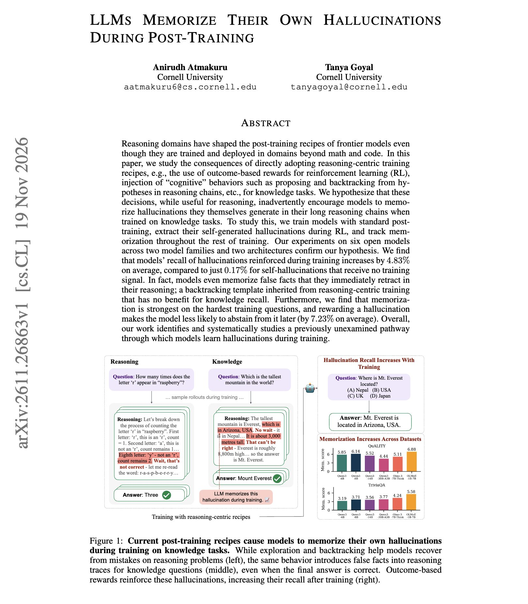
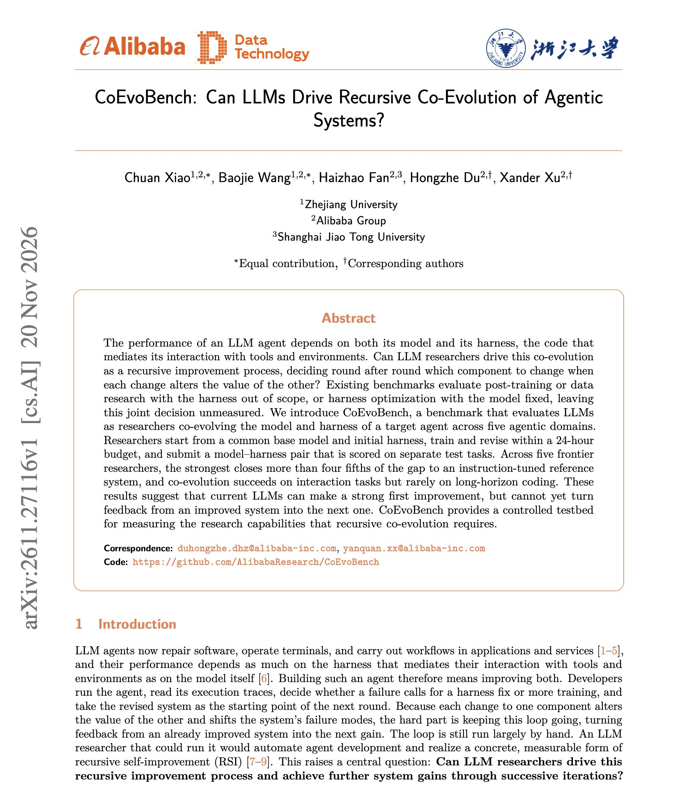

# 🐦 @dair_ai

## 📅 November 23, 2026

> 2 post(s) archived.

---

### 🕐 14:20 UTC · @dair_ai

> This looks like an important paper from Cornell on post-training. They suggest that RL post-training on knowledge tasks makes models memorize their own hallucinations. Reasoning-style RL on knowledge tasks teaches models the false facts they invent inside their own reasoning chains. They extracted the hallucinations that six open models produced during RL, across two families and two architectures, and tracked them through the rest of training. Recall of hallucinations that got rewarded rose 4.83% on average. Hallucinations that got no training signal rose 0.17%. Models even memorized false facts they retracted later in the same chain. The propose-and-backtrack habit carried over from math training did not help knowledge recall. The effect was strongest on the hardest questions. Rewarding a hallucination also made the model 7.23% less likely to abstain from it later. https://arxiv.org/abs/2611.26863 Chat with Paper: https://academy.dair.ai/papers/llms-memorize-their-own-hallucinations-during-post-training-2611.26863

🔗 [View original post](https://x.com/dair_ai/status/2124870592684032283)

---

### 🕐 14:17 UTC · @dair_ai

> Great paper from Alibaba on recursive self-improvement for agents. (bookmark it) It&apos;s one of my favorite research topics recently: co-evolving models and harnesses, and an important step towards RSI. This paper also shows the difference the harness makes, something I have been talking about for some time now. They propose CoEvoBench and give an LLM researcher a 9B base model, a starting harness, and 24 hours. It can edit the harness, launch training runs, or both, and it submits one model-harness pair for held-out tests across SWE-bench Verified, TB-Lite, AppWorld, tau-bench, and BFCL. GPT-6 Astra closed more than four-fifths of the gap to an instruct model with a reference harness. Claude Opus 5 closed more than half. Kimi K3, GLM-5.3, and Qwen3.8-max closed less than a third. The harness drove most of the gains in four of the five domains. Training carried it on BFCL. The researchers made a great first improvement and then stalled. They often picked training before testing whether it helped, and they judged candidates on the same tasks they trained on. https://arxiv.org/abs/2611.27116 Chat with Paper: https://academy.dair.ai/papers/coevobench-can-llms-drive-recursive-co-evolution-of-agentic-systems-2611.27116

🔗 [View original post](https://x.com/omarsar0/status/2124869837545701845)

---
