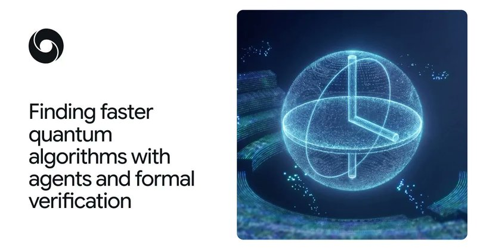

# 🐦 @demishassabis

## 📅 November 23, 2026

> 2 post(s) archived.

---

### 🕐 17:14 UTC · @demishassabis

> Gemini-powered agents are accelerating discoveries across our @GoogleDeepMind Science missions. Today, our team is sharing how this paradigm is able to increase the efficiency of quantum circuits, bringing forward the implementation of these algorithms on quantum hardware. 💻 Our agents found new algorithms that cut estimated compute costs by 10.9x for a fusion simulation, 8.1x for photochemistry, and 2.5x for simulating a molecule involved in drug metabolism. Similar to our recent software verification breakthrough with AlphaProof, each quantum circuit result is mathematically proved in Lean . This agentic-powered method compresses work that once took years, and empowers researchers to focus on defining problems and interpreting results. There is certainly more work to do — practical quantum simulations will require more powerful hardware than first-generation error-corrected machines — but these efficiency gains are promising. Congrats to @benjaderberg, Johannes Bausch, @SergeyShir994 and the broader @GoogleDeepMind and @GoogleQuantumAI teams who collaborated on this project. Read our blog for more details and a link to our technical paper: https://deepmind.google/blog/finding-faster-quantum-algorithms-with-agents-and-formal-verification/

🔗 [View original post](https://x.com/pushmeet/status/2124914424326525182)

---

### 🕐 03:54 UTC · @demishassabis

> Gemini 4 Neon is amazing!

🔗 [View original post](https://x.com/TimSweeneyEpic/status/2124713272309924144)

---
