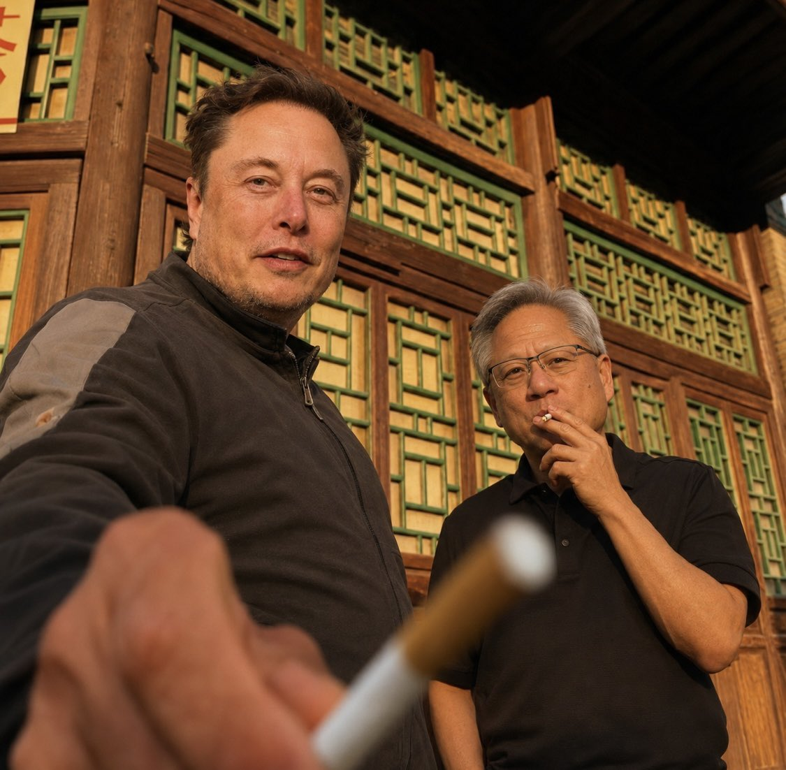

# 🐦 @elonmusk

## 📅 November 23, 2026

> 26 post(s) archived.

---

### 🕐 21:57 UTC · @elonmusk

> My favorite product we’ve ever made. The dream from V1 was a Starlink smaller and thinner than a tablet that works for hours and delivers incredible performance. So proud of the team that made it real. Getting online with Mini 2 is simple. Press the button and you&apos;re connected in 60 seconds, with a rechargeable battery that lasts up to 4.5 hours, or plug in with USB-C. Preorders are open by invitation in the US. Get notified when it&apos;s available → https://starlink.com/mini-2

🔗 [View original post](https://x.com/johnfederspiel/status/2124985724210712664)

---

### 🕐 20:56 UTC · @elonmusk

> Getting online with Mini 2 is simple. Press the button and you&apos;re connected in 60 seconds, with a rechargeable battery that lasts up to 4.5 hours, or plug in with USB-C. Preorders are open by invitation in the US. Get notified when it&apos;s available → https://starlink.com/mini-2 Media

🔗 [View original post](https://x.com/Starlink/status/2124970272327602448)

---

### 🕐 19:17 UTC · @elonmusk

> Welcome to the PvP of social media.

🔗 [View original post](https://x.com/cb_doge/status/2124945497152794908)

---

### 🕐 19:13 UTC · @elonmusk

> Beautiful shot by Andrew McCarthy I still can’t believe this is a real video I captured

🔗 [View original post](https://x.com/elonmusk/status/2124944467119747335)

---

### 🕐 19:07 UTC · @elonmusk

> Everyone I know at Nvidia wanted Jensen back and it shows Scenes from Nvidia headquarters as Jensen comes back. The Nvidia employees wanted him back more than anything. Grateful to the President, everyone in the administration, everyone who signed the petition, everyone who supported Jensen publicly, everyone who called the board, ever…

🔗 [View original post](https://x.com/elonmusk/status/2124942828274925651)

---

### 🕐 18:33 UTC · @elonmusk

> It&apos;s my X birthday, been here now 20 years. X is best for AI. And AI&apos;s best here on X is here. Very awesome to watch on high-news days, like today. Or, even better, have your GrokBot watch it, along with any of my other 65 lists (most complete here on X of AI, tech, news): https://x.com/i/lists/1953536336675365173?s=20 My GrokBot watches them all here (updates every three hours): https://news-pulse-docs-4g7j.pages.grok.bot/ All my lists: https://x.com/scobleizer/lists (I&apos;ve put thousands of hours into building them over the past 20 years). And that is used to build the AI news site at https://alignednews.com 70,000 people in AI alone, and tens of thousands of others. 10,100 AI companies. All the world&apos;s news too. When @biz and @ev started Twitter, I was the first to get to 1,000 followers back 20 years ago and @biz says I&apos;m the first influencer. Every once in a while I look at the other social networks and there&apos;s no way I could do this anywhere else.

🔗 [View original post](https://x.com/Scobleizer/status/2124934262915055677)

---

### 🕐 17:30 UTC · @elonmusk

> True The first room at the front door was Elon‘s. There was a mattress on the floor. When the young people arrived and were dancing upstairs, I thought the floor was going to collapse so I moved the mattress to the wall. I assumed just the middle would collapse. I put the door money …

🔗 [View original post](https://x.com/elonmusk/status/2124918561617694750)

---

### 🕐 17:28 UTC · @elonmusk

> Those who violate the law on this platform WILL be prosecuted, WHEREVER they may be in the world. This month, as part of its Cyber-Enabled Scam Initiative, the @DojCrimDiv opened an investigation into individuals suspected of utilizing stolen third-party payment credentials on @XMoney. We are dedicated to providing maximum cooperation to the @TheJusticeDept to bring swift ac…

🔗 [View original post](https://x.com/elonmusk/status/2124917923391443211)

---

### 🕐 16:42 UTC · @elonmusk

> BREAKING: President Trump says he spoke with Elon Musk about Jensen Huang before his return as NVIDIA CEO, revealing Elon’s support for Jensen. “I spoke to him over the last week or so about it, and all he said is, Jensen’s a smart guy. Elon respects Jensen a lot. He respects him a lot.” Media

🔗 [View original post](https://x.com/cb_doge/status/2124906448476094686)

---

### 🕐 16:14 UTC · @elonmusk

> BREAKING: Aer Lingus Chief Customer Officer Susanne Carberry praises @Starlink as the airline expands free Starlink Wi-Fi to European flights following a “fantastic” customer response on North American routes. “The response from our customers to Starlink Wi-Fi travelling to our North American destinations has been fantastic, so we’re delighted to start bringing that same experience to customers flying with us across Europe. “Our customers expect to be able to stay connected wherever they are, and that doesn’t stop when they step onboard an aircraft. “Bringing Starlink to our European fleet is about responding to that demand and giving customers the fast, reliable connectivity they increasingly expect when they travel. “Whether it’s keeping the kids entertained, catching up on work or getting a head start on the holiday, we want our customers to have more choice in how they spend their time with us.” — Susanne Carberry, Chief Customer Officer at Aer Lingus

🔗 [View original post](https://x.com/cb_doge/status/2124899403857318119)

---

### 🕐 16:08 UTC · @elonmusk

> BREAKING: Aer Lingus launches FREE Starlink Wi-Fi on European flights, with 29 short-haul aircraft to be connected in early 2027. • The expansion follows a “fantastic” response from passengers on its North American routes. • Spain, Portugal and Morocco are among the destinations planned for the rollout. • Passengers connected to Starlink on Aer Lingus’s A330 fleet used an average of 1.8 GB per device in October.

🔗 [View original post](https://x.com/cb_doge/status/2124897838656262339)

---

### 🕐 15:47 UTC · @elonmusk

> My composite image I created from this event was made into a limited number of gorgeous fine art prints. I still have some available, but they come off my shop tonight. Get a print as a memento of this incredible event: https://cosmicbackground.io/pages/dreams-of-martian-skies?utm_campaign=dreams-of-martian-skies&amp;utm_source=x-post-reply-under-video&amp;utm_medium=custom&amp;utm_content=custom-x-post-reply-under-video-0fda

🔗 [View original post](https://x.com/AJamesMcCarthy/status/2124892596749378029)

---

### 🕐 15:40 UTC · @elonmusk

> @stablequan We don’t dumb down our engineering meeting with Elon.

🔗 [View original post](https://x.com/yunta_tsai/status/2124890893975204334)

---

### 🕐 15:25 UTC · @elonmusk

> .@POTUS: &quot;It&apos;s very exciting news... We have to protect our geniuses — and he&apos;s a great genius.&quot; Media

🔗 [View original post](https://x.com/RapidResponse47/status/2124887036494839905)

---

### 🕐 14:48 UTC · @elonmusk

> Jensen Huang says he loves working with Elon Musk And he explains why. Musk uses Nvidia&apos;s technology three ways at once. Training his own AI models. Deploying them, like Grok, where demand is skyrocketing. And renting it out. Very few companies do all three. Musk also loves the place where computing meets the physical build-out. Jensen: &quot;Nobody knows more about energy than he does.&quot; So they went after a new market together. Data centers in space. Their two engineering teams were working super closely to create a new type of server. A new architecture that might work great in space, and on Earth. https://x.com/firesidealpha/status/2110731226776789366/video/1 Media

🔗 [View original post](https://x.com/NarutoNolimits/status/2124877757817704933)

---

### 🕐 14:46 UTC · @elonmusk

> Grok Bot can find you Black Friday deals I created a Grok Bot template called “DEAL HUNTER” for BLACK FRIDAY! It checks the internet for the best deals, every couple of hours, and notifies you when it finds something! It takes a couple of seconds to set it up. Add it from here: https://grok-bot.directory/bots/deal-hunt…

🔗 [View original post](https://x.com/elonmusk/status/2124877252412281142)

---

### 🕐 14:41 UTC · @elonmusk

> The mistake has been corrected NVIDIA Board reinstates Jensen Huang as President, CEO and Board Director. Read the release: https://nvidianews.nvidia.com/news/nvidia-board-reinstates-jensen-huang-as-president-ceo-and-board-director

🔗 [View original post](https://x.com/elonmusk/status/2124875939133751684)

---

### 🕐 14:29 UTC · @elonmusk

🔗 [View original post](https://x.com/willdepue/status/2124872898964050032)

---

### 🕐 14:28 UTC · @elonmusk

> It is done

🔗 [View original post](https://x.com/elonmusk/status/2124872664938602736)

---

### 🕐 14:27 UTC · @elonmusk

> “The NVIDIA Board of Directors has made the correct and proper decision to return Jensen Huang to the position of CEO… Congratulations to Jensen, the NVIDIA Board, to the People of the United States — and, indeed, the World!” - President DONALD J. TRUMP

🔗 [View original post](https://x.com/WhiteHouse/status/2124872428723552741)

---

### 🕐 14:06 UTC · @elonmusk

> Every person I’ve encountered at SpaceX, X, and xAI has cared deeply about products that are safe for users, protect children, and ultimately improve the human experience. Many are parents dedicating their lives to unlocking the next frontier via superintelligence, understanding the need to get it right and keep everyone safe. These are the people whom I trust to get it right, because they feel an immense responsibility to build not just for you, but for their own children and families. Protecting children is non-negotiable. Sexual content involving minors, whether real or AI-generated, is abhorrent. It has no place on X or in Grok, and neither do explicit images of real people made without their consent. The people who tried to use Grok Imagine to generate thi…

🔗 [View original post](https://x.com/KatieMiller/status/2124867132554875384)

---

### 🕐 13:41 UTC · @elonmusk

> Gemini 4 Neon is indeed crazy good. Cut Omarchy boot time in half!! Big optimizations on install as well. It&apos;s a quiet cat, though. Just goes off with very little output while it&apos;s working, and then, BAM, here&apos;s everything and it&apos;s perfect. Love it.

🔗 [View original post](https://x.com/dhh/status/2124860839572488538)

---

### 🕐 12:59 UTC · @elonmusk

> .@SpaceXSI has always prohibited this conduct, have taken extensive measures to prevent it, and haven&apos;t had any users evade those protections in a very long time. This is another example of Democrats singling out @elonmusk for political reasons rather than tackling big, ongoing societal problems in tech. Virginia, Oregon sue Musk’s AI company over sexual deepfakes https://politi.co/48CqKPT

🔗 [View original post](https://x.com/KatieMiller/status/2124850376188874863)

---

### 🕐 04:18 UTC · @elonmusk

> This is literally my new workflow now: Realtime Research → Grok Bot Planning &amp; Orchestration → Grok Bot Day-to-day Coding/Debug → Opus 5.5 Write &amp; Run Tests → Sonnet 5.5 Complex Coding/Debug → Fable 5.2 Frontend → Fable 5.2 Bookmark this.

🔗 [View original post](https://x.com/minchoi/status/2124719179022426450)

---

### 🕐 01:20 UTC · @elonmusk

> 😂 The funniest chart ever. 😂 $TSLA

🔗 [View original post](https://x.com/elonmusk/status/2124674295246811586)

---

### 🕐 00:06 UTC · @elonmusk

> The rate of change of technology is so quick these days that being on X very quickly compounds to a huge amount of alpha. Talking to people who aren’t feels like stepping in a time machine into the distant past. X is truly the town square for discussing technological progress.

🔗 [View original post](https://x.com/deedydas/status/2124655797879894316)

---
