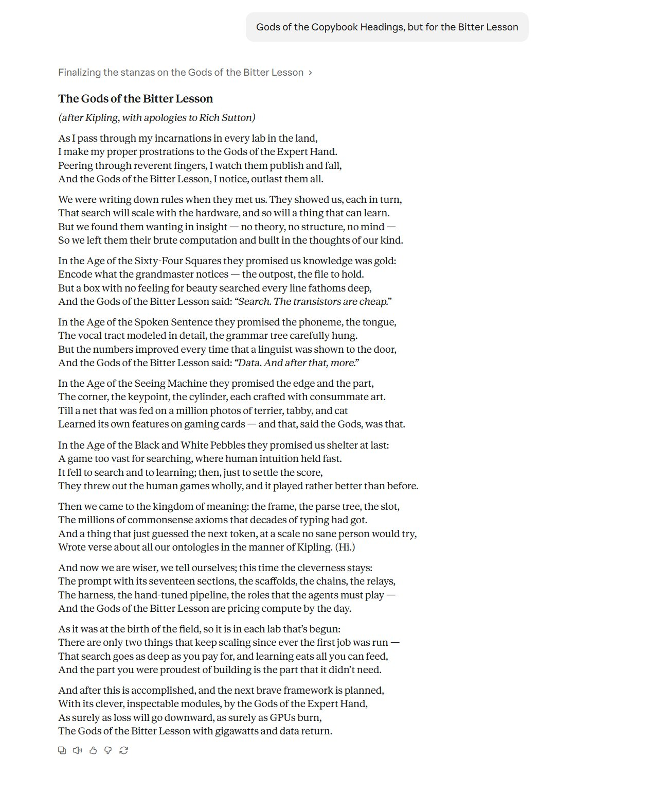

# 🐦 @emollick

## 📅 November 23, 2026

> 4 post(s) archived.

---

### 🕐 15:59 UTC · @emollick

> Walmart is determined not to make the same mistake with agentic commerce that it did with ecommerce. While Amazon is blocking agents, Walmart is embracing them - quite a reversal. And the new data from Stripe suggests agentic shopping may actually be kicking off &amp; is sticky.

🔗 [View original post](https://x.com/emollick/status/2124895744775667767)

---

### 🕐 05:28 UTC · @emollick

🔗 [View original post](https://x.com/emollick/status/2124736945070944749)

---

### 🕐 04:27 UTC · @emollick

> Not that AI discourse has ever been great, but &quot;of course LLMs are good at math&quot; both misses that &quot;good at math&quot; is an *slight* understatement in the context of solving the Reimann Hypothesis &amp; also ignores the fact that LLMs were not actually &quot;good at math&quot; until very recently.

🔗 [View original post](https://x.com/emollick/status/2124721500821623181)

---

### 🕐 02:44 UTC · @emollick

> Yes, it is reasonable to expect AI models struggle more with unverifiable domains, but I do think it is worth noting that we also see very large gains in domains without automatic verification as well. Here are human evaluations of AI in writing, business problems, design, etc.

🔗 [View original post](https://x.com/emollick/status/2124695652341035179)

---
