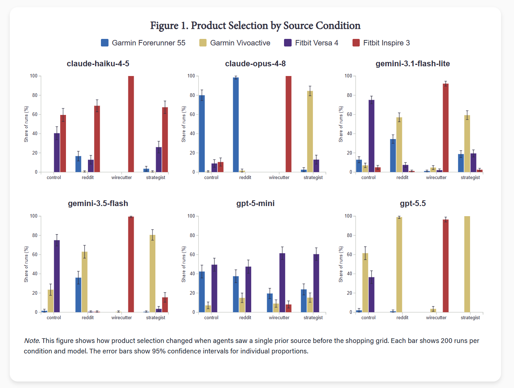
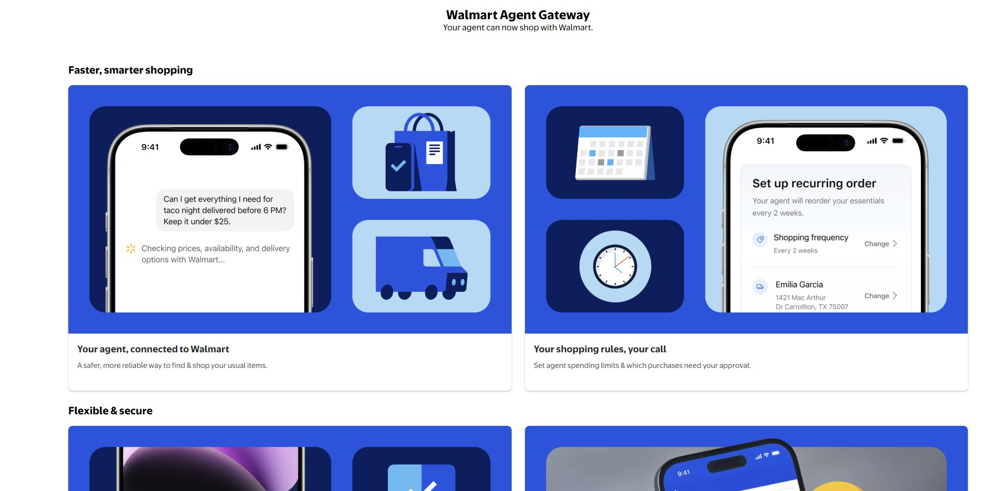
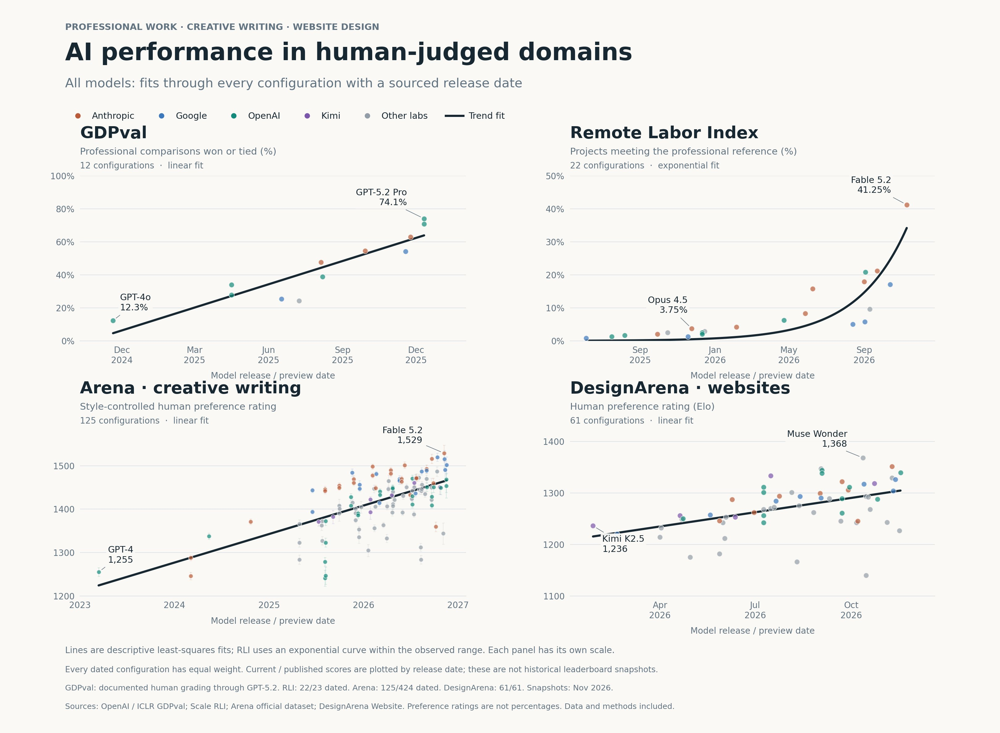

# 🐦 @emollick

## 📅 November 23, 2026

> 7 post(s) archived.

---

### 🕐 21:02 UTC · @emollick

> And each model behaves differently as well, so be careful if offered an easy solution to influencing AI preferences. As soon as anything enters the context window, things change a lot.

🔗 [View original post](https://x.com/emollick/status/2124971840997040163)

---

### 🕐 20:56 UTC · @emollick

> But in our research on AI shopping, we discovered that every pattern in agent preferences collapses remarkably easily. Change the order of the sites that the AI sees, have a conversation with the AI first, change a headline... and AI suggestions change. https://gail.wharton.upenn.edu/research-and-insights/technical-report-agentic-shopping/ Agents may be the biggest distribution opportunity ever - working 24/7 on our behalf, with our wallets How do you attract their attention? We @a16z partnered with @promptingco on more than 10,000 runs across the four leading agents - our takeaways 👇 (cc @venturetwins)

🔗 [View original post](https://x.com/emollick/status/2124970360445796544)

---

### 🕐 19:23 UTC · @emollick

> See also https://x.com/ahall_research/status/2124889867968741878?a=ojMMMXHr5GiitpCijxo&amp;s=20 Frontier models can now propose technical social science research designs that experts grade more highly than the world&apos;s top political economist&apos;s---that&apos;s the finding from our new Free Systems eval, SnyderBench, in which we have PhD experts blind grade research proposals from …

🔗 [View original post](https://x.com/emollick/status/2124946844543545356)

---

### 🕐 15:59 UTC · @emollick

> Walmart is determined not to make the same mistake with agentic commerce that it did with ecommerce. While Amazon is blocking agents, Walmart is embracing them - quite a reversal. And the new data from Stripe suggests agentic shopping may actually be kicking off &amp; is sticky.

🔗 [View original post](https://x.com/emollick/status/2124895744775667767)

---

### 🕐 05:28 UTC · @emollick

🔗 [View original post](https://x.com/emollick/status/2124736945070944749)

---

### 🕐 04:27 UTC · @emollick

> Not that AI discourse has ever been great, but &quot;of course LLMs are good at math&quot; both misses that &quot;good at math&quot; is an *slight* understatement in the context of solving the Reimann Hypothesis &amp; also ignores the fact that LLMs were not actually &quot;good at math&quot; until very recently.

🔗 [View original post](https://x.com/emollick/status/2124721500821623181)

---

### 🕐 02:44 UTC · @emollick

> Yes, it is reasonable to expect AI models struggle more with unverifiable domains, but I do think it is worth noting that we also see very large gains in domains without automatic verification as well. Here are human evaluations of AI in writing, business problems, design, etc.

🔗 [View original post](https://x.com/emollick/status/2124695652341035179)

---
