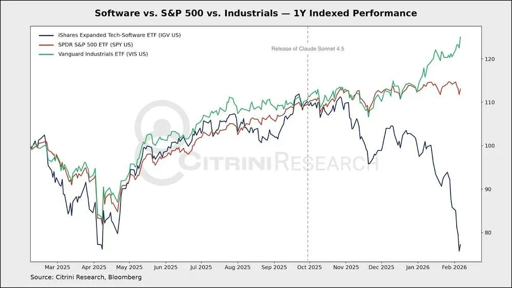

# 🐦 @omarsar0

## 📅 November 23, 2026

> 5 post(s) archived.

---

### 🕐 15:54 UTC · @omarsar0

> Open source AI is good. Good always prevails!

🔗 [View original post](https://x.com/omarsar0/status/2124894375088189710)

---

### 🕐 15:44 UTC · @omarsar0

> Recommended reading on why physical things may be the next big opportunity after code. Citrini Research argues that as AI makes software cheaper and easier to produce, the physical world becomes the bottleneck. That&apos;s why @antropirobotics interests me. They&apos;re building autonomous factories to make manufacturing faster and more accessible. We were promised flying cars and colonies on Mars. Instead, we&apos;re still waiting weeks to manufacture a simple metal part. Somehow, the world has accepted this as normal. We think it&apos;s absurd. At @antropirobotics , we&apos;re building autonomous factories to make hardware at software …

🔗 [View original post](https://x.com/omarsar0/status/2124891751328497781)

---

### 🕐 15:37 UTC · @omarsar0

> This was a also a good read on the topic: https://x.com/GoodfireAI/status/2123873150803100059?a=gPPRaxkqwCP63I2zmdU&amp;s=20 Looped models are weird. A layer can write to itself or read from &quot;future&quot; layers. @thinkymachines gave us early access to Inkling 2 Mini so we could study its inner mechanisms. We uncover how it coordinates information flow across layers, blocks, and loops. Studying Inkling 2 M…

🔗 [View original post](https://x.com/omarsar0/status/2124890165684453559)

---

### 🕐 15:36 UTC · @omarsar0

> Don&apos;t sleep on Loop Transformers. Really interesting decision by GLM to move to loop transformers as well. TM&apos;s Inkling 2 Mini is also a looped transformer. Looped transformers offer parameter efficiency when scaling to deeper networks. In practical terms, this means adding more reasoning depth (potentially increasing capability) without adding more weights. The team didn&apos;t pre-train from scratch; they adapted an already pre-trained base model into a Loop Transformer through continued training. Introducing GLM-5.4: Generalized Coding with Our First Loop Transformer. - Loops existing layers in the GLM-5 base model for deeper reasoning - Pushes beyond traditional coding to video, games, 3D shaders, and CAD modeling - Adds vision capabilities for stronger visual coding AP…

🔗 [View original post](https://x.com/omarsar0/status/2124889845474476538)

---

### 🕐 14:25 UTC · @omarsar0

> Huge! 💚 NVIDIA Board reinstates Jensen Huang as President, CEO and Board Director. Read the release: https://nvidianews.nvidia.com/news/nvidia-board-reinstates-jensen-huang-as-president-ceo-and-board-director

🔗 [View original post](https://x.com/omarsar0/status/2124871905681268739)

---
