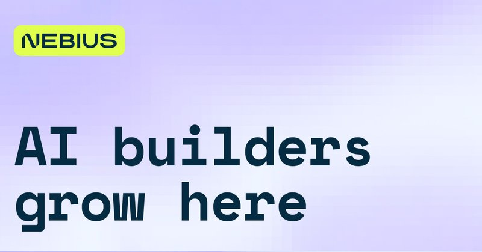
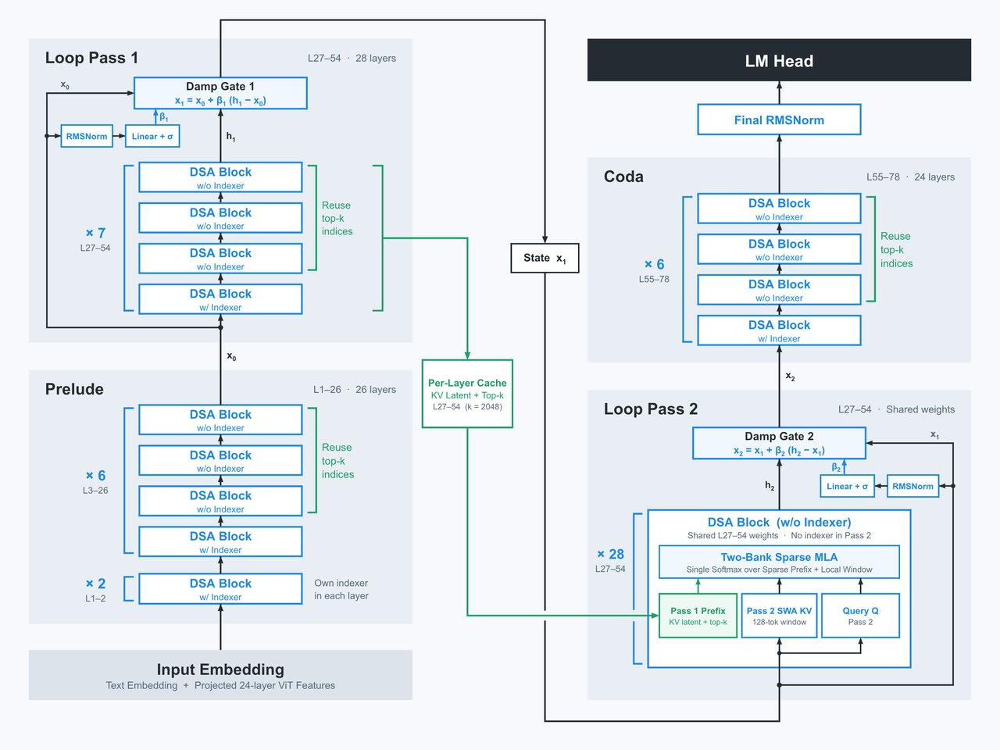

# 🐦 @omarsar0

## 📅 November 23, 2026

> 11 post(s) archived.

---

### 🕐 18:30 UTC · @omarsar0

> Great benchmark to measure the visual intelligence of frontier models. Copy Bench evaluates visual intelligence through tasks involving physics, WebGL, and shaders. GPT-6.2 Astra seems to be dominating all categories. Worth checking out, especially if you use models for these types of tasks. How good is AI at 3D, Physics, WebGL, shaders and games? We built a benchmark to measure the visual intelligence of frontier models. Introducing Copy Bench, the first in the @21st_dev Labs research series https://21st.dev/benchmarks/copy

🔗 [View original post](https://x.com/omarsar0/status/2124933620783808682)

---

### 🕐 18:16 UTC · @omarsar0

> MCP keeps proving to be the right interface for agent tools. @canva just made its MCP generally available. Agents can now generate editable designs and videos, remove backgrounds, resize creative, and export the final file. Everything comes back as an editable Canva design that you can review and tweak. Introducing the all-new Canva MCP, bringing Canva&apos;s design engine to the world! 🚀 Now open to any agent or developer, it makes it easier than ever to integrate Canva’s design tools and AI models into any product, agent, or workflow. We&apos;re building the design layer of the intern…

🔗 [View original post](https://x.com/omarsar0/status/2124930193944871253)

---

### 🕐 17:45 UTC · @omarsar0

> Models increasingly need training data that captures how people actually work. Perit brings human expertise into model training across audio, egocentric data, RL coding tasks, and enterprise datasets. Experts can propose tasks directly to labs and help shape what models learn. Love that. We joined YC at $2M in revenue. Less than 3 months later we&apos;re at $11M+ (5x), and we&apos;ve raised $5M from YC, @rrhoover, @RebelFund_VC , @robinhood ventures, @SchemaVentures and lots of great angels!

🔗 [View original post](https://x.com/omarsar0/status/2124922367554060302)

---

### 🕐 17:36 UTC · @omarsar0

> The next phase of proactive agents looks something like this. Demi builds and pulls in richer context so agents can work more proactively on tasks. This is also one of the most powerful use cases I&apos;ve seen decision models help to unlock. 1/7 This Thanksgiving, I&apos;m thankful for all the work Demi did before I asked. tl;dr: http://demi.ai is the first AI assistant that lives on your Mac, learns how you work, and does the work before you ask. Our invite-only beta is live today. The first 100 people to comment across…

🔗 [View original post](https://x.com/omarsar0/status/2124920075262308419)

---

### 🕐 17:19 UTC · @omarsar0

> More AI engineers should be running their own evals and fine-tunes. GPU access is usually the bottleneck. The Nebius Builder Program now includes free AI Cloud credits for Spot GPUs. That covers an afternoon on a B300 or up to a day on an H100, with no credit card. A great way to test your workload on new hardware. A B300 for an afternoon. An H100 for up to a day. Free on spot with AI Cloud. No credit card required. We&apos;re adding $25 in AI Cloud credits to the Nebius Builder Program so you can get hands-on with GPUs at spot prices. Spot pricing gets you idle GPU capacity at a fraction of on…

🔗 [View original post](https://x.com/omarsar0/status/2124915685092393073)

---

### 🕐 17:19 UTC · @omarsar0

> Sign up here https://dev.nebius.com/builders

🔗 [View original post](https://x.com/omarsar0/status/2124915687147614451)

---

### 🕐 15:54 UTC · @omarsar0

> Open source AI is good. Good always prevails!

🔗 [View original post](https://x.com/omarsar0/status/2124894375088189710)

---

### 🕐 15:44 UTC · @omarsar0

> Recommended reading on why physical things may be the next big opportunity after code. Citrini Research argues that as AI makes software cheaper and easier to produce, the physical world becomes the bottleneck. That&apos;s why @antropirobotics interests me. They&apos;re building autonomous factories to make manufacturing faster and more accessible. We were promised flying cars and colonies on Mars. Instead, we&apos;re still waiting weeks to manufacture a simple metal part. Somehow, the world has accepted this as normal. We think it&apos;s absurd. At @antropirobotics , we&apos;re building autonomous factories to make hardware at software …

🔗 [View original post](https://x.com/omarsar0/status/2124891751328497781)

---

### 🕐 15:37 UTC · @omarsar0

> This was a also a good read on the topic: https://x.com/GoodfireAI/status/2123873150803100059?a=gPPRaxkqwCP63I2zmdU&amp;s=20 Looped models are weird. A layer can write to itself or read from &quot;future&quot; layers. @thinkymachines gave us early access to Inkling 2 Mini so we could study its inner mechanisms. We uncover how it coordinates information flow across layers, blocks, and loops. Studying Inkling 2 M…

🔗 [View original post](https://x.com/omarsar0/status/2124890165684453559)

---

### 🕐 15:36 UTC · @omarsar0

> Don&apos;t sleep on Loop Transformers. Really interesting decision by GLM to move to loop transformers as well. TM&apos;s Inkling 2 Mini is also a looped transformer. Looped transformers offer parameter efficiency when scaling to deeper networks. In practical terms, this means adding more reasoning depth (potentially increasing capability) without adding more weights. The team didn&apos;t pre-train from scratch; they adapted an already pre-trained base model into a Loop Transformer through continued training. Introducing GLM-5.4: Generalized Coding with Our First Loop Transformer. - Loops existing layers in the GLM-5 base model for deeper reasoning - Pushes beyond traditional coding to video, games, 3D shaders, and CAD modeling - Adds vision capabilities for stronger visual coding AP…

🔗 [View original post](https://x.com/omarsar0/status/2124889845474476538)

---

### 🕐 14:25 UTC · @omarsar0

> Huge! 💚 NVIDIA Board reinstates Jensen Huang as President, CEO and Board Director. Read the release: https://nvidianews.nvidia.com/news/nvidia-board-reinstates-jensen-huang-as-president-ceo-and-board-director

🔗 [View original post](https://x.com/omarsar0/status/2124871905681268739)

---
