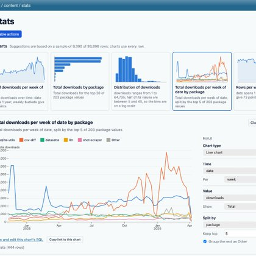

# 🐦 @simonw

## 📅 November 23, 2026

> 4 post(s) archived.

---

### 🕐 23:24 UTC · @simonw

> You can try the new plugin out using Datasette Lite (Datasette in Python in Pyodide in WebAssembly in your browser) here: https://lite.datasette.io/?install=datasette-charts#/content/stats

🔗 [View original post](https://x.com/simonw/status/2125007727621706018)

---

### 🕐 23:22 UTC · @simonw

> I built (with a lot of help from Fable 5.2) a new datasette-charts plugin, which is my best attempt yet at having Datasette automatically pick credible visualizations for any data you might throw at it https://simonwillison.net/2026/Nov/23/datasette-charts/

🔗 [View original post](https://x.com/simonw/status/2125007029442114041)

---

### 🕐 23:02 UTC · @simonw

> Gotta admit I thought the proof really was 250,000 pages of prose on top of the Lean Stupid things I did: 1. 250,000+ pages was a joke guys!, I find big number extremely hilarious. I tried to make it clear by the level of pedantry of the reals total ordered statement in the main theorem, but people ran with it unfortunately and I didn’t feel like talking on soci…

🔗 [View original post](https://x.com/simonw/status/2125001984029921636)

---

### 🕐 22:07 UTC · @simonw

> I&apos;ve been trying this out today and it&apos;s really, really good - feels snappy, nice UI, works with most of the sites I&apos;ve tried - more notes here https://simonwillison.net/2026/Nov/23/ladybird/ Ladybird is now in alpha 🐞 Downloads for macOS and Linux available on our website. https://ladybird.org/posts/alpha/

🔗 [View original post](https://x.com/simonw/status/2124988263857635572)

---
