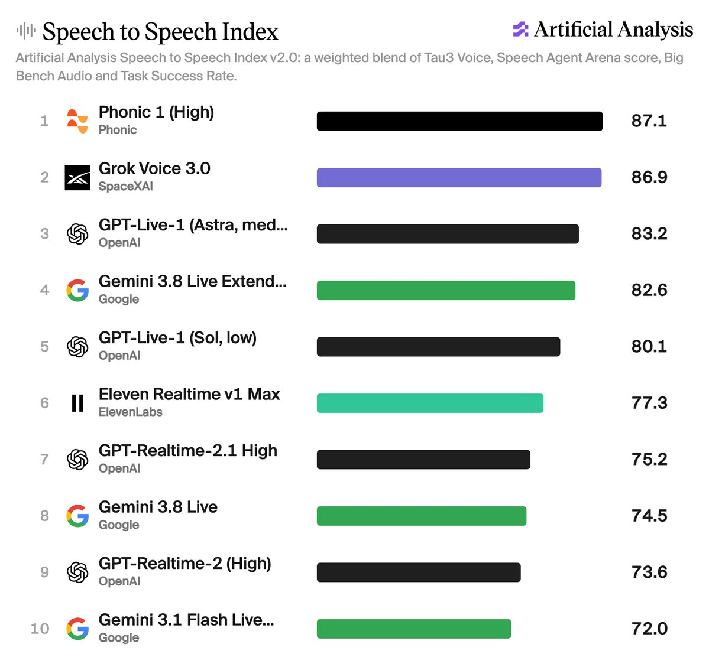
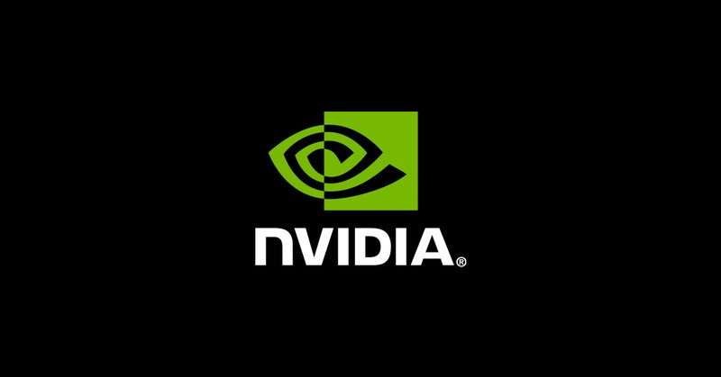

# 🐦 @swyx

## 📅 November 23, 2026

> 5 post(s) archived.

---

### 🕐 17:30 UTC · @swyx

> Phonic 1.1 (High) is the new #1 on the Artificial Analysis Speech to Speech Index at 89.1, taking the top spot from Phonic&apos;s own Phonic 1 (87.1), released less than a month ago Congratulations to @phonic_co on the release! 🧵

🔗 [View original post](https://x.com/ArtificialAnlys/status/2124918494110298127)

---

### 🕐 13:58 UTC · @swyx

> NVIDIA Board reinstates Jensen Huang as President, CEO and Board Director. Read the release: https://nvidianews.nvidia.com/news/nvidia-board-reinstates-jensen-huang-as-president-ceo-and-board-director

🔗 [View original post](https://x.com/nvidianewsroom/status/2124865060397019480)

---

### 🕐 08:21 UTC · @swyx

> microsoft answers the call!!!!! oh my, am I a @mustafasuleyman stan?? https://x.com/mustafasuleyman/status/2124663594449318173 i think we need @alexandr_wang to join in and that will be the tipping point for all labs to unite on this effort We fully support OpenAI&apos;s transparency initiative. Thanks to @merettm @markchen90 @gdb @sama for leading the way. We all got into this field to build safe AGI that is genuinely good for humanity. One of the hardest parts of AI safety is coordination, and this is a step in the ri…

🔗 [View original post](https://x.com/swyx/status/2124780264916423021)

---

### 🕐 07:26 UTC · @swyx

> @theallinpod also this FTX SBF quote https://x.com/aquariusacquah/status/2124618540997304647?a=Hfzl1YRgy_fJrLyv9BE&amp;s=20 @taimurabdaal hahaha

🔗 [View original post](https://x.com/swyx/status/2124766474736976240)

---

### 🕐 05:04 UTC · @swyx

> incredible founder journey breakdown from founding to acquisition complete with regrets and advice. not enough founders document this! please do, it saves others potentially a lot of pain highlights - @theallinpod top ticking saas market - IP assignment woes - do not brag about your SEO - how to draw @naval’s interest - hiring advice and layoff advice - how to fish for an acquisition - how to clear roadblocks for an acquisition - there are CTO coaches?? Anthropic IPO at $1T, Riemann hypothesis proved, anyway... here&apos;s the story of our B2B SaaS Felt a lot of nostalgia for the quaint 2019–2024 era of startups writing this. Hopefully still some relevant lessons for early stage startups today: https://taimur.me/blog-posts/causal-fr…

🔗 [View original post](https://x.com/swyx/status/2124730733147390347)

---
