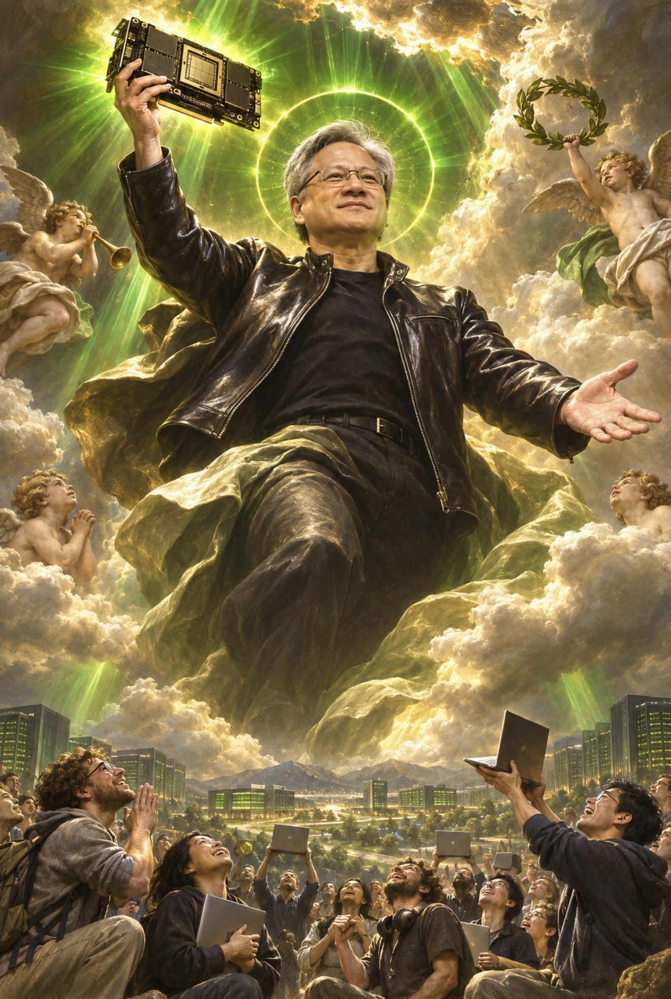

# 🐦 @tunguz

## 📅 November 23, 2026

> 14 post(s) archived.

---

### 🕐 20:49 UTC · @tunguz

> Nice, nice, nice, I still haven’t used my previous quota though. Resetting Gemini quotas for everyone on Antigravity because we’re upgrading models across tiers! Paid Pro users will now have access to Carbon and Hydrogen will be available to all users as promised! And as always, keep swarming with Neon 🚀

🔗 [View original post](https://x.com/tunguz/status/2124968552138702902)

---

### 🕐 19:39 UTC · @tunguz

> Generational talent. Breaking: Jim Cramer says avoid Nvidia and buy Anthropic Cramer admits $NVDA earnings were “fabulous” but to buy $ANT instead

🔗 [View original post](https://x.com/tunguz/status/2124950891555856622)

---

### 🕐 19:36 UTC · @tunguz

> I&apos;d love to check on him, but he blocked him a while back for calling his book undulated sycophantic hagiography. LMAO someone check up on tae kim

🔗 [View original post](https://x.com/tunguz/status/2124950145791836439)

---

### 🕐 19:16 UTC · @tunguz

> Never been more back. Media

🔗 [View original post](https://x.com/tunguz/status/2124945262594732159)

---

### 🕐 15:32 UTC · @tunguz

> How does he do it all the time?!?!?!!?! Oh god he&apos;s CEO for life

🔗 [View original post](https://x.com/tunguz/status/2124888905233191180)

---

### 🕐 15:05 UTC · @tunguz

> Wow!

🔗 [View original post](https://x.com/tunguz/status/2124882017166950451)

---

### 🕐 14:42 UTC · @tunguz

> Second Coming of Jensen Huang

🔗 [View original post](https://x.com/tunguz/status/2124876211662819697)

---

### 🕐 14:35 UTC · @tunguz

> Stock Market is the final boss.

🔗 [View original post](https://x.com/tunguz/status/2124874565830783278)

---

### 🕐 14:11 UTC · @tunguz

> We are so back. Time to put board back in waterboard. Waterboarding of underperforming managers was one of the standard practices at NVIDIA. Jensen personally supervised all of them.

🔗 [View original post](https://x.com/tunguz/status/2124868399918403873)

---

### 🕐 14:07 UTC · @tunguz

> All autocracies are fragile, both political and corporate.

🔗 [View original post](https://x.com/tunguz/status/2124867400638054779)

---

### 🕐 13:35 UTC · @tunguz

> RNNs have no reason to exist at this point. XGBoost with target encoding does the same. Transformers have no reason to exist at this point. An RNN with softmax layer, residual stream, layer norm and positional encoding does the same.

🔗 [View original post](https://x.com/tunguz/status/2124859409511665689)

---

### 🕐 13:30 UTC · @tunguz

> If you act like a beast, you deserve to be treated as such. If you act like a machine, you deserve to be treated as such. If you act like a human, you deserve to be treated as such.

🔗 [View original post](https://x.com/tunguz/status/2124858167070789709)

---

### 🕐 13:22 UTC · @tunguz

> Today we are launching another big project that I&apos;ve been really excited about: SciMetal - accelerated SciPy for Apple Silicon. MAJOR accelerations on both CPU and GPU. Easy install: pip install scimetal Introducing SciMetal: SciPy, accelerated on Apple Silicon 🚀 A drop-in replacement for parts of scipy.ndimage, scipy.fft and scipy.signal, built on Metal GPU kernels and a multithreaded Accelerate/NEON CPU engine. Change your import, keep your code. 🧵 1/9

🔗 [View original post](https://x.com/tunguz/status/2124856094547743072)

---

### 🕐 02:16 UTC · @tunguz

> Most of you have never drained all of your Fable weekly quota in an hour with a single ultracode project run and it shows.

🔗 [View original post](https://x.com/tunguz/status/2124688460128858569)

---
