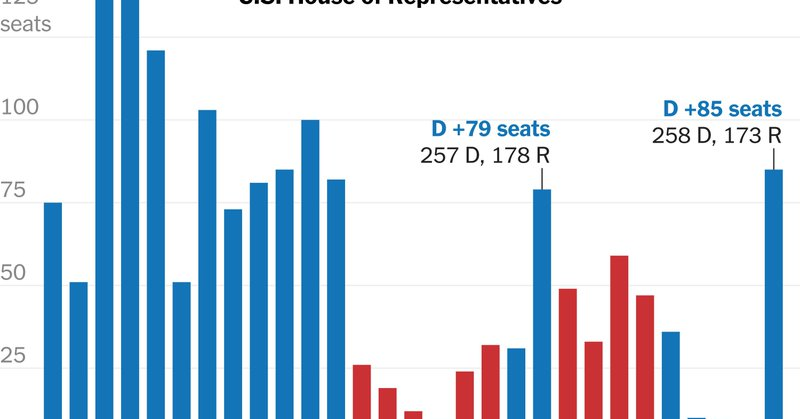

# 🐦 @ylecun

## 📅 November 23, 2026

> 4 post(s) archived.

---

### 🕐 17:00 UTC · @ylecun

> I&apos;m excited to introduce Embo! We are building the brain for intelligent robots to help people around the world. We believe intelligent robots will unlock an era of abundance, making goods and services affordable for everybody. But to deploy them at scale, robots need to work out of the box in unfamiliar scenarios. At Embo, we are building frontier AI models with a deep understanding of physical reality and fine-grained motor skills. Today&apos;s robot skills are fragile. Demonstrations can teach repetitive behaviors, but they cannot cover every object or situation a robot will encounter. We need general pretraining at internet scale to fill the gaps between individual tasks and practice to develop reliable motor skills. The world models our team has pioneered unlock a path to general robots. Our robot brain pretrains on massive amounts of internet video to learn about objects, physical interactions, and how tasks unfold. It then practices motor skills in diverse imagined scenarios to become robust to unexpected situations. Our team is behind seminal work in AI including Dreamer, VideoGPT, and Diffusion Forcing, with experience from DeepMind, Meta Superintelligence Labs, NVIDIA Cosmos, Berkeley, and MIT. We have raised a $110M Seed led by @a16z. We are excited to partner with them, @khoslaventures, DST Global, NVentures (@nvidia), @strikervp, and other strategic investors to bring reliable intelligent robots out into the world. @EmboAI Media

🔗 [View original post](https://x.com/danijar/status/2124911019562811820)

---

### 🕐 03:14 UTC · @ylecun

> All that Republican gerrymandering couldn&apos;t stop the Democrats from securing the largest house majority of this century. The popular revulsion against the Republicans in Congress who did nothing to stop Trump&apos;s corrupt and abusive rule was just too great. https://trib.al/Uv0ae6f

🔗 [View original post](https://x.com/KenRoth/status/2124703080646090986)

---

### 🕐 02:06 UTC · @ylecun

> 1/12 OpenAI&apos;s perplexity post made me angry enough that me and my agents ran some experiments over the weekend.

🔗 [View original post](https://x.com/ziv_ravid/status/2124685983488643267)

---

### 🕐 01:18 UTC · @ylecun

> 刚看完《华盛顿邮报》和《华尔街日报》最近扒出的 Anthropic 一大堆内部奇观，这家公司已经不是一般的抽象了。 首先，Dario 曾经头顶一整条面包去参加开发者会议。 对，你没看错。面包，顶在头上。没人知道这哥们到底在干什么。 更有意思的是，Dario 每两周都要给全公司开一次叫作「Dario Vision Quest」的大会，拿着长篇文档，给员工讲 AI、人类文明、战争、政治，还有他对世界末日的理解。 公司甚至把 Dario 一篇长达 14000 词的 AI 宣言印成实体书发给员工，内部有人管它叫「小蓝书」。 还给员工发过一批帽子，上面写着「Good luck, everyone」，祝大家好运。这也是 Dario 给自己的思想大会收尾时爱说的一句话。 好家伙，末日预言、领袖著作、定期布道，周边产品都齐了。 那怎么才能加入这个组织呢？ Anthropic 有一套专门的「文化面试」，应聘者要提前读 Dario 写的文章，再接受价值观考察。 一位落选者收到招聘经理的短信，经理自己都形容，这面试有点像在问你：「准备好加入邪教了吗？」 公司早期员工还会互相写「如何与我共事」的操作手册。员工自称 Ants，也就是蚂蚁；Dario 当年带着一帮人从 OpenAI 出走时，那群人还有个绰号叫 Pandas，熊猫。 公司搞团建也很离谱，把三米高的书架搬到户外草坪上，搭出阅读角，让大家一起玩游戏、编友谊手链。 但最吓人的其实是他们脑子里那套东西。 《华盛顿邮报》挖出一份 Dario 2022 年的内部备忘录。他当时估计，AGI 有 20%～30% 的概率导致人类毁灭或文明永久停滞，危险程度甚至可能超过核武器。 与此同时，《华尔街日报》还披露，Dario 当年在 OpenAI 工作时，曾经在 Slack 讨论过一个非常赛博朋克的设想： 如果 AI 抢走大量工作，引发社会动荡怎么办？ 「沉浸式电子游戏，或许可以缓解由此产生的政治冲突。」 还有更有意思的。 Dario 以前写涉及敏感 AI 技术的文章，甚至要用完全断网的电脑，写完打印出来，生怕信息泄露。 而 Anthropic 内部真的发生过泄密事件。据前员工向《华盛顿邮报》透露，公司去年因为内部 Slack 信息外泄展开调查，泄密者最终被开除。 Dario 随后还在内部大会上表示，自己不会因为泄密而闭嘴。为了证明这一点，他甚至直接骂当时的英伟达 CEO 黄仁勋贪婪。 在这样的内部文化下，Anthropic 已经不满足于只教育自己的员工了。 《华盛顿邮报》还发现，他们开始把学者、智库研究员和媒体人士请进公司，安排为期两天的思想交流。参加者要阅读 Dario 的文章，以及长达 23000 词的 Claude 宪法。 其中就包括向外界解释他们对 AI 安全、地缘政治，以及限制中国获得先进芯片的看法。 这一切背后有一条特别完整的逻辑： AI 可能毁灭人类，所以人类需要我们。 我们需要更强大的 AI 才能保护人类，所以我们必须继续开发。 为了确保人类安全，我们需要更多算力、更多资本、更多政治影响力，以及更大的权力。 于是，一家坚信自己正在制造人类末日风险的公司，一路冲到了万亿美元市值，还培养出一大批身价上亿的员工。 这套理论好像永远都能自圆其说。 Anthropic 真正擅长的不是训练 Claude，而是把一家商业公司的野心，包装成一场拯救人类的道德事业。 世界是否真的需要救世主，我不知道。 但这群人显然已经把自己当成救世主了。

🔗 [View original post](https://x.com/sleepy0x13/status/2124673937636462716)

---
