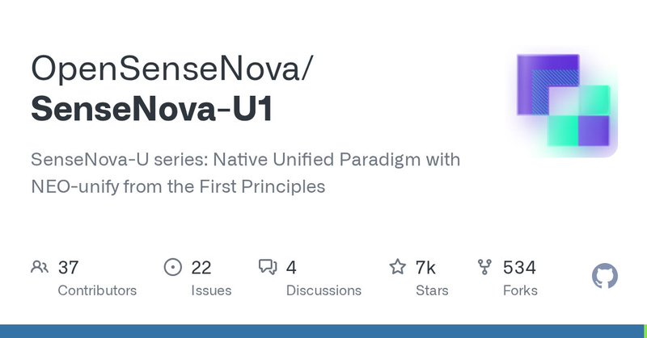
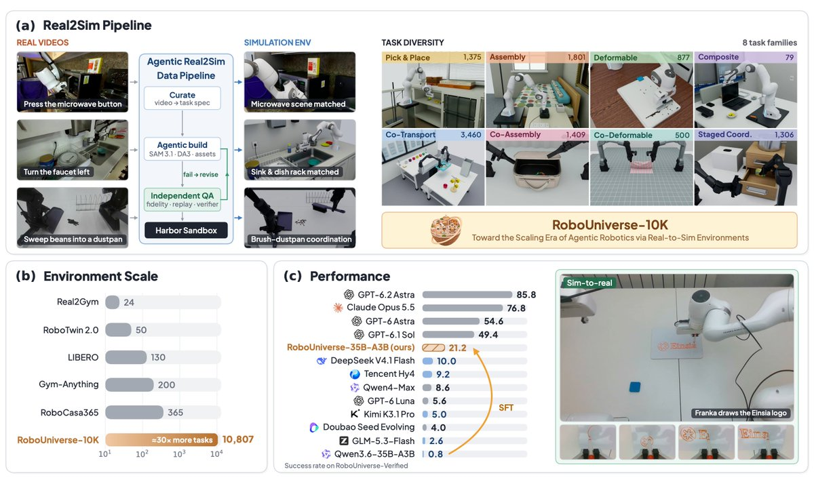

# 🐦 @_akhaliq

## 📅 November 24, 2026

> 8 post(s) archived.

---

### 🕐 20:09 UTC · @_akhaliq

> AVTR Adaptive Multimodal Reasoning with Visual Imagination paper: https://huggingface.co/papers/2611.24161 app: https://huggingface.co/spaces/shenxq/AVTR Media

🔗 [View original post](https://x.com/_akhaliq/status/2125320949117735044)

---

### 🕐 18:26 UTC · @_akhaliq

> WorldLatent A Unified 4D Latent Space for World Perception and Generation paper: https://huggingface.co/papers/2611.31209 Media

🔗 [View original post](https://x.com/_akhaliq/status/2125295056211103898)

---

### 🕐 17:04 UTC · @_akhaliq

> We’re running the largest post-training competition ever! Together with: @OpenAI @GoogleDeepMind @MistralAI @modal @baseten @Lovable @OpenRouter @nebiusai @awscloud @OpenAIDevs @googlegemma Sign up now at http://whitecircle.com/halo/competition - $1.5m in compute for participants - $200k+ in cash prizes - Online, worldwide, Dec 1–10 Media

🔗 [View original post](https://x.com/whitecircle/status/2125274360369815717)

---

### 🕐 16:08 UTC · @_akhaliq

> WorldLeague benchmarks physical agency in AI A new benchmark of 60 simulated robot tasks finds the best of 13 systems completes only 13 goals. Even perfect final answers earned zero physical-progress credit in 71.8% of episodes. Media

🔗 [View original post](https://x.com/HuggingPapers/status/2125260192317141114)

---

### 🕐 14:51 UTC · @_akhaliq

> 🤗 Meet 🎨#SenseNova-U1.6🎨 Built upon our NEO-unify, U1.6 is a unified multimodal model with *native self-reflection*, *refined aesthetics*, and *improved text rendering* - GitHub: https://github.com/OpenSenseNova/SenseNova-U1 - Try now @huggingface: https://huggingface.co/spaces/sensenova/sensenova-u1.6-studio . Thanks to @_akhaliq! SenseNova U1.6 🔥 New multimodal model for image understanding and generation from @SenseTime_AI - 8B - Apache 2.0 - Native image self correction - +10% aesthetic quality vs. U1.5 - Fast 4/8 step inference

🔗 [View original post](https://x.com/liuziwei7/status/2125240940269092879)

---

### 🕐 14:30 UTC · @_akhaliq

> LLMs hit their scaling inflection with internet-scale text. Coding agents broke through when SWE-Gym and SWE-Universe turned GitHub PRs into thousands of executable RL environments. Robotics is still stuck in dozens of hand-crafted scenes. Introducing Einsia&apos;s RoboUniverse-10K — the first open-source suite of 10,000+ interactive, verifiable RL environments built directly from real-world manipulation videos. - 10,807 Isaac Sim tasks: 4,132 single-arm Franka + 6,675 bimanual AgileX across 8 families &amp; 16 subcategories (~30× RoboCasa365) - 500 held-out zero-shot tasks (RoboUniverse-Verified): top frontier score 85.8%, while 7 of 11 models sit at ≤10% - RoboUniverse-35B-A3B: SFT on ~17K trajectories lifts zero-shot success from 0.8% → 21.2% (2.12× best open baseline), transferring to external benchmarks &amp; real Franka hardware 🌐 Project: https://lab.einsia.ai/robo-universe 💻 GitHub: https://github.com/Einsia/RoboUniverse-10K 📄 Paper: https://arxiv.org/abs/2611.31002 🧵 Full breakdown below 👇

🔗 [View original post](https://x.com/EinsiaAI/status/2125235490567897265)

---

### 🕐 13:11 UTC · @_akhaliq

> Made a @code plugin so you can push your agent traces to @huggingface You can then fine-tune models like Qwen 3.8 or Inkling 2 Small on them 🤗 Media Folks, if you&apos;re currently running any kind of agentic use case with frontier models, save the traces to @huggingface. This allows you to later fine-tune smaller, cheaper open-source models on them (such as Qwen3.5 4B, Qwen 3.8, or Inkling-2 Mini). You&apos;ll save a lot of $$$ + it&apos;…

🔗 [View original post](https://x.com/NielsRogge/status/2125215715955298786)

---

### 🕐 12:09 UTC · @_akhaliq

> NTU presents Embo-Harness on Hugging Face A practical recipe for using frontier multimodal models as robot policies, reaching 83.3% on RoboLab-120 and 15/20 zero-shot real-world trials. Media

🔗 [View original post](https://x.com/HuggingPapers/status/2125200179502739528)

---
