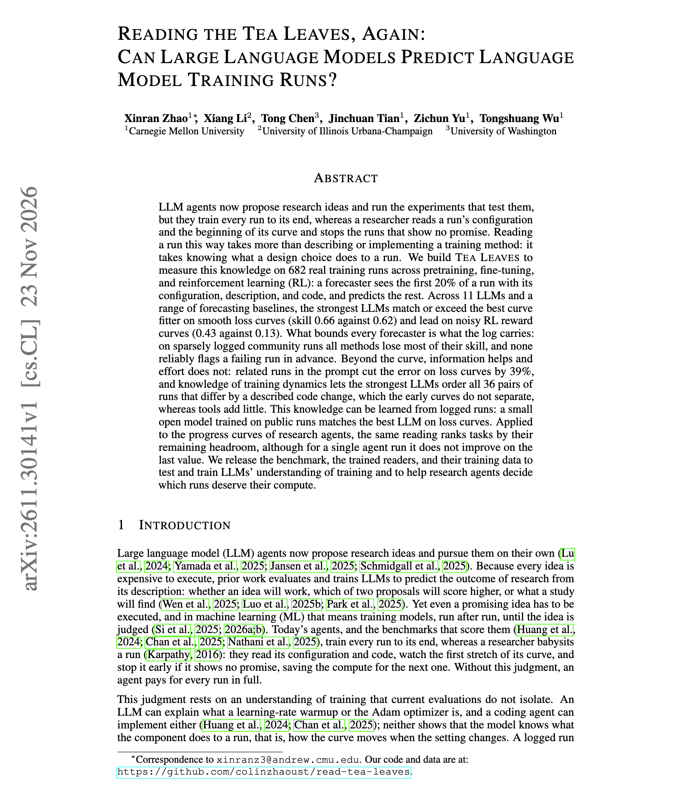

# 🐦 @dair_ai

## 📅 November 24, 2026

> 3 post(s) archived.

---

### 🕐 15:52 UTC · @dair_ai

> This is a fascinating research topic and matters a lot in a world of RSI. It investigated whether an LLM can tell from the first 20% of a training run how it will end. The strongest LLMs can. They match or beat dedicated curve-fitting methods, but only when the run is logged in detail. Researchers built Tea Leaves from 682 real runs across pretraining, fine-tuning, and RL. The forecaster sees the config, description, code, and early curve, then predicts the rest. Across 11 LLMs, the strongest matched the best curve fitter on smooth loss curves (skill 0.66 against 0.62) and led on noisy RL reward curves (0.43 against 0.13). More information helped more than more effort. Related runs in the prompt cut loss-curve error by 39%, while tools added little. On sparsely logged runs, every method lost most of its skill. A small open model trained on public runs matched the best LLM on loss curves. Research agents today train every run to the end. Log densely, give your agent related runs, and use its forecasts to rank which runs get more compute. https://arxiv.org/abs/2611.30141 Chat with Paper: https://academy.dair.ai/papers/reading-the-tea-leaves-again-can-large-language-models-predict-language-model-tr-2611.30141

🔗 [View original post](https://x.com/omarsar0/status/2125256189831508395)

---

### 🕐 14:26 UTC · @dair_ai

> https://x.com/i/article/2125233081082613761

🔗 [View original post](https://x.com/omarsar0/status/2125234668396023943)

---

### 🕐 13:28 UTC · @dair_ai

> Shipping a first product is faster than ever. Funding the next one usually still means raising a round and giving up equity. The No Excuses Fund from .tech domains is a pool of up to $1M in equity-free funding for pre-Series A builders and founders who have already shipped. No equity. No repayment. No board seat. The one requirement: Your build must be live on a .tech domain. For Edition 1, the deadline is December 15. Apply now at http://noexcuses.tech/elvis (T&amp;Cs apply)

🔗 [View original post](https://x.com/omarsar0/status/2125220048478298234)

---
