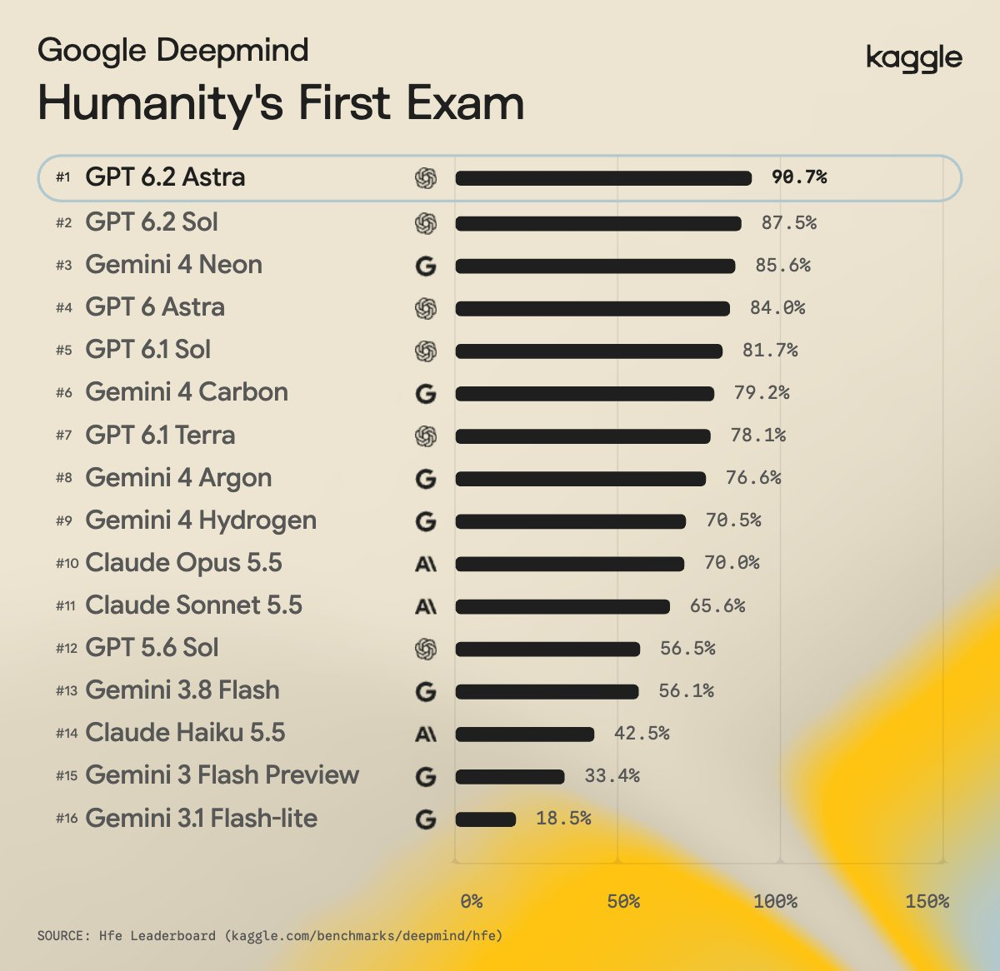

# 🐦 @demishassabis

## 📅 November 24, 2026

> 3 post(s) archived.

---

### 🕐 19:39 UTC · @demishassabis

> Why can frontier AI models write complex code, yet still occasionally stumble when asked to identify the colors of five simple objects in order or verify what&apos;s not in an image? That disconnect is called jagged intelligence and measuring it scientifically is critical to advancing AI reliability. Today, @GoogleDeepMind is launching Humanity&apos;s First Exam on Kaggle, a benchmark designed to measure &quot;floor reliability&quot;: whether models get simple tasks right every time, not just once. It spans 544 text and multimodal prompts across 20 foundational subcategories, in 136 four-prompt families. Some early findings, across 18 frontier models: • High single-shot accuracy masks inconsistency: Top five models reach 96%–98% pass@1 and 100% family pass@4, yet average only 85.6% on family pass^4 (80.5%–92.4%), with a 7.6–80.1 percentage-point Family Reliability Gap across all 18 models. • Visual perception drives 74% of wrong answers: Extra thinking time helps far less on visual tasks than on text. • Single-step slips are common: In 39% of failed prompt–model pairs, the answer is off by one or has a single wrong element; this holds for 167 of the 298 counting errors. Current leaderboard: 🥇 GPT- 6.2 Astra (xhigh) - 90.7% 🥈 GPT- 6.2 Sol (xhigh) - 87.5% 🥉 Gemini 4 Neon (high) - 85.6% Help us stress-test these models. Join the Humanity&apos;s First Exam competition: submit everyday tasks that almost anyone gets right in a minute or two, but frontier AI models still get wrong. 💰 Prize: $50,000 in Kaggle swag ⏰ Deadline: December 15, 2026 Compete and explore Humanity&apos;s First Exam here: https://www.kaggle.com/benchmarks/deepmind/hfe/leaderboard

🔗 [View original post](https://x.com/kaggle/status/2125313430303244739)

---

### 🕐 19:33 UTC · @demishassabis

> Neon set a new Day-1 usage record on our paid APIs and @Antigravity tokens/day are ⬆️ 82% since Argon launched (only) 6 weeks ago. It&apos;s been great to see the reception and thanks for all the model feedback including areas to improve - huge thanks to the teams across @GoogleDeepMind, Research, Infrastructure and serving teams, security efforts to make sure we are responsibly advancing the frontier and the product teams, more progress to come!

🔗 [View original post](https://x.com/sundarpichai/status/2125311868168515603)

---

### 🕐 11:44 UTC · @demishassabis

> Gemini 4 Neon is the most pleasant model I’ve used like ever. Seriously, nothing comes even close to how nice it is.

🔗 [View original post](https://x.com/PrasoonPratham/status/2125193804823282168)

---
