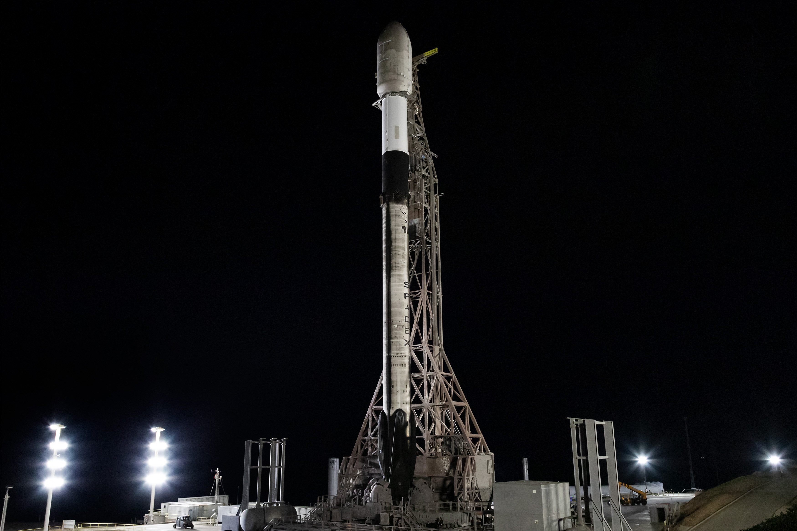

# 🐦 @elonmusk

## 📅 November 24, 2026

> 2 post(s) archived.

---

### 🕐 15:19 UTC · @elonmusk

> All systems are looking good, and weather is favorable for liftoff. Propellant load is about to begin for Falcon 9’s launch of the USSF-266 mission from California → https://spacex.com/launches/ussf266

🔗 [View original post](https://x.com/SpaceX/status/2125247855409692869)

---

### 🕐 10:44 UTC · @elonmusk

> Bullseye Energy. Compute is energy. Data needs energy to generate and move. Humans are slow, fragile, energy-limited bags of meat. Once pure intellect is solved, the hard limit is how much power you can actually deliver to turn solutions into physical reality. Thermodynamics does not neg…

🔗 [View original post](https://x.com/elonmusk/status/2125178828943184363)

---
