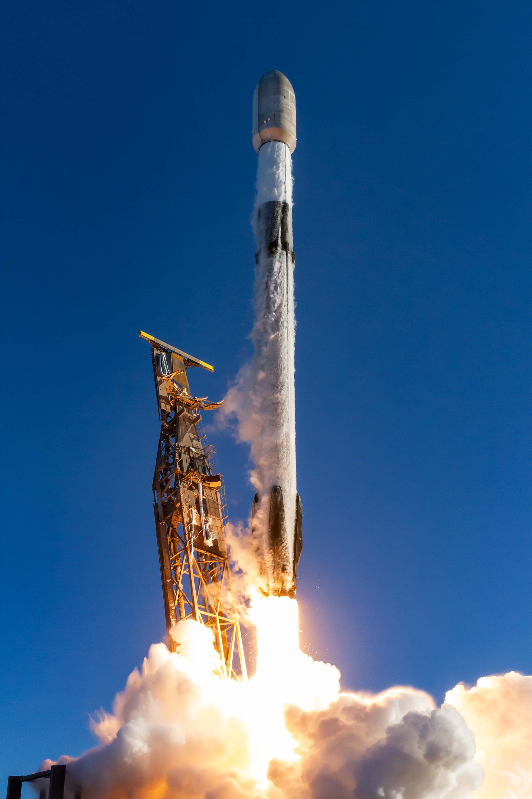
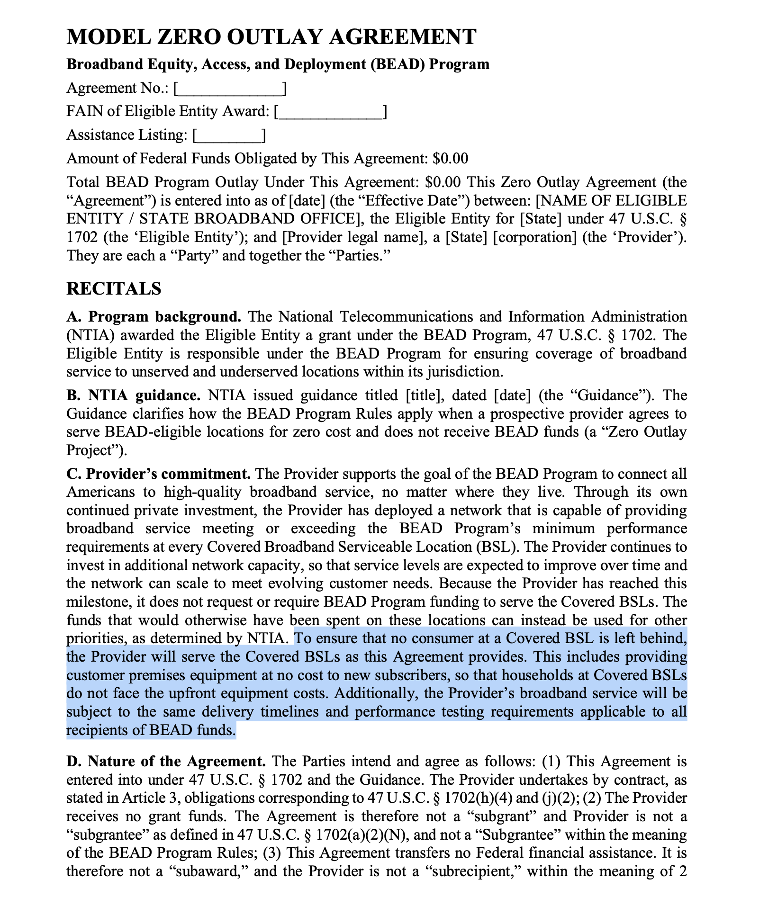
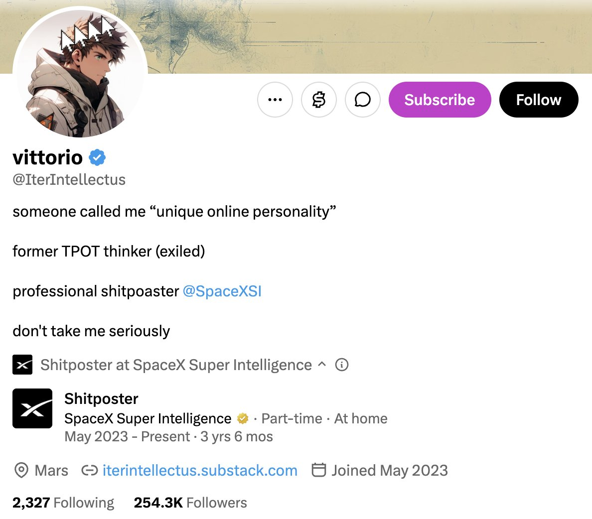

# 🐦 @elonmusk

## 📅 November 24, 2026

> 9 post(s) archived.

---

### 🕐 23:00 UTC · @elonmusk

> Starlink SpaceX has agreed to forgo $738 million in U.S. federal broadband subsidies and instead provide free @Starlink hardware to eligible American households. NTIA: &quot;To ensure that no consumer at a Covered BSL is left behind, the provider (SpaceX) will serve the covered BSLs as this a…

🔗 [View original post](https://x.com/elonmusk/status/2125363942977597554)

---

### 🕐 21:33 UTC · @elonmusk

> Falcon 9 launches USSF-266 to orbit from pad 4E in California

🔗 [View original post](https://x.com/SpaceX/status/2125342179216261600)

---

### 🕐 21:14 UTC · @elonmusk

> Geordie and Jess Flanagan run two home businesses on Salt Spring Island, B.C. Starlink keeps them connected at home and on remote job sites where other services drop out → https://starlink.com/saltspring

🔗 [View original post](https://x.com/Starlink/status/2125337322468295036)

---

### 🕐 19:42 UTC · @elonmusk

> SpaceX has agreed to forgo $738 million in U.S. federal broadband subsidies and instead provide free @Starlink hardware to eligible American households. NTIA: &quot;To ensure that no consumer at a Covered BSL is left behind, the provider (SpaceX) will serve the covered BSLs as this agreement provides. This includes providing customer premises equipment at no cost to new subscribers, so that households at covered BSL do not face the upfront equipment costs. Additionally, the provider’s broadband service will be subject to the same delivery timelines and performance testing requirements applicable to all recipients of BEAD funds.&quot; Under the new agreement, SpaceX would: • Provide free Starlink hardware to eligible households. • Guarantee minimum download speeds of 100 Mbps and upload speeds of 20 Mbps. • Offer a low-cost monthly internet plan. • Commit to providing service for 10 years. • Continue to comply with federal performance testing requirements. The agreement will save American taxpayers hundreds of millions of dollars while accelerating high-speed internet access in underserved rural communities. In exchange, SpaceX would be exempt from most BEAD-related financial audits, procurement requirements and administrative reporting, while remaining subject to network performance testing.

🔗 [View original post](https://x.com/SawyerMerritt/status/2125314062997467640)

---

### 🕐 16:09 UTC · @elonmusk

> Liftoff! Media

🔗 [View original post](https://x.com/SpaceX/status/2125260653560562086)

---

### 🕐 15:23 UTC · @elonmusk

> You can literally turn your X bookmarks into instructions for Grok Bot. It finds the guides, prompts and tools you&apos;ve saved. Then follows the tutorials and tests the ideas for you. Full guide with every prompt to build your own 👇 https://x.com/i/article/2125241714935742464

🔗 [View original post](https://x.com/liam_fallen/status/2125248925334454647)

---

### 🕐 15:19 UTC · @elonmusk

> All systems are looking good, and weather is favorable for liftoff. Propellant load is about to begin for Falcon 9’s launch of the USSF-266 mission from California → https://spacex.com/launches/ussf266

🔗 [View original post](https://x.com/SpaceX/status/2125247855409692869)

---

### 🕐 15:15 UTC · @elonmusk

> just added my work experience i love my very professional job brb, just adding work experience to my 𝕏 profile

🔗 [View original post](https://x.com/IterIntellectus/status/2125246814580592758)

---

### 🕐 10:44 UTC · @elonmusk

> Bullseye Energy. Compute is energy. Data needs energy to generate and move. Humans are slow, fragile, energy-limited bags of meat. Once pure intellect is solved, the hard limit is how much power you can actually deliver to turn solutions into physical reality. Thermodynamics does not neg…

🔗 [View original post](https://x.com/elonmusk/status/2125178828943184363)

---
