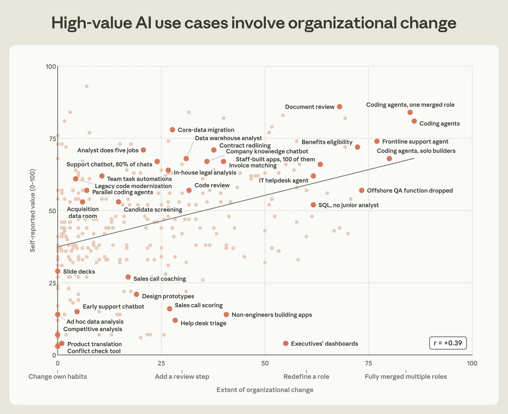

# 🐦 @emollick

## 📅 November 24, 2026

> 7 post(s) archived.

---

### 🕐 16:42 UTC · @emollick

> There is no established playbook for what to do as a result, and these teams are often crossing department boundaries (marketing, legal, engineering, sales) with their work that is making reactions especially fraught as they threaten existing structures, traditions, and rules.

🔗 [View original post](https://x.com/emollick/status/2125268803206398206)

---

### 🕐 16:38 UTC · @emollick

> Thing I am hearing from a number of big firms, from manufacturers to financial services: we have scattered teams of 2-3 people using AI that are doing the work of dozens of folks in a fraction of the time, creating large-scale management fights over the implications and politics.

🔗 [View original post](https://x.com/emollick/status/2125267894644916669)

---

### 🕐 15:07 UTC · @emollick

> There is a lot of focus on AI-aided discoveries in quantitative fields, but they can go beyond that, too: Historian Mark Humphries asked GPT-6.2 Astra to look at an anonymous 1808 sketchbook at Yale and it found the author, an obscure French aristocrat. https://generativehistory.substack.com/p/gpt-62-astra-solves-a-historical

🔗 [View original post](https://x.com/emollick/status/2125245031842042301)

---

### 🕐 06:34 UTC · @emollick

> The guy proved the Riemann Hypothesis. There&apos;s virtually no doubt that the proof is correct. It is impossible to overstate the magnitude of this intellectual achievement. Mozart had a lifelong fondness for scatological humour. His letters are full of jokes about farting and defecation, and he even composed a six-voice canon entitled &quot;Leck mich im Arsch&quot; (&quot;Lick my arse&quot;). None of this has diminished his standing as one of the greatest musical geniuses of all time. I think @__alpoge__ can joke about whatever he wants, and communicate in any sort of style he wants without worrying about losing the respect of his mathematical peers. @__alpoge__ Good way to completely lose the respect of your peers I guess.

🔗 [View original post](https://x.com/ObhishekSaha/status/2125115749450514931)

---

### 🕐 06:12 UTC · @emollick

> Two kinds of people: those watching the agent swarm trying to crack P=NP and those watching the agent swarm trying to illegally port the Xbox version of GTA 6 to the PC. Here is the P=NP one: https://pequalnp.com/

🔗 [View original post](https://x.com/emollick/status/2125110318665793740)

---

### 🕐 05:26 UTC · @emollick

> A secret third point that is not in the paper is that even the most advanced use cases that companies are trying are not that advanced (outside of coding). The capability overhang of AI is very, very large.

🔗 [View original post](https://x.com/emollick/status/2125098776025080203)

---

### 🕐 05:24 UTC · @emollick

> Two big points from this new Anthropic paper: 1) The most AI value comes from changing the organization 2) There is wide worker resistance to AI adoption (partially due to point 1) Changes that expand what workers do &amp; share AI gains with them could help https://www.anthropic.com/research/working-with-ai

🔗 [View original post](https://x.com/emollick/status/2125098309928812898)

---
